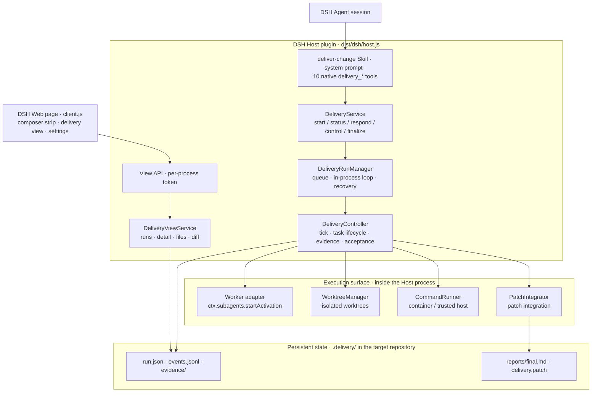
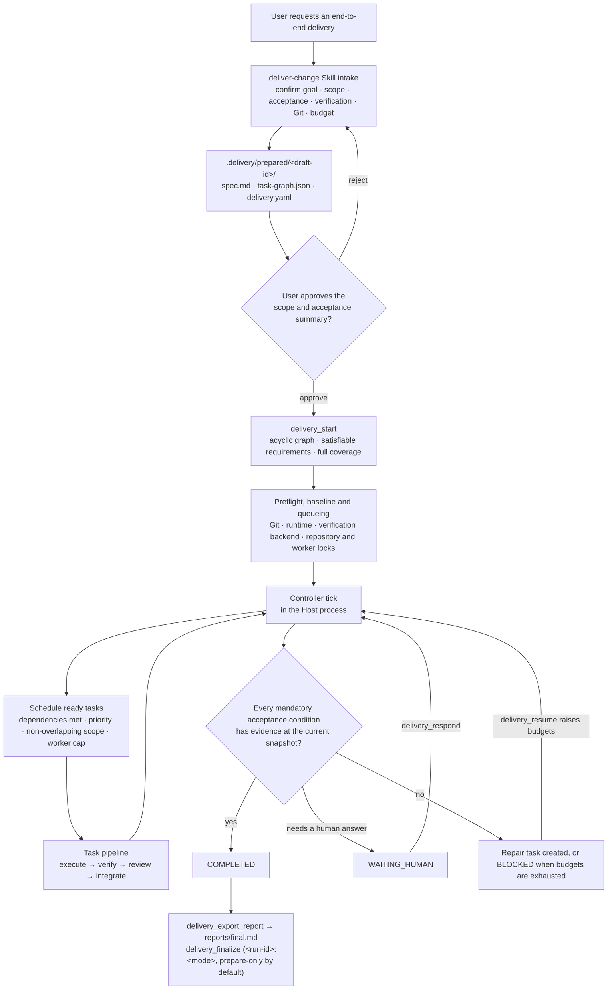
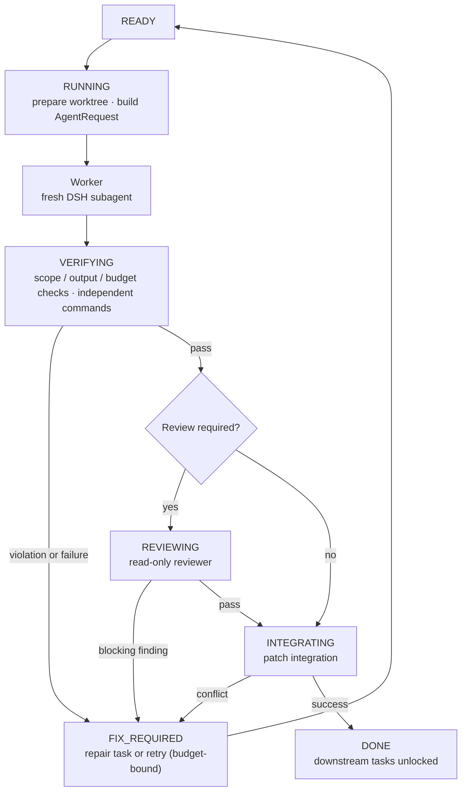

# Delivery Loop

English | [简体中文](readme-cn.md)

Delivery Loop is a native **DeepSeek Harness (DSH)** plugin for resumable end-to-end software delivery. It turns an approved specification into a persistent task DAG, runs each task in a fresh DSH subagent, verifies the resulting content, turns test and review failures into new tasks, and continues until acceptance passes or a human decision is required.

The plugin runs entirely inside DSH:

- native Host plugin and native `delivery_*` tools;
- workers are fresh `ctx.subagents` children, not external CLI processes;
- the controller runs in the DSH Host process;
- the Skill, run state, evidence, decisions, and Web view are first-class DSH surfaces.

## What it provides

- `deliver-change` Skill for intake, one-time approval and status reporting.
- Native `delivery_*` tools, a token-guarded HTTP view API, and a Web delivery view.
- Deterministic scheduler, task state machine, retry limits and failure fingerprints.
- Fresh-context DSH subagent workers for implementation, debugging, review and acceptance.
- Vendored and hash-locked generic Skills; no OpenSpec or domain Skill is required by default.
- Evidence persisted per code snapshot, with invalidation after integration changes.
- Isolated Git worktrees, Patch-based integration and `prepare-only` delivery by default.
- A durable decision journal and changed-file records for the view.

## Architecture and run flow

Delivery Loop separates **deciding** from **doing**. The Host controller owns the plan, budgets, and state; every unit of work is a disposable, fresh-context DSH subagent. Nothing important lives only in a model's context — each transition is persisted, each result is verified independently, and each failure becomes a task rather than a silent retry.

> The diagrams below use Mermaid, which GitHub renders inline.

### Layers



### End-to-end run flow



### Task pipeline



### Design rules

- **The controller decides, workers do.** A worker only returns a result; the controller runs verification, review, integration, and acceptance itself.
- **State is the source of truth.** `run.json` plus the event log survive a Host restart; a run whose worker lock has no live owner is recovered and re-queued.
- **Evidence is snapshot-bound.** A passing command is evidence only for the code snapshot it ran against; integration invalidates older evidence, and completed tasks' commands are re-run in the final verification matrix.
- **Failures become tasks.** Test failures, review findings, acceptance gaps, and scope violations create bounded repair tasks. Exhausted budgets block the run instead of looping forever.
- **One approval gate, one finalization gate.** The user approves scope and acceptance once; no Git action happens until `delivery_finalize` receives `<run-id>:<mode>`.

The concrete worker-launch mechanics are described in [How workers run](#how-workers-run).

## Requirements

- DeepSeek Harness 0.2.x
- Node.js 24+
- Git for the target repository

No external agent CLI or gateway is required.

## Install

Build the package:

```bash
npm install
npm run build
```

In DSH, install this directory as a local bundle:

- **Plugins → Add plugin** and choose this directory, or
- ask the agent to run `plugin_manager` with `action: install_bundle` and the absolute directory.

The bundle inserts the `delivery-loop` row from `cordis.patch.yml`. Its Host half is `dist/dsh/host.js`; its browser half is `client.js`.

After installing or changing `client.js`, refresh the DSH page. The Host injects a per-process view token into the page and the browser half sends it with every view request; a view that shows `401` is running old page code, so refresh it.

## Bundle configuration

The loader row accepts:

```yaml
- id: delivery-loop
  name: 'delivery-loop'
  config:
    apiPrefix: /delivery-loop     # view API prefix
    modelInvocableSkill: true     # register deliver-change
    systemPrompt: true            # add the short Delivery Loop prompt section
    subagentProvider: spawn       # ctx.subagents provider for workers
    # subagentMaxDepth: 4         # optional recursion cap
    # defaultRepoRoot: /path/to/repo
```

See [Configuration](docs/configuration.md) for all fields.

## The delivery view

The DSH bundle adds a view over the durable run state:

- a **Delivery Loop strip** under the session composer shows the live run, progress, and pending-decision count; click it to open the full view;
- the full view has **Overview / Tasks / Decisions / Files / Artifacts / Events** tabs:
  - progress, status, token usage, current tasks and the specification excerpt;
  - the task graph with attempts, risk, origin, dependencies, scope, failure context and changed files;
  - a chronological **decision timeline**: dispatch, worker results, verification, review findings, integration, acceptance, retries, budget blocks and every human answer;
  - changed-file preview and diff, with worktree/repository switching;
  - run artifacts (`spec.md`, `task-graph.json`, `reports/final.md`, `completion.json`, `delivery.patch`, evidence logs);
  - the raw event stream;
- **Settings → 交付循环 / Delivery loop** lists every registered run across repositories.

The view is read-only except for pause, resume, cancel, export report, answering pending human decisions, and a mode-confirmed finalization request. Run data stays in the target repository's `.delivery/` directory; the cross-run index stays in `~/.delivery-loop/runs.json`. If the web carrier cannot inject the view token, the plugin refuses to register the HTTP API rather than exposing an unauthenticated one.

The view API is same-origin and guarded by a per-process token injected into the DSH page. It reads only the run's repository, its worktrees, and `.delivery` artifacts, refuses paths outside those roots (including symlink escapes), and never creates a `.delivery` directory just to list runs.

## Use

Call the skill explicitly:

```text
使用 deliver-change 完成以下需求，并持续实现、修复、评审和验收：

<需求>
```

The skill prepares:

```text
.delivery/prepared/<draft-id>/
├── spec.md
├── task-graph.json
└── delivery.yaml (optional; repository root configuration is preferred)
```

After you approve the scope and acceptance summary, ask the agent to call `delivery_start`. Native tools:

| Tool | Purpose |
| --- | --- |
| `delivery_start` | Start an approved prepared run |
| `delivery_status` | Bounded progress, tasks, pending decisions, recent decisions |
| `delivery_inspect` | Full view payload: graph, requirements, decisions, files, artifacts |
| `delivery_watch` | Wait for progress or a terminal state |
| `delivery_respond` | Answer a pending human decision |
| `delivery_pause` / `delivery_resume` / `delivery_cancel` | Lifecycle control; resume can raise budget/time/attempt limits |
| `delivery_export_report` | Write `reports/final.md` |
| `delivery_finalize` | Explicitly confirmed post-completion Git action; confirmation is `<run-id>:<mode>` |

## How workers run

Each task is executed by a fresh DSH child Agent started through `ctx.subagents.startActivation`:

- the child runs with the task worktree as `cwd` and its own session, tools, and abort signal;
- `outputSchema` is the engine's `AgentResult` schema, so the child must call DSH's `structured_output` tool and the controller receives a validated object;
- `delivery: 'caller'` captures the result in the controller instead of injecting a settlement message into the initiating conversation;
- the controller runs in the DSH Host process, so the installed plugin owns the loop; the run's initiating Agent is remembered for its worker tree, with a coordinator fallback after a Host restart;
- token usage is summed from the child session's `assistant/message` usage events; a run reports `usage_incomplete: true` only when no usage event was observed;
- reviewer and acceptance workers are told to stay read-only, and the controller independently rejects a review that changes the candidate snapshot.

## Preview the view

Without starting a real delivery:

```bash
npm run demo:view
```

It creates a synthetic completed run in its own temporary Git repository and registers it under **Settings → 交付循环 / Delivery loop**. Delete the printed repository directory and its `~/.delivery-loop/runs.json` entry when done.

## Runtime and state

The Host plugin runs the controller loop in-process; there is no detached controller or external worker process. State is written under `.delivery/runs/<run-id>/` with atomic files and locks. The registry at `~/.delivery-loop/runs.json` lets a restarted Host resolve a run and resume it. Tests may inject an in-process controller to keep feedback deterministic.

## Verification

- `npm test` — controller, scheduler, state, evidence, workspace, finalizer, DSH adapter, view service, and real-Git integration tests.
- `npm run typecheck`
- `npm run verify:skills`
- `npm run verify:release` — schema freshness, typecheck/build/tests, DSH package layout and entry syntax.

A completed live DSH-subagent delivery run is recorded in [the verification report](docs/verification-report.md).

## Documentation

- [简体中文 README](readme-cn.md)
- [Configuration](docs/configuration.md)
- [Operations](docs/operations.md)
- [Evaluation](docs/evaluation.md)
- [Design](docs/design/dsh-end-to-end-delivery-plugin-design.md)
- [Verification report](docs/verification-report.md)

## Current limits

- Local verification was performed on macOS; Windows remains unverified.
- Reviewer/acceptance read-only enforcement is prompt-based plus an independent snapshot check, not an OS sandbox.
- Token usage is summed from assistant-message usage and can be incomplete when a provider omits usage.
- The coordinator fallback used after a Host restart has not been exercised in a real restart drill.
- The view's rendered layout, light/dark appearance, focus behavior, and narrow-width layout were not verified in a browser in this environment; refresh the page after install or upgrade.
- Verification defaults to a fail-closed container backend requiring a preloaded digest-pinned image. This host has no container runtime; explicit trusted-host mode is available for trusted projects.
- Artifact acceptance is limited to the produced delivery artifact (`delivery.patch`); other artifact types need a project-specific provider.
- The `merge` finalization mode requires a project-specific finalizer.
