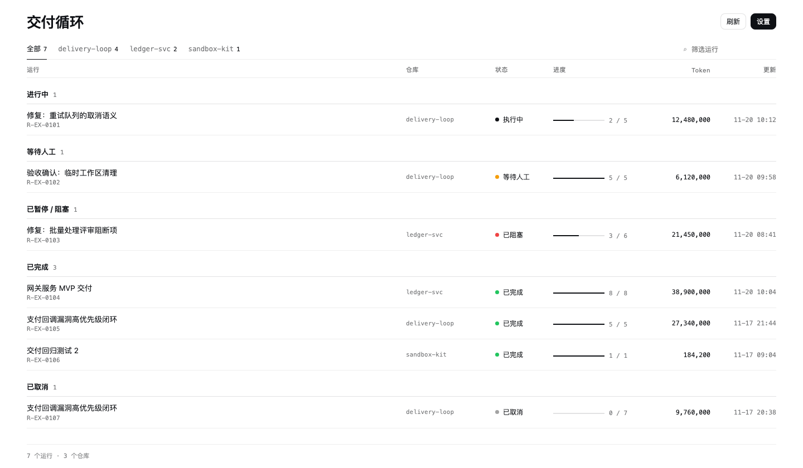
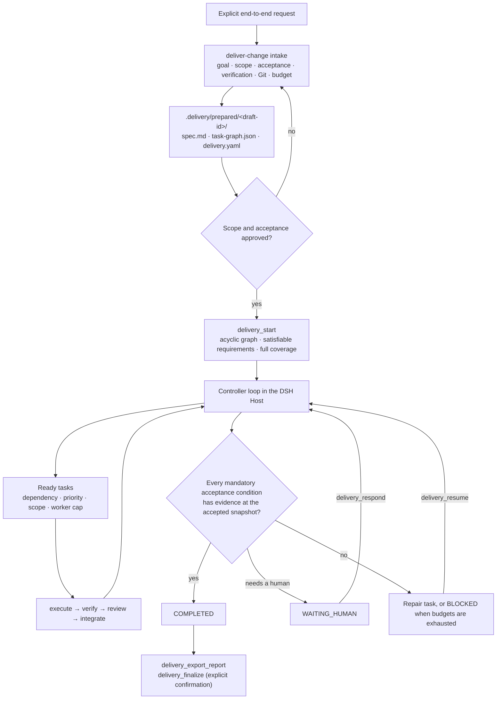

# Delivery Loop

[](https://www.npmjs.com/package/dsh-delivery-loop)
[](https://github.com/loveowie/delivery-loop/actions/workflows/ci.yml)
[](LICENSE)
[](https://nodejs.org/)
[](https://github.com/deepseek-ai/deepseek-harness)

English | [简体中文](README.zh-CN.md)

**Resumable, verifiable end-to-end software delivery for [DeepSeek Harness](https://github.com/deepseek-ai/deepseek-harness) (DSH).**

> Status: 0.2.0, the first public release. Pre-1.0 interfaces may change; see the [changelog](CHANGELOG.md) before upgrading.

Delivery Loop turns an approved specification into a persistent task graph, runs every task in a fresh DSH subagent, verifies the result against a code snapshot, converts test and review failures into repair tasks, and continues until acceptance passes or a human decision is required.

It is a native DSH plugin: the controller runs in the DSH Host process, workers are `ctx.subagents` children rather than external CLI processes, and the run state, evidence, decision log, and delivery view are first-class DSH surfaces.



## Quick start

> Requires DeepSeek Harness 0.2.x, Node.js 24+, and a Git repository.

1. Install the bundle from the **Plugins → Discover** marketplace, from npm, or [from source](docs/installation.md).
2. Ask the agent to `Use deliver-change to deliver this change end to end…` and describe the work.
3. Review the prepared scope and acceptance summary, then approve once.
4. Follow the run in the **Delivery loop** board or with `delivery_status`, and answer decisions as they arrive.
5. Export the report and confirm a finalization mode when you are ready.

## Why Delivery Loop

A model that works for hours in one context drifts: it forgets approvals, trusts its own claims, and silently retries the same failure. Delivery Loop is built around five rules:

- **The controller decides; workers only do.** Planning, budgets, verification, review, integration, and acceptance are owned by the Host controller, not by a worker's summary.
- **Evidence is bound to a snapshot.** A passing command counts only for the code snapshot it ran against. Integration invalidates older evidence.
- **Failures become tasks.** Test failures, review findings, scope violations, and acceptance gaps create bounded repair tasks. Exhausted budgets block a run instead of looping forever.
- **State is the source of truth.** `run.json` and the event log survive a Host restart; a run with no live worker owner is recovered and re-queued.
- **Two human gates.** You approve scope and acceptance once, and you confirm a Git finalization action explicitly. Nothing is committed, pushed, or merged by default.

## Features

- `deliver-change` skill for intake, one-time approval, and status reporting.
- Ten native `delivery_*` tools for starting, inspecting, waiting, answering, pausing, resuming, cancelling, exporting, and finalizing runs.
- Deterministic scheduler with a task state machine, retry limits, failure fingerprints, and queue fencing.
- Fresh-context DSH subagent workers for planning, implementation, testing, debugging, review, and acceptance.
- Isolated Git worktrees and patch-based integration; `prepare-only` delivery by default.
- Snapshot-bound verification evidence, a baseline failure matrix, and a final verification matrix at the accepted snapshot.
- Independent review and acceptance, with blocking findings turned into repair tasks.
- A Web delivery board, a composer status strip, a full run view, and a runtime budget settings page.
- Vendored, hash-locked generic skills; no OpenSpec or domain skill is required for the default profile.

## How it works



Each task moves through `READY → RUNNING → VERIFYING → (REVIEWING) → INTEGRATING → DONE`. A violation or failure sends the task to `FIX_REQUIRED`, creates a bounded repair task, and re-enters the queue. See [Architecture](docs/architecture.md) for the components, lifecycle, recovery, and security boundaries.

The concrete worker mechanics matter for trust:

- the child runs in the task worktree with its own session, tools, and abort signal;
- `outputSchema` is the engine's `AgentResult` schema, so the controller receives a validated object;
- workers are caller-delivered, so results never appear as settlement messages in your conversation;
- the controller independently rejects a review that changes the candidate snapshot.

## Requirements

| Requirement | Notes |
| --- | --- |
| DeepSeek Harness 0.2.x | The plugin uses native `ctx.tools`, `ctx.agents`, and `ctx.subagents` seams. |
| Node.js 24+ | Declared by `engines` in `package.json`. |
| Git | Every target repository must be a Git worktree. |
| Container runtime *(optional)* | Only for the default `container` verification backend. `trusted-host` needs no runtime but is not isolation. |

No external agent CLI, gateway, or daemon is required.

## Install

### From the plugin marketplace

Open **Plugins → Discover** in DSH, search for **Delivery loop**, and install the bundle. Then open the **Delivery loop** entry in the left sidebar.

### From npm

Ask the agent to install the bundle:

```text
Install the dsh-delivery-loop bundle from npm and enable it.
```

The equivalent `plugin_manager` call uses `action: install_bundle` with the package name `dsh-delivery-loop` (and the registry the market shows). The package declares `dsh.bundle.patch`, so the bundle inserts its `delivery-loop` row automatically.

### From source

```bash
git clone https://github.com/loveowie/delivery-loop.git
cd delivery-loop
npm ci
npm run build
```

In DSH, choose **Plugins → Add plugin** and select this directory, or run `plugin_manager` with `action: install_bundle` and the absolute directory.

After installing or changing `client.js`, refresh the DSH page. The Desktop app needs a restart when the plugin package itself changes; a browser page only needs a reload. If the view returns `401`, reload the bundle so the page receives the current session credential.

Full instructions, including upgrade and uninstall, are in [Installation](docs/installation.md).

## First delivery

Describe the change and ask for Delivery Loop explicitly:

```text
Use deliver-change to deliver this change end to end, and keep going until
it is verified and accepted:

<your requirement>
```

The skill prepares `.delivery/prepared/<draft-id>/`, shows the scope and acceptance summary, and waits for your approval. After you approve:

- start the run with `delivery_start` (the agent does this for you);
- follow it in the sidebar board, the composer strip, or with `delivery_status` / `delivery_watch`;
- answer a pending decision with `delivery_respond`;
- export `reports/final.md` and confirm a finalization mode when you are ready.

The complete workflow, prepared-file format, and tool reference are in [Usage](docs/usage.md). A minimal portable configuration is in [examples/portable](examples/portable/).

## The delivery view

The DSH bundle adds:

- a **Delivery loop** board in the left sidebar: repository filters, per-repository counts, and runs grouped by status;
- a status strip under the session composer that opens the active run;
- a full run view with **Overview / Tasks / Decisions / Files / Artifacts / Events**;
- a **Settings** page for runtime budgets (tokens, duration, attempts, progress cycles, parallel workers, worker timeout) that never edits the approved `delivery.yaml`.

The view is read-only except for pause, resume, cancel, exporting a report, answering pending decisions, applying budget increases, and a mode-confirmed finalization request. Run data stays in the target repository's `.delivery/` directory; the cross-run index stays in `~/.delivery-loop/runs.json`.

## Tools

| Tool | Purpose |
| --- | --- |
| `delivery_start` | Start an approved prepared run |
| `delivery_status` | Bounded progress, current tasks, pending decisions, recent decisions |
| `delivery_inspect` | Full view payload: graph, requirements, acceptance, decisions, files, artifacts |
| `delivery_watch` | Wait for progress or a terminal state |
| `delivery_respond` | Answer one pending human decision |
| `delivery_pause` | Stop scheduling after the current step |
| `delivery_resume` | Resume a paused, queued, or blocked run; can raise budgets |
| `delivery_cancel` | Abort workers and cancel unfinished tasks |
| `delivery_export_report` | Write `reports/final.md` |
| `delivery_finalize` | Apply an explicitly confirmed Git action |

## Configuration

Start with a repository-level `delivery.yaml`:

```yaml
version: 1
profile: portable

runtime:
  max_parallel_workers: 2
  max_task_attempts: 3
  max_duration_hours: 8
  max_total_tokens: 2000000

verification:
  execution:
    backend: container
    image: "your-build-image@sha256:<64 lowercase hex digits>"
  commands:
    build: ["npm run build"]
    test: ["npm test"]
    lint: ["npm run lint"]

git:
  mode: prepare-only
  worktree_isolation: true
```

See [Configuration](docs/configuration.md) for every field, precedence rules, the runtime settings panel, verification backends, Git modes, and bundle configuration.

## Documentation

| Document | Audience |
| --- | --- |
| [Documentation index](docs/README.md) | Start here for reading paths and conventions |
| [Installation](docs/installation.md) | Users installing, upgrading, or removing the plugin |
| [Usage](docs/usage.md) | Users starting and operating a delivery |
| [Configuration](docs/configuration.md) | Users writing `delivery.yaml` or bundle configuration |
| [Architecture](docs/architecture.md) | Contributors and reviewers |
| [Operations](docs/operations.md) | Operators running deliveries day to day |
| [Troubleshooting](docs/troubleshooting.md) | Anyone diagnosing a failed install or run |
| [Testing](docs/testing.md) | Contributors and release reviewers |
| [Publishing](docs/publishing.md) | Maintainers cutting a release |
| [Design: verification isolation](docs/design/verification-isolation.md) | Proposal, not implemented in 0.2.0 |
| [Verification report](docs/reports/2026-11-18-verification.md) | Historical release evidence |
| [Contributing](CONTRIBUTING.md) · [Security](SECURITY.md) · [Changelog](CHANGELOG.md) | Contributors |

## Compatibility and limitations

Delivery Loop 0.2.x targets DeepSeek Harness 0.2.x. The package declares `engines.dsh: ">=0.2.0 <0.3.0"`, so the plugin manager can refuse an incompatible DSH runtime instead of activating it. The plugin depends on DSH seams that may evolve; pin the plugin version you verified and read the [changelog](CHANGELOG.md) before upgrading.

Known limits, stated so they are not mistaken for guarantees:

- Local verification was performed on macOS; Windows is unverified. CI covers unit and integration tests on Ubuntu and macOS.
- Reviewer and acceptance read-only behavior is prompt-based plus an independent snapshot check, not an OS sandbox.
- `trusted-host` verification runs on the host with a filtered environment; it is **not** isolation.
- The default `container` backend is fail-closed and requires a preloaded, digest-pinned image. It never pulls implicitly.
- Token usage is summed from assistant-message usage events and can be incomplete when a provider omits usage.
- The coordinator fallback used after a Host restart has not been exercised in a real restart drill.
- Rendered browser layout, light/dark appearance, focus behavior, and narrow-width layout are not covered by automated tests; refresh or restart as described in [Installation](docs/installation.md).
- Artifact acceptance is limited to the produced `delivery.patch`; other artifact types need a project-specific provider.
- The `merge` finalization mode requires a project-specific finalizer; the generic finalizer refuses it before writing state.

## Contributing

Issues and pull requests are welcome. Read [CONTRIBUTING.md](CONTRIBUTING.md) for the development setup, test commands, commit conventions, and documentation rules. Participation is governed by our [Code of Conduct](CODE_OF_CONDUCT.md). Security reports should follow [SECURITY.md](SECURITY.md), not a public issue.

## License

[MIT](LICENSE) © Delivery Loop Contributors.

Vendored skill content and third-party dependencies keep their own licenses; see [THIRD_PARTY_NOTICES.md](THIRD_PARTY_NOTICES.md) and [capabilities/THIRD_PARTY_LICENSES](capabilities/THIRD_PARTY_LICENSES/README.md).
