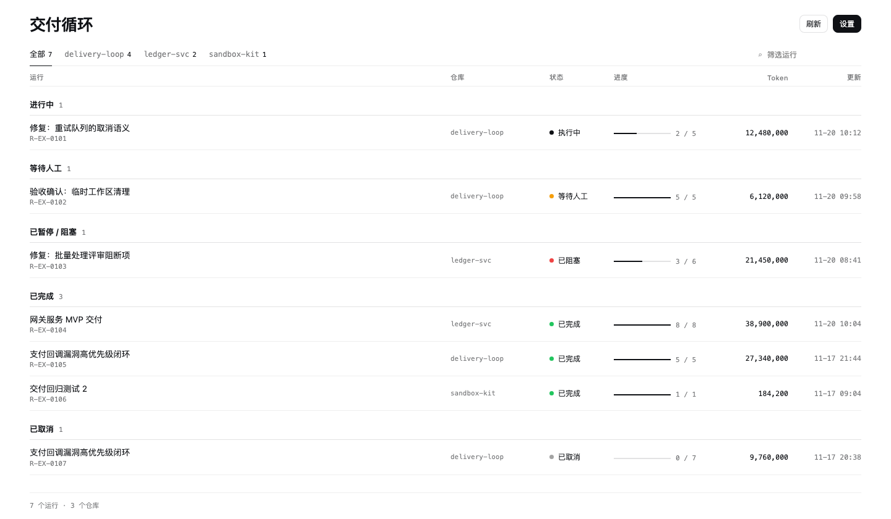
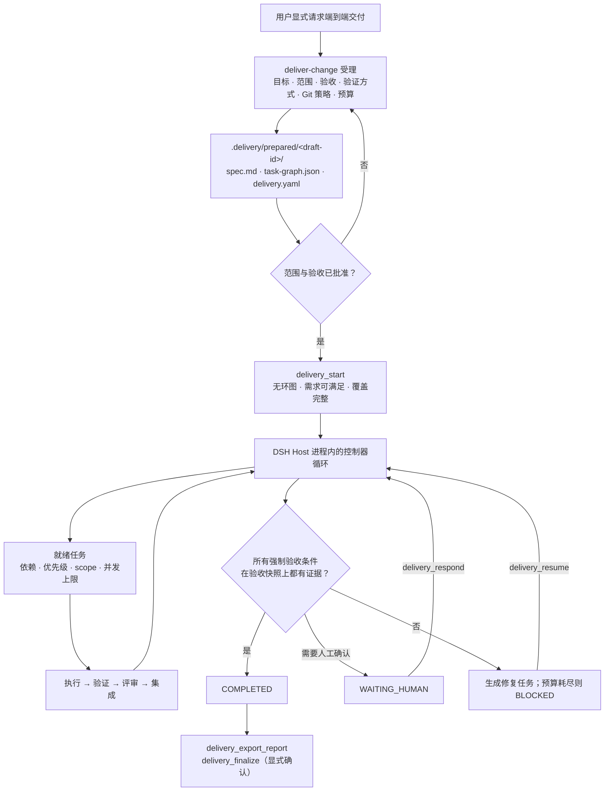

# Delivery Loop（交付循环）

[](https://www.npmjs.com/package/dsh-delivery-loop)
[](https://github.com/loveowie/delivery-loop/actions/workflows/ci.yml)
[](LICENSE)
[](https://nodejs.org/)
[](https://github.com/deepseek-ai/deepseek-harness)

[English](README.md) | 简体中文

**面向 [DeepSeek Harness](https://github.com/deepseek-ai/deepseek-harness)（DSH）的可恢复、可验证的端到端软件交付插件。**

> 状态：0.2.1，首个公开版本系列。1.0 之前接口可能变化；升级前请阅读[更新日志](CHANGELOG.md)。

Delivery Loop 把一份已批准的规格说明转换为持久化的任务图，在全新的 DSH 子代理中执行每个任务，针对代码快照独立验证结果，把测试与评审中的失败转化为修复任务，并持续运行，直到验收通过或需要人工决策。

它是一个原生 DSH 插件：控制器运行在 DSH Host 进程内，Worker 是 `ctx.subagents` 子代理而非外部 CLI 进程；运行状态、证据、决策日志和交付视图都是一等的 DSH 界面。



## 快速开始

> 需要 DeepSeek Harness 0.2.x、Node.js 24+ 与一个 Git 仓库。

1. 从 **插件 → 发现** 市场安装 bundle，或从 npm / [源码](docs/installation.md)安装。
2. 让 Agent `使用 deliver-change 完成以下需求，并持续实现、修复、评审和验收…`，并描述需求。
3. 审阅准备好的范围与验收摘要，批准一次。
4. 在 **交付循环** 看板或通过 `delivery_status` 跟进运行，及时回答决策。
5. 需要时导出报告，并确认定稿模式。

## 为什么需要 Delivery Loop

一个在单一上下文中连续工作数小时的模型会逐渐漂移：忘记批准范围、相信自己的完成声明、静默重试同一个失败。Delivery Loop 围绕五条规则构建：

- **控制器决策，Worker 只执行。** 计划、预算、验证、评审、集成与验收都由 Host 控制器负责，而不是采信 Worker 的总结。
- **证据绑定快照。** 一条通过的命令只对它运行时的代码快照有效；集成会使旧证据失效。
- **失败转化为任务。** 测试失败、评审发现、范围越界与验收缺口都会生成数量受限的修复任务；预算耗尽时运行转入 `BLOCKED`，而不是无限循环。
- **状态即事实来源。** `run.json` 与事件日志可在 Host 重启后恢复；没有存活 Worker 持有者的运行会被回收并重新入队。
- **两个人工关口。** 你只需批准一次范围与验收，并在 Git 定稿前显式确认模式。默认不会提交、推送或合并任何内容。

## 提供的能力

- `deliver-change` Skill：负责需求受理、一次性批准与状态汇报。
- 10 个原生 `delivery_*` 工具：启动、检查、等待、应答、暂停、恢复、取消、导出与定稿。
- 确定性调度器：任务状态机、重试上限、失败指纹与队列围栏。
- 用于规划、实现、测试、调试、评审与验收的全新上下文 DSH 子代理 Worker。
- 隔离的 Git worktree 与基于 Patch 的集成；默认 `prepare-only` 交付。
- 绑定代码快照的验证证据、基线失败矩阵，以及验收快照上的最终验证矩阵。
- 独立评审与验收；阻塞性问题会转化为修复任务。
- Web 交付看板、会话状态条、完整运行视图与运行预算设置页。
- 内置并做哈希锁定的通用 Skill；默认 profile 不依赖 OpenSpec 或任何业务领域 Skill。

## 工作原理



每个任务按 `READY → RUNNING → VERIFYING →（REVIEWING）→ INTEGRATING → DONE` 流转。违规或失败会把任务送入 `FIX_REQUIRED`，生成数量受限的修复任务并重新入队。组件、生命周期、恢复与安全边界见[架构说明](docs/architecture.md)。

Worker 的启动机制直接影响可信任程度：

- 子代理以任务 worktree 为工作目录，拥有自己的会话、工具与中止信号；
- `outputSchema` 使用引擎的 `AgentResult` schema，控制器收到的总是已校验的对象；
- Worker 以 caller-delivered 方式交付，结果不会作为结算消息注入你的会话；
- 控制器会独立拒绝任何改动了候选快照的评审。

## 环境要求

| 要求 | 说明 |
| --- | --- |
| DeepSeek Harness 0.2.x | 插件使用原生 `ctx.tools`、`ctx.agents` 与 `ctx.subagents` 接缝。 |
| Node.js 24+ | 由 `package.json` 的 `engines` 声明。 |
| Git | 目标仓库必须是 Git worktree。 |
| 容器运行时（可选） | 仅默认的 `container` 验证后端需要。`trusted-host` 不需要运行时，但它不是隔离。 |

不需要外部 Agent CLI、网关或常驻进程。

## 安装

### 从插件市场安装

在 DSH 中打开 **插件 → 发现**，搜索 **交付循环 / Delivery loop** 并安装 bundle。安装后左侧边栏会出现 **交付循环** 入口。

### 从 npm 安装

让 Agent 安装并启用 bundle：

```text
从 npm 安装 dsh-delivery-loop bundle 并启用它。
```

等价的 `plugin_manager` 调用使用 `action: install_bundle`，安装目标为包名 `dsh-delivery-loop`（以及市场给出的 registry）。该包含有 `dsh.bundle.patch`，会由 bundle 自动插入 `delivery-loop` 行。

### 从源码安装

```bash
git clone https://github.com/loveowie/delivery-loop.git
cd delivery-loop
npm ci
npm run build
```

在 DSH 中选择 **插件 → 添加插件** 并选中该目录，或调用 `plugin_manager` 的 `action: install_bundle` 并传入绝对路径。

安装或修改 `client.js` 后请刷新 DSH 页面。插件包本身变化时，Desktop 应用需要重启；浏览器页面只需重新加载。如果视图返回 `401`，请重新加载 bundle，让页面拿到当前会话凭据。

安装、升级与卸载的完整说明见[安装指南](docs/installation.md)。

## 第一次交付

明确描述需求，并显式要求使用 Delivery Loop：

```text
使用 deliver-change 完成以下需求，并持续实现、修复、评审和验收，直到交付完成：

<你的需求>
```

Skill 会准备 `.delivery/prepared/<draft-id>/`，展示范围与验收摘要，并等待你批准。批准之后：

- 由 Agent 调用 `delivery_start` 启动运行；
- 在侧边栏看板、会话状态条中跟进，或使用 `delivery_status` / `delivery_watch`；
- 用 `delivery_respond` 回答待处理的人工决策；
- 需要时导出 `reports/final.md`，并确认定稿模式。

完整流程、预置文件格式与工具参考见[使用指南](docs/usage.md)。最小可移植配置见 [examples/portable](examples/portable/)。

## 交付视图

DSH bundle 会提供：

- 左侧边栏的 **交付循环** 看板：仓库筛选、各仓库运行数，以及按状态分组的运行索引；
- 会话输入框下方的状态条，点击打开当前运行；
- 完整运行视图：**概览 / 任务 / 决策 / 文件 / 产物 / 事件**；
- **设置** 页：调整运行预算（Token、时长、尝试次数、连续无进展轮数、并行 Worker 数、Worker 超时），不会改写已批准的 `delivery.yaml`。

除暂停、恢复、取消、导出报告、回答待处理决策、上调预算，以及经模式确认的定稿请求外，视图是只读的。运行数据保存在目标仓库的 `.delivery/` 目录，跨运行索引保存在 `~/.delivery-loop/runs.json`。

## 工具

| 工具 | 用途 |
| --- | --- |
| `delivery_start` | 启动一份已批准的预置运行 |
| `delivery_status` | 有界地返回进度、当前任务、待处理决策与近期决策 |
| `delivery_inspect` | 完整视图负载：任务图、需求、验收、决策、文件、产物 |
| `delivery_watch` | 等待进度变化或终态 |
| `delivery_respond` | 回答一个待处理的人工决策 |
| `delivery_pause` | 在当前步骤后停止调度 |
| `delivery_resume` | 恢复已暂停、排队或阻塞的运行；可上调预算 |
| `delivery_cancel` | 中止 Worker 并取消未完成任务 |
| `delivery_export_report` | 写出 `reports/final.md` |
| `delivery_finalize` | 执行显式确认的 Git 操作 |

## 配置

从仓库级 `delivery.yaml` 开始：

```yaml
version: 1
profile: portable

runtime:
  max_parallel_workers: 2
  max_task_attempts: 3
  max_duration_hours: 8
  max_total_tokens: 2000000

verification:
  execution:
    backend: container
    image: "your-build-image@sha256:<64 位小写十六进制摘要>"
  commands:
    build: ["npm run build"]
    test: ["npm test"]
    lint: ["npm run lint"]

git:
  mode: prepare-only
  worktree_isolation: true
```

全部字段、配置优先级、运行预算设置、验证后端、Git 模式与 bundle 配置见[配置说明](docs/configuration.md)。

## 文档

| 文档 | 读者 |
| --- | --- |
| [文档索引](docs/README.md) | 阅读路径与文档约定 |
| [安装指南](docs/installation.md) | 安装、升级或卸载插件的用户 |
| [使用指南](docs/usage.md) | 启动与操作交付的用户 |
| [配置说明](docs/configuration.md) | 编写 `delivery.yaml` 或 bundle 配置的用户 |
| [架构说明](docs/architecture.md) | 贡献者与评审者 |
| [运维手册](docs/operations.md) | 日常运行交付的运维人员 |
| [故障排查](docs/troubleshooting.md) | 诊断安装或运行失败 |
| [测试说明](docs/testing.md) | 贡献者与发布评审者 |
| [发布流程](docs/publishing.md) | 维护者 |
| [设计：验证隔离](docs/design/verification-isolation.md) | 提案，0.2.0 尚未实现 |
| [验证报告](docs/reports/2026-11-18-verification.md) | 历史发布证据 |
| [贡献指南](CONTRIBUTING.md) · [安全策略](SECURITY.md) · [更新日志](CHANGELOG.md) | 贡献者 |

## 兼容性与已知限制

Delivery Loop 0.2.x 面向 DeepSeek Harness 0.2.x。包声明了 `engines.dsh: ">=0.2.0 <0.3.0"`，插件管理器可以据此拒绝不兼容的 DSH 运行时，而不是尝试激活。插件依赖可能演进的 DSH 接缝；升级前请阅读[更新日志](CHANGELOG.md)，并固定你验证过的插件版本。

以下限制如实列出，避免被误认为保证：

- 本地验证在 macOS 上完成；Windows 尚未验证。CI 在 Ubuntu 与 macOS 上运行单元与集成测试。
- 评审/验收的只读约束是提示词约束加独立的快照检查，并非操作系统级沙箱。
- `trusted-host` 在主机上以过滤后的环境执行验证；它**不是**隔离。
- 默认 `container` 后端失败即关闭，需要预加载的、以摘要（digest）锁定的镜像，且不会隐式拉取镜像。
- Token 用量由助手消息的 usage 事件累加；供应商未提供 usage 时可能不完整。
- Host 重启后的协调者回退尚未在真实重启演练中验证。
- 视图的渲染布局、明暗外观、焦点行为与窄屏布局没有自动化测试覆盖；请按[安装指南](docs/installation.md)刷新或重启。
- 产物验收仅限产出的 `delivery.patch`；其他产物类型需要项目自定义 provider。
- `merge` 定稿模式需要项目自定义 finalizer；通用 finalizer 会在写入状态前拒绝该模式。

## 贡献

欢迎提交 Issue 与 Pull Request。开发环境、测试命令、提交约定与文档规范见[贡献指南](CONTRIBUTING.md)；参与本项目即表示同意遵守[行为准则](CODE_OF_CONDUCT.md)。安全问题请按[安全策略](SECURITY.md)私下报告，不要开公开 Issue。

## 许可证

[MIT](LICENSE) © Delivery Loop Contributors。

内置 Skill 内容与第三方依赖保留各自许可证；见 [THIRD_PARTY_NOTICES.md](THIRD_PARTY_NOTICES.md) 与 [capabilities/THIRD_PARTY_LICENSES](capabilities/THIRD_PARTY_LICENSES/README.md)。
