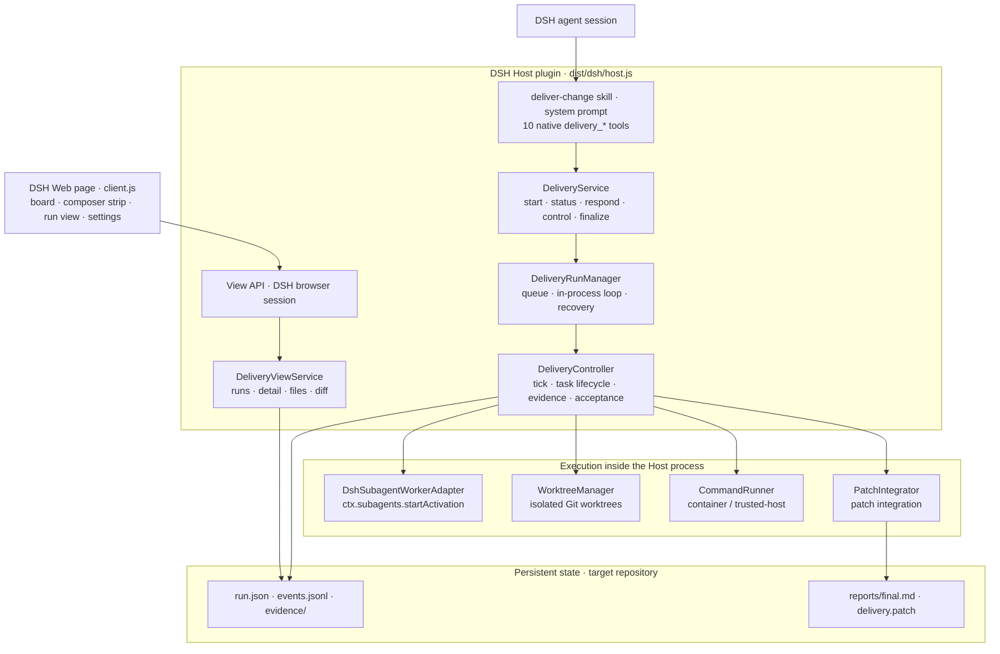
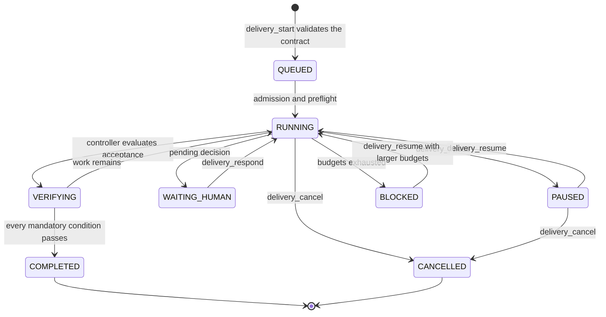
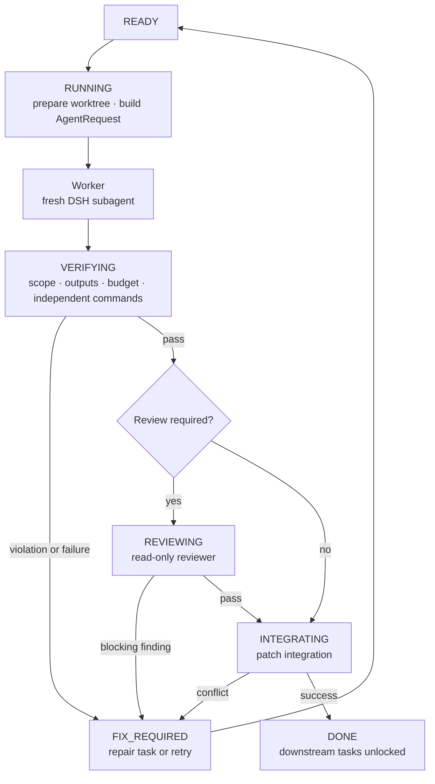

# Architecture

Delivery Loop runs entirely inside DeepSeek Harness (DSH). This document describes the components, the run and task lifecycle, durability and recovery, the evidence model, and the trust boundaries. It describes the 0.2.0 implementation; the [verification isolation proposal](design/verification-isolation.md) describes work that is **not** implemented.

## Goals and non-goals

The design has one goal: make "the change was delivered" a claim backed by durable state and independent evidence, not by a model's summary.

Non-goals are equally explicit:

- it does **not** wrap an external agent CLI or run a detached controller process;
- it does **not** bypass DSH's sandbox, approval, or permission policy;
- it does **not** provide OS-level isolation for reviewers; the engine checks the candidate snapshot instead;
- it does **not** define a stable public API for third-party verification backends yet.

## Composition



### Host plugin

`src/dsh/host.ts` registers:

- ten native tools: `delivery_start`, `delivery_status`, `delivery_inspect`, `delivery_watch`, `delivery_respond`, `delivery_pause`, `delivery_resume`, `delivery_cancel`, `delivery_export_report`, `delivery_finalize`;
- the `deliver-change` runtime skill (unless `modelInvocableSkill: false`);
- a short system-prompt section (unless `systemPrompt: false`);
- an HTTP view API under `apiPrefix`, authenticated by the DSH browser session with a per-process token fallback;
- a settings API limited to the runtime budget whitelist.

The plugin declares a hard dependency on `tools`, `agents`, and `subagents`; activation fails when the native worker composition is unavailable.

### Services

| Component | Responsibility |
| --- | --- |
| `DeliveryService` | Tool-facing operations: create and queue a run, read status, answer decisions, pause/resume/cancel, export the report, finalize |
| `DeliveryRunManager` | Repository write slots, queue admission, the in-process controller loop, stale-owner recovery, worker locks |
| `DeliveryController` | One tick: schedule ready tasks, run the task pipeline, verify content, review, integrate, evaluate acceptance |
| `Scheduler` | Ready-task selection by dependencies, priority, non-overlapping scope, and worker capacity |
| `DeliveryViewService` | Read model for the board and run view: list, detail, changed files, diff, artifacts |
| `PreparedRunFactory` | Validate the prepared contract, inspect the repository, merge configuration, freeze `resolved-config.yaml`, create `run.json` |
| `StateStore` / `EvidenceLedger` | Atomic run-state writes with revisions and lock files; evidence index and redacted logs |
| `DshSubagentWorkerAdapter` | Resolve the parent agent, start a caller-delivered child with `cwd`, prompt, and `AgentResult` schema, validate the result, measure usage |
| `WorktreeManager` / `PatchIntegrator` | Create and validate managed worktrees; integrate task patches into the integration worktree |
| `CommandRunner` | Run verification commands in a container or on the trusted host, capture redacted evidence |
| `Finalizer` | Apply the explicitly confirmed Git mode; generic finalizer refuses `merge` |
| `ReportWriter` | Write `reports/final.md` from durable state |

## Run lifecycle



The controller owns transitions. A worker result never transitions a run by itself.

## Task pipeline



A task reaches `DONE` only after its patch is integrated into the integration worktree. Downstream tasks unlock from `DONE`, not from a worker's claim. Task verification commands are re-run at the final integrated snapshot, so an early task's evidence is not silently treated as current.

## Worker lifecycle

For each task:

1. The controller creates a task worktree and builds an `AgentRequest` from the task, requirements, acceptance, frozen decisions, baseline failures, resolved skills, scope, and timeout.
2. `DshSubagentWorkerAdapter` resolves the run's parent agent: the remembered initiating agent, a live agent fallback, or the coordinator.
3. It starts a caller-delivered child with the worktree as `cwd`, the bounded prompt, and the engine's `AgentResult` output schema.
4. The child uses DSH tools inside the worktree and must call `structured_output`.
5. The adapter validates the value with Zod, checks `task_id`, and returns an `AgentResult` with measured token usage.
6. The controller verifies content, optionally reviews it, integrates the patch, and continues.

Timeout and cancellation abort the child's signal. Results are captured by the controller and never injected as settlement messages into the initiating conversation.

Token usage is summed from the child session's `assistant/message` usage events. A run reports `usage_incomplete: true` only when no usage event was observed at all.

## Durability, concurrency, and recovery

`run.json` is authoritative. Each write is atomic, carries a monotonically increasing revision, and runs under a repository lock. `events.jsonl` records lifecycle and decision events append-only. `~/.delivery-loop/runs.json` maps run ids to repositories so a restarted Host can find a run.

- **Repository write slot.** `runtime.repository.max_active_write_runs` (default `1`) limits concurrent write runs per repository; additional runs wait in `QUEUED`.
- **Queue fencing.** Admission and recovery writes use expected revisions, so a stale queue snapshot cannot overwrite a terminal state such as `COMPLETED` or `CANCELLED`.
- **Worker lock.** Each executing run holds a worker lock. A second Host or plugin activation cannot start a duplicate loop for the same run.
- **Recovery.** A run with no live lock owner is recovered on the next status, watch, inspect, resume, or respond call: `RUNNING` / `VERIFYING` / `REVIEWING` / `INTEGRATING` tasks reset to `READY`, recovery consumes one attempt, and the run is queued again. Paused runs stay paused.
- **Worktree validation.** A missing managed worktree, changed `HEAD`, deleted `.git` entry, unexpected Git root, or missing frozen seed index is rejected rather than recreated silently.
- **Loop guards.** Duration, token, no-progress, and dynamic-task budgets bound the loop; an exhausted budget blocks the run instead of spinning.

## Evidence model

An `EvidenceRecord` records the command, working directory, code snapshot id, start and end times, exit code, stdout/stderr paths, and result. Evidence is valid only for the snapshot that produced it.

- A baseline verification runs configured commands before work starts and records `baseline_failures`, so a pre-existing failure is not blamed on the delivery.
- Integration creates a new snapshot and invalidates evidence bound to older snapshots.
- A requirement is evidenced when every verification command of at least one `DONE` task covering it passed at the current snapshot.
- The final verification matrix re-runs completed tasks' commands at the accepted snapshot.
- Acceptance checks `command` / `test` exit codes, `manual` approvals, the `delivery.patch` digest for `artifact`, and independent review evidence for `review`.
- Captured logs are redacted for common credential patterns before they are persisted.

## Decisions

Every meaningful transition appends a decision event: baseline, dispatch, worker result, scope or output violation, verification, review, integration, acceptance, retry or budget block, recovery, and human answer. Pending decisions are first-class: `delivery_status` returns the exact id, question, and options, and `delivery_respond` records the answer with a timestamp.

Workers cannot ask the user directly. They return blockers, the controller turns them into decisions, and the run enters `WAITING_HUMAN`.

## Trust boundaries

| Boundary | Guarantee |
| --- | --- |
| Worker writes | A worker only writes inside its managed worktree. The controller checks scope paths and required outputs before integration |
| Review and acceptance | Instructed to stay read-only; the controller independently rejects a review that changes the candidate snapshot. This is not an OS sandbox |
| Verification input | `container` mounts a copy of the source read-only with no network, no capabilities, and a tmpfs `/tmp`; `trusted-host` runs in the worktree with a filtered environment and a temporary home. `trusted-host` is **not** isolation |
| Verification image | The container backend requires an explicitly digest-pinned image already present locally; it never pulls implicitly and fails closed |
| View API | Same-origin, authenticated by the DSH browser session (Desktop forwards its Host cookie) with a per-process token fallback. Without either credential the API rejects requests instead of serving run data unauthenticated. Validates relative paths, rejects roots outside the run's repository/worktrees/`.delivery`, rejects symlink escapes, and caps file reads |
| Settings API | Writes only the runtime budget whitelist to `<repo>/.delivery/settings.yaml` or `~/.delivery-loop/settings.json`; rejects every other config key |
| Finalization | Explicit mode and `<run-id>:<mode>` confirmation; `prepare-only` by default; commits disable repository hooks, signing, and fsmonitor |
| Secrets | Evidence logs are redacted; the view reads only run data, not arbitrary repository files |

The `container` backend remains the default because it is fail-closed. A run that cannot find a runtime or image produces error evidence and blocks; it never falls back to host execution.

## State layout

```text
<repo>/.delivery/
├── prepared/<draft-id>/          # approved input, written by the skill
├── settings.yaml                 # optional repository budget overrides
└── runs/<run-id>/
    ├── run.json                  # authoritative state
    ├── events.jsonl              # lifecycle and decision events
    ├── spec.md
    ├── task-graph.json
    ├── resolved-config.yaml      # frozen merged configuration
    ├── evidence/index.json + logs
    ├── worktrees/                # managed task and candidate worktrees
    ├── reports/final.md          # exported report
    ├── completion.json
    └── delivery.patch
```

`~/.delivery-loop/runs.json` is the cross-repository index; `~/.delivery-loop/settings.json` holds global budget settings. `DELIVERY_LOOP_HOME` relocates the per-user directory.

## Extension points

- **Project skills** extend workers with repository-specific instructions (`capabilities.project_skills`); the path must contain `SKILL.md`.
- **Capability profiles** bind worker roles to skills in `capabilities/profiles.yaml` and `capabilities/role-skills.yaml`.
- **Spec providers** support `native` and `openspec`; `custom` is rejected in 0.2.0.
- **Verification backends** are fixed to `container` and `trusted-host` in 0.2.0. Adding an `os-sandbox` backend and snapshot-derived verification input is proposed in [verification isolation](design/verification-isolation.md).
- **Git finalizers** are generic for `prepare-only`, `commit`, `branch`, and `push`; `merge` requires a project-specific finalizer.

## Known extensions

These are not implemented in 0.2.0; they are recorded so the design direction is visible:

- a read-only agent preset for reviewers and acceptance workers;
- per-worker token budget enforcement from live usage;
- a warm coordinator agent for restarts;
- a right-sidebar tab instead of the modal view;
- snapshot-derived verification input and an `os-sandbox` backend ([proposal](design/verification-isolation.md)).

## Related documents

- [Usage](usage.md) — operator-facing workflow
- [Configuration](configuration.md) — field reference and precedence
- [Operations](operations.md) — recovery and retention procedures
- [Testing](testing.md) — how the implementation is verified
- [Verification isolation proposal](design/verification-isolation.md) — not implemented
