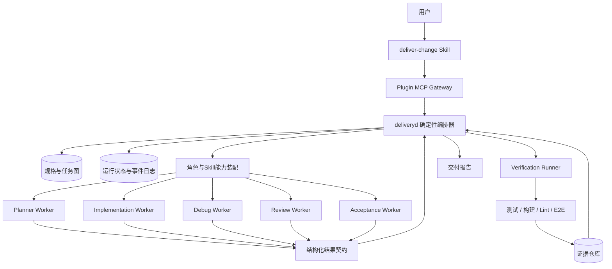

# Codex 通用端到端研发交付插件设计

> 文档状态：v0.1.0 已实现，等待真实 Codex/Git 环境联合验收
> 目标插件名：`delivery-loop`
> 目标入口 Skill：`deliver-change`
> 首期平台：Codex App 与 Codex CLI
> 设计范围：通用软件研发，不绑定具体业务仓库、技术栈或规格工具

## 1. 背景

已有编码智能体擅长完成单点任务，但复杂需求通常仍需要人手动完成以下工作：

- 追问并澄清需求；
- 把需求拆成有依赖关系的研发任务；
- 给不同任务选择实现、测试、调试或评审角色；
- 运行测试并依据失败结果继续修 Bug；
- 在多个智能体之间分配任务和合并结果；
- 判断是否真正达到验收条件；
- 在中断、上下文压缩或应用重启后继续执行；
- 防止智能体自述“完成”但没有测试和代码依据。

OpenSpec、Superpowers 等Skill或框架已经能够覆盖规格、计划、TDD、评审和验证中的单项能力，但仅靠一份串联流程的`SKILL.md`无法形成可靠的长期控制循环。真正的端到端交付需要“规格层 + 确定性编排层 + 多智能体执行层 + 验证层”协同工作。

本项目设计一个Codex Plugin，把上述能力封装成可安装、可配置、可恢复的通用研发交付流程。用户只需明确需求并批准一次规格，插件即可持续执行、修复、评审和验收，直到满足退出条件或进入需要人工决策的阻塞状态。

## 2. 产品定位

`delivery-loop`是一个通用端到端研发编排插件，而不是某个业务系统的自动化脚本。

插件负责：

- 以统一流程接收任意软件研发需求；
- 把自然语言需求转换为结构化规格、验收条件和任务图；
- 自动调度Codex智能体完成实现、测试、调试和评审；
- 用确定性程序管理状态、重试、并发、预算和终止条件；
- 用真实命令结果验证代码，而不是依赖智能体自述；
- 持续循环修复，直到验收通过或明确阻塞；
- 生成可追溯的交付、评审和验收报告。

插件不负责：

- 替用户做产品范围或业务规则决策；
- 绕过Codex沙箱、权限或审批机制；
- 默认提交、推送、合并或部署代码；
- 承诺在测试命令、环境或外部依赖失效时仍能完成交付；
- 在信息不足时猜测并静默扩大需求范围。

首期明确只处理单机上的单个Git仓库，不处理跨仓库联调、跨仓库原子提交或跨机器分布式调度。macOS与Linux为首期运行平台；Windows支持在阶段零完成进程和本地IPC验证后再纳入兼容范围。

## 3. 参考框架与借鉴点

| 框架 | 成熟能力 | 本项目借鉴 | 不直接照搬 |
| --- | --- | --- | --- |
| [BMad Loop](https://github.com/bmad-code-org/bmad-loop) | 用普通Python驱动确定性循环，启动全新编码智能体会话，执行实现、复审、验证和状态推进；支持恢复、预算、停滞检测和worktree隔离 | 控制循环与LLM分离；新会话隔离；磁盘状态；预算和停滞判定；失败后可恢复 | 其BMAD Sprint数据模型；默认自动提交；v1单单位执行限制 |
| [BMad Autonomous Development](https://github.com/stephenleo/bmad-autonomous-development) | 协调器把任务分给独立智能体，覆盖建故事、ATDD、开发、测试评审、代码评审、CI修复 | 每类工作使用独立上下文；缺陷回流任务图；协调器不直接写代码 | Claude Code专属能力；自动push、PR和merge |
| [Superpowers](https://github.com/obra/superpowers) | `brainstorming`、`writing-plans`、TDD、`systematic-debugging`、子代理开发和多阶段代码评审 | 需求澄清；测试先行；系统化调试；实现与评审分离；完成前验证 | 把流程完全交给模型自行记得执行 |
| [OpenSpec](https://github.com/Fission-AI/OpenSpec) | 管理`proposal`、`design`、`specs`、`tasks`，支持探索、提案、实现、验证和归档 | 规格制品和需求追踪；可选OpenSpec适配器 | 把OpenSpec当作控制循环或任务调度器 |
| [GitHub Spec Kit](https://github.com/github/spec-kit) | 可配置的规格驱动流程、模板、工作流、扩展、预置和目录 | 流程分级；可插拔的质量门禁；项目级覆盖；扩展点 | 首期引入完整Spec Kit运行框架和目录体系 |
| [Codex Plugins](https://github.com/openai/plugins) | `.codex-plugin/plugin.json`、Skills、MCP、commands、hooks、agents和marketplace | Codex原生分发结构；Skill渐进披露；本地MCP服务；插件级UI元数据 | 依赖插件内静态prompt完成长时间状态机控制 |
| [Codex CLI](https://github.com/openai/codex) | `codex exec`支持JSONL事件、输出JSON Schema、独立工作目录、worktree和会话恢复 | 新上下文Worker；结构化结果；工作区隔离；可恢复会话 | 无限并发或无条件绕过审批 |

## 4. 设计目标

### 4.1 核心目标

1. 用户批准规格后，研发流程能够自动持续运行。
2. 任务拆解是有依赖关系的DAG，而不是一次性线性清单。
3. 每类任务可以选择不同角色和模型配置。
4. 测试失败、评审问题和验收缺口都能自动生成修复任务。
5. 状态和执行证据持久化，应用重启后能够恢复。
6. 所有完成判断均由确定性规则和真实命令证据支撑。
7. 默认保护用户工作区，支持并行Worker隔离和受控合并。
8. 插件核心保持通用，项目规则通过配置和适配器注入。
9. 首期只在Codex上运行，但核心接口为后续其他harness适配预留边界。

### 4.2 质量目标

- 不遗漏需求：每个验收条件都必须追踪到实现任务和验证证据。
- 不产生幽灵任务：模型提出的新任务必须关联需求、缺陷、风险或评审发现。
- 不无限循环：每类失败都有重试上限、去重指纹和停滞检测。
- 不静默成功：Worker返回完成只代表“提交结果”，不代表任务完成。
- 不覆盖主工作区：默认在隔离worktree中执行，集成由协调器串行完成。
- 不泄露凭据：Worker输入、日志和状态中不保存密钥等敏感信息。

## 5. 关键设计原则

### 5.1 控制面不使用LLM决定流程合法性

模型负责需求分析、代码实现、测试设计和评审判断等创造性工作。以下规则由程序执行：

- 哪个任务处于可执行状态；
- 是否超过重试或预算；
- 工作区是否只修改了允许路径；
- 验证命令是否成功；
- 缺陷任务是否重复；
- 是否达到并行上限；
- 是否进入完成、阻塞或取消状态。

### 5.2 Skill负责交互，MCP负责控制接口，`deliveryd`负责控制循环

`SKILL.md`负责：

- 识别用户是否要启动端到端交付；
- 引导用户补充目标、边界和验收方式；
- 调用插件MCP工具；
- 向用户解释状态、阻塞和最终报告。

插件MCP服务器负责：

- 向当前Codex任务暴露稳定的控制工具；
- 校验参数和运行ID；
- 把控制请求转发给本地`deliveryd`；
- 向调用方返回结构化状态和最近事件；
- 在MCP连接重启后重新连接已有运行。

`deliveryd`本地守护进程负责：

- DAG调度；
- 状态迁移；
- Worker进程管理；
- 验证和证据记录；
- 重试、并发、预算和恢复。

MCP不是任务队列，也不是控制状态机本身。即使当前Codex会话停止调用MCP工具，已经提交给`deliveryd`的控制循环仍应继续运行。Codex任务通过MCP启动、观察、暂停或改变运行，但不能依赖主智能体每轮手动调用一次工具来维持循环。

### 5.3 子智能体复用现有Skill

子智能体不是只接收一段裸Prompt。每个Worker由四部分组成：

1. 统一Worker契约和结构化输出Schema；
2. 角色职责与目标；
3. 该角色需要加载的现有Skill集合；
4. 项目规则、任务上下文和验收证据。

控制循环负责选择角色和Skill集合，Worker负责在独立Codex会话中执行。插件自身只补充编排、状态、证据和验收机制，不重复实现TDD、系统化调试、计划或代码评审等通用方法。

复用必须遵守调用边界：

- 单任务方法可以在每个任务Worker中使用；
- 阶段制品工作流只能在规格、规划、验证等阶段Worker中使用；
- 自带“遍历全部任务直到完成”的全流程Skill不能直接交给任务Worker，否则会绕过`deliveryd`的任务调度；
- 需要复用的全流程Skill必须经过能力适配器收窄为单任务、无人工交互、结构化输出的调用；
- 所有随插件分发的Skill都使用固定版本和完整性哈希，不读取用户环境中同名但版本未知的Skill。

插件核心不依赖OpenSpec CLI或任何业务领域Skill。OpenSpec是可选规格和阶段工作流Provider，业务领域Skill是项目级扩展。

### 5.4 实现与验收分离

实现智能体可以修改代码并提出完成结论，但只有以下条件同时满足时才可将任务标记为`DONE`：

1. Worker输出符合结构化结果契约；
2. 修改路径没有越界；
3. 任务要求的验证命令通过；
4. 高风险任务已完成独立评审；
5. 没有未处理的阻断级评审问题；
6. 任务Patch已进入integration worktree，并通过集成后受影响验证。

### 5.5 动态规划，单写者

初始任务图由规划阶段生成。执行期间允许根据测试失败、评审发现和验收缺口动态增加任务，但`deliveryd`是任务图和运行状态的唯一写入者。Worker只能提交建议，不能直接修改权威状态。

### 5.6 默认安全边界

- 默认`prepare-only`：只修改工作区并生成报告，不自动commit、push、merge或deploy。
- 默认使用隔离worktree。
- 默认不使用`--dangerously-bypass-approvals-and-sandbox`一类危险参数。
- 需要产品决策、外部权限或不可逆操作时进入`WAITING_HUMAN`。

## 6. 用户使用流程

### 6.1 基本调用

```text
使用 $deliver-change 完成以下需求，并持续修复和验收，直到满足全部验收条件：

<需求描述>
```

### 6.2 交互阶段

1. Skill读取仓库规则和现有工程上下文。
2. Skill与用户确认目标、范围、排除项、兼容性、约束和验收条件。
3. Skill生成`spec.md`、`requirements.json`和初步`task-graph.json`。
4. 用户批准规格和运行策略。这是启动自动化前唯一必须完成的流程门禁。
5. Skill调用`delivery_start`启动本地控制循环。
6. `deliveryd`自动执行、修复、评审和验收。
7. 用户可随时查询状态、暂停、恢复、取消或回答阻塞问题。
8. 流程完成或阻塞后，插件生成最终报告。

### 6.3 自动运行期间的人工介入

自动运行期间仅在以下情况暂停：

- 需求存在无法从代码或现有文档解决的冲突；
- 需要用户选择业务规则或产品行为；
- 需要新增外部权限、账号、数据或环境；
- 需要执行commit、push、merge、deploy或其他非默认授权的写操作；
- 连续多次没有产生有效进展；
- 达到用户设置的时间、token或成本预算；
- 验证环境本身不可用，无法区分代码失败与环境失败。

普通测试失败、编译失败、评审发现问题和小范围返工不需要人工确认，由循环自动创建修复任务并继续执行。

## 7. 总体架构



系统分为五层：

1. **交互层**：Codex Skill、用户状态查询和人工决策。
2. **控制接口层**：插件MCP服务器，负责当前Codex任务与本地控制进程之间的通信。
3. **控制层**：`deliveryd`守护进程、DAG调度、状态机和预算控制。
4. **执行层**：根据角色和能力包，通过`codex exec`启动的独立Worker会话。
5. **验证层**：在受控工作区运行测试、构建、静态检查和验收脚本。

## 8. 插件包结构

```text
delivery-loop/
├── .codex-plugin/
│   ├── plugin.json
│   └── assets/
├── .mcp.json
├── skills/
│   └── deliver-change/
│       ├── SKILL.md
│       ├── agents/
│       │   └── openai.yaml
│       └── references/
│           ├── intake.md
│           ├── lifecycle.md
│           ├── worker-contracts.md
│           ├── verification.md
│           └── troubleshooting.md
├── server/
│   ├── package.json
│   ├── src/
│   │   ├── index.ts
│   │   ├── mcp/
│   │   ├── daemon/
│   │   ├── scheduler/
│   │   ├── state/
│   │   ├── workers/
│   │   ├── capabilities/
│   │   ├── verification/
│   │   └── reporting/
│   └── dist/
├── capabilities/
│   ├── profiles.yaml
│   ├── role-skills.yaml
│   ├── skills.lock.yaml
│   ├── vendors/
│   │   └── <upstream-skill>/
│   └── THIRD_PARTY_LICENSES/
├── schemas/
│   ├── agent-request.schema.json
│   ├── agent-result.schema.json
│   ├── delivery-config.schema.json
│   ├── requirement.schema.json
│   └── task.schema.json
├── scripts/
│   ├── launch_delivery_mcp
│   └── sync-vendored-skills
├── patches/
└── README.md
```

### 8.1 Codex Plugin声明

`.codex-plugin/plugin.json`声明：

- 插件名、版本、描述和许可证；
- `skills`目录；
- `mcpServers`配置；
- 插件界面元信息、默认提示和图标。

### 8.2 Skill职责边界

`deliver-change/SKILL.md`保持短小，包含：

- 何时触发；
- 启动前必须确认的内容；
- 如何生成规格文件；
- 如何调用MCP工具；
- 如何解释`QUEUED`、`RUNNING`、`PAUSED`、`WAITING_HUMAN`、`BLOCKED`和`COMPLETED`；
- 何时允许用户取消或扩大范围。

详细状态解释、角色提示词和验收规则放入`references/`，在需要时加载。

### 8.3 MCP服务

`.mcp.json`以本地stdio方式启动一个轻量MCP网关，不开放公网端口。当前实现中，网关与后台控制器通过经过文件锁保护的`.delivery/`状态目录协作，不额外开放本地控制端口。网关负责：

- 检测目标仓库是否已有对应的`deliveryd`；
- 没有运行时启动后台守护进程；
- 启动或重新启动独立的后台控制器进程；
- 通过磁盘状态、心跳和运行级Worker锁协调控制请求；
- MCP网关退出或重启时不中断已有控制循环；
- 再次启动时从磁盘恢复状态并重新连接。

launcher优先使用宿主提供的`CODEX_MCP_NODE_PATH`或等价的内置Node运行时，不假设用户PATH中存在兼容Node。运行时不可用或版本不满足要求时，`delivery_start`在预检阶段失败。

`deliveryd`使用单进程单写者模式管理运行状态。该进程退出时，未完成Worker会被标记为中断，下一次启动根据Worker进程、会话ID、worktree和证据文件决定恢复或重跑。

所有MCP工具只接受当前用户可访问的本地仓库路径，不提供远程网络控制接口。

后台守护进程依赖独立于MCP网关的进程生命周期。实现前必须通过阶段零技术验证确认Codex App、Codex CLI和各目标操作系统允许该进程跨会话存活。如果宿主环境不允许后台进程，则使用`foreground`运行模式：MCP网关保持前台tick循环，直到完成或达到单次调用上限，再由下一次`delivery_resume`继续。

文件式控制通道还必须满足：

- `.delivery/`与运行目录只允许当前用户访问；
- 状态写入使用跨进程文件锁和原子替换；
- Worker锁同时校验运行ID与持有进程；
- MCP网关退出后由独立后台控制器继续监督Worker；
- 运行完成、取消或守护进程失活后释放本地控制资源。

### 8.4 启动预检

`delivery_start`创建运行前执行确定性预检：

1. 解析canonical worktree和Git common directory，校验仓库路径、Git基线和工作区状态；
2. 校验`codex`可执行文件、认证状态和最低版本；
3. 校验必需Skill存在、版本匹配、哈希正确，并检查其声明的脚本运行时和外部命令依赖；
4. 校验所选规格Provider；`openspec`Provider额外检查CLI版本；
5. 校验验证命令可被发现或已显式配置；
6. 校验运行目录可写、后台或前台运行模式可用；
7. 校验当前仓库没有冲突的写入型活动运行；
8. 将预检结果写入`run.json`，失败时不创建可执行任务。

## 9. 规格模型

### 9.1 规格来源

插件通过`spec.provider`选择规格来源：

- `native`：默认Provider，使用插件内置规格、需求、任务和证据Schema，不依赖外部CLI；
- `openspec`：可选Provider，读写`openspec/changes/<change>/`，复用OpenSpec的阶段Skill和CLI；
- `custom`：通过配置指定规格目录和命令。

`portable`配置默认选择`native`，无需OpenSpec和业务领域Skill。`openspec`配置只有在用户显式选择时才检查CLI和相关Skill。OpenSpec负责规格制品和需求一致性，`deliveryd`负责运行状态、任务调度和验收证据，两者职责不重叠。

复制`openspec-*` Skill不会复制OpenSpec CLI。需要使用OpenSpec的模板、状态查询和校验能力时，必须同时安装兼容版本的CLI；否则应继续使用`native`，不得把自行生成的Markdown冒充为经过OpenSpec校验的制品。

OpenSpec Provider的执行边界为：

1. Planner阶段Worker调用`openspec-explore`和`openspec-propose`生成制品；
2. Provider读取OpenSpec任务和依赖信息，导入内部`task-graph.json`；
3. 单任务Implementer只接收`deliveryd`分配的任务，不调用会遍历全部任务的`openspec-apply-change`；
4. Acceptance阶段Worker可以调用`openspec-verify-change`；
5. 是否满足完成条件仍由`deliveryd`验证矩阵和独立验收门禁决定。

业务领域Skill通过项目扩展加载。插件核心、配置默认值和MCP工具都不得要求特定业务Skill存在。

### 9.2 需求编号

每个需求使用稳定ID，例如`REQ-001`。每个需求至少包含：

- 需求描述；
- 业务优先级；
- 验收场景；
- 非功能约束；
- 来源文件或用户陈述；
- 当前状态。

### 9.3 验收条件

每个验收条件使用稳定ID，例如`AC-001`，并声明一种验证方式：

- `command`：执行命令并以退出码和输出作为证据；
- `test`：执行指定测试用例；
- `manual`：需要用户确认；
- `artifact`：检查生成的文档、报表或配置；
- `review`：由独立评审确认。

示例：

```json
{
  "id": "AC-003",
  "requirement_id": "REQ-002",
  "description": "并发提交时只能产生一个有效结果",
  "verification": {
    "type": "command",
    "command": "mvn -Dtest=LogicalJobLifecycleTest test",
    "expected_exit_code": 0
  },
  "mandatory": true,
  "risk": "high"
}
```

## 10. 运行状态机

### 10.1 交付状态

| 状态 | 含义 | 允许进入的条件 |
| --- | --- | --- |
| `DRAFT` | 正在澄清需求 | 创建运行后 |
| `SPEC_READY` | 规格和验收条件已生成 | 结构化校验通过 |
| `QUEUED` | 已通过启动预检，等待仓库写入锁 | 仓库已有其他写入型活动运行 |
| `PLANNING` | 校验并冻结已批准任务图，或在批准范围内重新规划 | 用户批准规格和运行策略 |
| `RUNNING` | 正在自动执行 | 初始DAG有效 |
| `VERIFYING` | 所有实现任务完成，正在整体验收 | DAG无待执行实现任务 |
| `WAITING_HUMAN` | 等待用户决策或权限 | 出现明确的阻塞事件 |
| `BLOCKED` | 当前环境下无法继续 | 达到阻塞判定规则 |
| `PAUSED` | 用户暂停新调度，已运行任务允许安全收尾 | 收到暂停指令 |
| `COMPLETED` | 所有验收通过并生成交付报告 | 验收门禁通过 |
| `CANCELLED` | 用户取消 | 收到取消指令 |

`WAITING_HUMAN`在收到有效回复后可以回到`PLANNING`、`RUNNING`或`VERIFYING`；`BLOCKED`和`PAUSED`在环境或用户操作恢复后可以回到`RUNNING`。`COMPLETED`和`CANCELLED`为终态。

交付状态迁移如下：

| 当前状态 | 允许进入 |
| --- | --- |
| `DRAFT` | `SPEC_READY`、`CANCELLED` |
| `SPEC_READY` | `DRAFT`、`PLANNING`、`CANCELLED` |
| `PLANNING` | `QUEUED`、`RUNNING`、`WAITING_HUMAN`、`BLOCKED`、`CANCELLED` |
| `QUEUED` | `RUNNING`、`CANCELLED` |
| `RUNNING` | `VERIFYING`、`WAITING_HUMAN`、`PAUSED`、`BLOCKED`、`CANCELLED` |
| `VERIFYING` | `RUNNING`、`WAITING_HUMAN`、`BLOCKED`、`COMPLETED`、`CANCELLED` |
| `WAITING_HUMAN` | `PLANNING`、`RUNNING`、`VERIFYING`、`BLOCKED`、`CANCELLED` |
| `PAUSED` | `RUNNING`、`VERIFYING`、`CANCELLED` |
| `BLOCKED` | `QUEUED`、`PLANNING`、`RUNNING`、`WAITING_HUMAN`、`CANCELLED` |
| `COMPLETED` | 无 |
| `CANCELLED` | 无 |

### 10.2 任务状态

| 状态 | 含义 |
| --- | --- |
| `PENDING` | 已创建，但依赖尚未满足 |
| `READY` | 依赖已满足，可调度 |
| `RUNNING` | Worker正在执行 |
| `VERIFYING` | 代码结果已提交，正在运行验证 |
| `REVIEWING` | 正在独立评审 |
| `INTEGRATING` | 已通过任务验证和必要评审，正在应用Patch并重跑受影响验证 |
| `FIX_REQUIRED` | 需要缺陷修复任务 |
| `INTERRUPTED` | Worker超时、宿主退出或进程异常终止，等待恢复判定 |
| `DONE` | 验证通过且无阻断评审问题 |
| `BLOCKED` | 需要人工或外部条件 |
| `CANCELLED` | 不再执行 |

### 10.3 状态迁移约束

- Worker不能直接修改任务状态；
- `deliveryd`只能按合法迁移表更新状态；
- `RUNNING`超过超时时间或宿主异常退出后进入`INTERRUPTED`，再按恢复策略转为`READY`、新建尝试或`BLOCKED`；
- 需要评审的任务只能从`REVIEWING`进入`INTEGRATING`，不需要评审的任务可以从`VERIFYING`进入`INTEGRATING`；
- 任务从`DONE`回到可执行状态必须通过显式评审或验收失败事件；
- `COMPLETED`和`CANCELLED`是单向终态，恢复已结束运行必须创建新运行ID。

合法状态迁移如下：

| 当前状态 | 允许进入 |
| --- | --- |
| `PENDING` | `READY`、`CANCELLED` |
| `READY` | `RUNNING`、`BLOCKED`、`CANCELLED` |
| `RUNNING` | `VERIFYING`、`INTERRUPTED`、`BLOCKED`、`CANCELLED` |
| `VERIFYING` | `REVIEWING`、`INTEGRATING`、`FIX_REQUIRED`、`BLOCKED`、`CANCELLED` |
| `REVIEWING` | `INTEGRATING`、`FIX_REQUIRED`、`BLOCKED`、`CANCELLED` |
| `INTEGRATING` | `DONE`、`FIX_REQUIRED`、`BLOCKED`、`INTERRUPTED`、`CANCELLED` |
| `FIX_REQUIRED` | `PENDING`、`CANCELLED` |
| `INTERRUPTED` | `READY`、`PENDING`、`BLOCKED`、`CANCELLED` |
| `BLOCKED` | `PENDING`、`READY`、`CANCELLED` |

`DONE`是普通任务终态。运行级验收失败时，通过创建新的`bugfix`或`verification`任务处理，不直接把历史`DONE`任务移回执行态；只有明确发现原任务结论错误时，才允许记录审计事件后将任务重新打开。

## 11. 任务图模型

### 11.1 任务字段

```json
{
  "id": "TASK-004",
  "type": "implementation",
  "title": "实现并发运行锁",
  "status": "READY",
  "priority": "high",
  "risk": "high",
  "origin": "initial_plan",
  "depends_on": ["TASK-002"],
  "requirement_ids": ["REQ-003"],
  "acceptance_ids": ["AC-005", "AC-006"],
  "scope_paths": [
    "src/main/java/example/lock",
    "src/test/java/example/lock"
  ],
  "worker_role": "implementer",
  "attempt": 0,
  "max_attempts": 3,
  "verification_commands": [
    "mvn -Dtest=LockTest test"
  ],
  "required_outputs": ["code", "test"],
  "review_policy": "required"
}
```

`required_outputs`支持`code`、`test`、`documentation`、`migration`和`configuration`。Coordinator在应用Patch前检查真实文件变化，缺少必需产物时不能进入集成。

### 11.2 任务类型

- `spec`：补充规格或验收条件；
- `implementation`：实现功能；
- `test`：新增或修正测试；
- `bugfix`：修复测试、评审或验收失败；
- `refactor`：为满足约束进行的小范围重构；
- `integration`：合并或解决冲突；
- `verification`：执行整体验证；
- `documentation`：同步接口文档、运行说明或设计文档；
- `review_fix`：处理评审发现。

### 11.3 动态任务生成

只有以下事件可以创建新任务：

- 验证命令失败；
- 独立评审产生阻断级发现；
- 验收场景未覆盖；
- 任务执行时发现必须修改的前置依赖；
- 需求批准后发生显式范围变更。

每个动态任务必须记录`origin`，例如`test_failure`、`review_finding`、`acceptance_gap`或`user_change`。不能仅凭模型建议无限扩展任务图。

依赖任务只有在前置任务完成integration并进入`DONE`后才视为满足。任务在自己的worktree中验证通过，但尚未完成集成时，不能解锁下游实现任务。

每次任务图更新后执行确定性校验：

- 任务ID唯一；
- 依赖目标存在；
- 不形成环；
- 必需的Requirement和Acceptance引用存在；
- 角色和验证命令在运行允许列表内；
- `required_outputs`与任务类型相容；
- `scope_paths`位于仓库内；
- 动态任务深度和总数没有超过运行预算。

校验失败时拒绝提交任务图，并由Coordinator重新规划或进入阻塞状态。

## 12. 核心执行循环

```text
初始化运行
  ↓
校验已批准的规格、验收条件、任务图、运行策略和仓库状态
  ↓
导入已批准的任务DAG；缺失或无效时回到规划阶段
  ↓
while 运行未终止:
    检查预算、超时和人工阻塞
    根据依赖、风险和并行上限选择READY任务
    if 没有READY任务:
        执行整体验收
        if 验收通过:
            生成最终报告并进入COMPLETED
        else:
            为每个验收缺口创建bugfix/verification任务
        continue

    启动对应角色Worker
    收集结构化结果和真实文件变更
    校验修改路径和任务完整性
    运行任务级验证
    if 验证失败:
        创建或复用bugfix任务
        更新失败指纹和重试计数
        continue

    if 需要独立评审:
        启动全新上下文Review Worker
        if 存在阻断级发现:
            创建review_fix任务
            continue

    将任务加入串行integration队列
    应用Patch并运行受影响验证
    if 集成验证失败或发生冲突:
        进入FIX_REQUIRED并创建integration修复任务
        continue

    将任务标记DONE
```

该循环采用“准备下一步，再执行下一步”的tick模型。每次tick都从磁盘状态重新计算，避免应用重启、上下文压缩或单次工具调用超时导致流程丢失。

## 13. 多智能体角色设计

### 13.1 Planner

输入需求、代码库摘要、项目规则和历史失败信息，输出：

- 设计摘要；
- 任务DAG；
- 风险清单；
- 验证矩阵；
- 预计并行分组。

Planner不直接修改业务代码。

### 13.2 Implementer

负责一个或多个相互兼容的实现任务，必须：

- 只修改授权路径；
- 遵循项目指令；
- 添加或修改测试；
- 执行任务级验证；
- 输出结构化结果和未解决风险。

### 13.3 Test Author

在测试缺口明显或验收场景复杂时创建，负责：

- 把验收场景转换为测试；
- 添加失败用例；
- 维护测试夹具；
- 避免只测试实现细节。

### 13.4 Debugger

仅在测试、构建或运行失败时启动。输入包含最小复现、失败日志、相关代码和已有修复尝试。Debugger应优先定位根因，输出最小修复和回归证据。

### 13.5 Reviewer

必须使用与实现者不同的全新会话。默认不继承实现者推理上下文，只读取：

- 需求与验收条件；
- 当前Diff；
- 测试和构建证据；
- 相关代码和接口文档。

Reviewer输出按严重级别分类的发现，始终不修改业务代码。需要修复时由Coordinator创建`review_fix`任务并交给Implementer或Debugger。

### 13.6 Acceptance Worker

对最终结果做需求级验收，重点检查：

- 每个Requirement是否被实现；
- 每个Acceptance Condition是否有有效证据；
- 是否存在未覆盖的回归风险；
- 文档、接口和迁移是否同步；
- 是否满足项目的完成定义。

Acceptance Worker只能判定通过、部分通过或阻塞；最终状态仍由确定性门禁决定。

### 13.7 角色能力包

每个Worker在启动时由`capabilities/role-skills.yaml`装配能力。默认装配如下：

| 角色 | 默认Skill | 可选Provider | 说明 |
| --- | --- | --- | --- |
| Planner | `brainstorming`、`writing-plans` | OpenSpec阶段Worker、项目Spec Skill | 先探索和澄清，再生成规格、任务与验证矩阵 |
| Implementer | `test-driven-development` | 项目实现Skill | 只实现当前任务，不接管整个计划循环 |
| Test Author | `test-driven-development` | 项目测试Skill | 把验收场景转换为可执行测试 |
| Debugger | `systematic-debugging`、`test-driven-development` | 项目调试Skill | 基于失败证据定位根因，限制原样重试 |
| Reviewer | 内置评审规则 | `open-code-review`、项目评审Skill | 使用全新上下文评审需求和Diff |
| Acceptance | `verification-before-completion` | OpenSpec验证Provider、项目验收Skill | 建立Requirement、Acceptance和证据的映射 |

执行规则如下：

- Worker请求中声明`capability_profile`和`required_skills`；
- 启动前执行能力预检，缺少必需Skill时不静默降级；
- WorkerPrompt只补充角色契约和任务上下文，通用工作方法由现有Skill提供；
- Worker禁止递归调用`deliver-change`、创建新的交付运行或派生未受控的交付Worker；
- Worker不得直接等待用户输入；Skill中需要提问或确认的部分必须转换为`blockers`，由Coordinator统一进入`WAITING_HUMAN`；
- 每次只加载与当前角色直接相关的少量Skill，避免上下文膨胀；
- `portable`能力包只依赖插件内置和随包分发的通用Skill；
- `openspec`能力包在`portable`基础上增加OpenSpec CLI和阶段Skill；
- 插件清单和运行记录保存Skill版本，便于复盘行为变化。

角色最小权限如下：

| 角色 | 默认沙箱 | 写入范围 |
| --- | --- | --- |
| Planner | `workspace-write` | 规格、设计和任务制品 |
| Implementer | `workspace-write` | 当前任务worktree内的`scope_paths` |
| Test Author | `workspace-write` | 测试文件和必要测试资源 |
| Debugger | `workspace-write` | 当前修复任务worktree内的`scope_paths` |
| Reviewer | `read-only` | 不写入；评审发现写入结构化输出 |
| Acceptance | `read-only` | 不写入；验收结论和证据引用写入结构化输出 |

Skill按调用范围分类：

| 范围 | Skill示例 | 使用方式 |
| --- | --- | --- |
| 单任务方法 | `test-driven-development`、`systematic-debugging` | 每个对应任务Worker直接调用 |
| 阶段制品工作流 | `brainstorming`、`writing-plans`、`openspec-propose`、`openspec-verify-change` | 只由Planner、规格或验收阶段Worker调用 |
| 全流程执行器 | `executing-plans`、`openspec-apply-change` | 不直接交给单任务Worker；由`deliveryd`承担循环，必要时通过适配器提取单个任务指令 |

`requesting-code-review`和`receiving-code-review`属于评审协作流程，不直接充当Reviewer的评审规则。Coordinator负责请求评审，Implementer负责接收和修复发现，Reviewer使用独立评审规则。

Worker启动Prompt的逻辑顺序固定为：

```text
项目AGENTS规则
→ 插件Worker统一契约
→ 角色职责
→ 必需Skill调用要求
→ 当前任务与验收条件
→ 上下文文件和代码范围
→ 结构化输出Schema
```

### 13.8 Skill Vendoring与解析

插件发布包包含固定的基础Skill副本，运行时不从`~/.codex/skills`选择同名Skill。Vendoring规则如下：

- `skills.lock.yaml`记录上游仓库、tag或commit、原始路径、许可证和SHA-256；
- `capabilities/vendors/`保存上游Skill的原始内容和附属资源；
- `THIRD_PARTY_LICENSES/`保存许可证和归属说明；
- 构建脚本根据`role-skills.yaml`生成运行时Skill清单；
- 每次Worker启动前校验文件存在、版本和哈希；
- 上游更新通过显式同步脚本完成，运行期间禁止自动联网更新；
- 插件只内置通用能力；业务领域Skill由项目扩展提供；
- `openspec-*`Skill和OpenSpec CLI分别管理，Skill副本不能替代CLI预检；
- 复制后若需要修改，保留上游来源并将差异记录在`patches/`。
- 每个能力包声明脚本、Python、Node、Git或其他外部命令依赖，启动预检统一校验。

运行开始时记录`runtime_bundle_id`，绑定插件版本、Skill版本和Worker适配器版本。插件升级不得替换活动运行正在使用的Skill；如果宿主无法保留旧版本，运行进入`BLOCKED`并明确报告，不能静默切换到新Skill。为保证可恢复性，可以将本次运行所需的小型Skill快照复制到`.delivery/runs/<run-id>/runtime-skills/`。

Skill在Worker中的解析顺序固定为：

```text
插件内置Skill
→ 项目扩展Skill
→ 用户显式追加Skill
```

同名Skill默认拒绝加载，只有配置中显式声明覆盖时才允许替换，并在运行记录中标记覆盖来源。

`SkillResolver`为每个角色生成可验证的Skill引用：

```json
{
  "skill_id": "test-driven-development",
  "root": "/path/to/delivery-loop/capabilities/vendors/superpowers/test-driven-development",
  "entry": "SKILL.md",
  "sha256": "<locked-hash>",
  "resources": ["testing-anti-patterns.md"]
}
```

WorkerPrompt显式携带Skill路径并要求Worker读取执行，避免依赖用户环境中的同名Skill。阶段零还需要验证：当`codex exec`能够发现插件作用域Skill时，可以使用`$skill-name`；如果子会话无法发现，则继续使用经过哈希校验的绝对路径加载。两种方式的运行记录必须记录同一个Skill版本。

## 14. 并发与隔离

### 14.1 默认并发策略

- 默认最大并行Worker数为2；
- 主协调器不占用Worker并发配额；
- 每个仓库默认最多允许一个写入型活动运行，其他运行进入仓库级队列；
- 同一运行内部允许多个不冲突任务并行；
- 高风险任务默认独占执行；
- 只有当两个任务满足以下条件时才允许并行：
  - 依赖均已满足；
  - `scope_paths`互不重叠；
  - 不共享数据库迁移、公共接口或生成文件；
  - 验证环境可以独立运行。

`RepositoryContext`以Git common directory识别同一个仓库，避免用户从不同linked worktree启动运行后形成多个互相不可见的仓库。仓库级锁和活动运行索引存放在canonical主工作区的`.delivery/`中，锁获取使用原子创建；linked worktree只作为任务和集成工作目录。

### 14.2 Worktree策略

每个可并行实现任务默认运行在独立Git worktree：

```text
主工作区
  └── .delivery/runs/<run-id>/worktrees/<task-id>/
```

`WorktreeManager`使用`git worktree add --detach <path> <baseline-commit>`创建固定路径，再通过`codex exec -C <path>`启动Worker。插件不依赖`codex exec --worktree`生成的动态路径；如果增加该模式，只作为独立适配器并记录实际路径。

任务通过验证和评审后进入串行集成队列。集成过程使用独立integration worktree：

1. 以运行基线创建或复用integration worktree；
2. 按任务依赖顺序应用每个任务的Git patch，包括二进制Diff和显式记录的未跟踪文件；
3. 无冲突时形成新的集成快照；
4. 有冲突时创建`integration`任务，允许修改冲突文件及其明确声明的关联测试；
5. 每次应用任务后重新运行受影响的验证命令；
6. 所有任务集成后运行任务级、集成级和验收级验证。

任务级验证只在产生它的worktree和代码快照上有效。代码快照变化后，旧证据保留为历史记录，但不能用于新的验收结论。

### 14.3 单写者合并

合并、复制产物和更新主分支状态由`deliveryd`按顺序执行。默认只将结果保留在隔离分支或worktree中，不自动commit。

`prepare-only`模式的交付结果是：

- 完整integration worktree；
- `delivery.patch`，包含文本、二进制和新增文件；
- 变更文件清单和快照摘要；
- 验收、评审和验证报告。

主工作区除插件所有的`.delivery/`外保持干净。用户确认后可以自行应用Patch、切换到交付分支或授权插件执行commit。`prepare-only`不产生Git提交，因此不能使用“当前提交状态”作为完成依据。

运行期间持续记录主工作区HEAD和工作区状态。主工作区HEAD在运行开始后发生变化时，最终Patch必须重新验证能否应用到新HEAD：

- 可以无冲突应用时，生成新的集成快照并重跑受影响验证；
- 存在冲突时创建`integration`任务；
- 主工作区存在未提交改动时不自动覆盖，交付停留在`WAITING_HUMAN`。

## 15. Worker协议

### 15.1 Worker请求

```json
{
  "run_id": "R-20261028-001",
  "task_id": "TASK-004",
  "role": "implementer",
  "capability_profile": "portable",
  "required_skills": [
    "test-driven-development"
  ],
  "objective": "实现运行锁并补充测试",
  "workdir": "/path/to/worktree",
  "requirement_ids": ["REQ-003"],
  "acceptance_ids": ["AC-005"],
  "scope_paths": ["src/main/java/example/lock", "src/test/java/example/lock"],
  "constraints": [
    "不得修改已发布数据库schema",
    "不得执行git commit",
    "不得递归创建交付运行或交付Worker"
  ],
  "verification_commands": [
    "mvn -Dtest=LockTest test"
  ],
  "context_files": [
    "AGENTS.md",
    "docs/设计/lock-design.md"
  ],
  "timeout_seconds": 1800,
  "max_attempts": 3
}
```

### 15.2 Worker结果

```json
{
  "task_id": "TASK-004",
  "status": "completed",
  "summary": "实现运行锁并新增并发测试",
  "files_changed": [
    "src/main/java/example/lock/LeaseLock.java",
    "src/test/java/example/lock/LeaseLockTest.java"
  ],
  "commands_run": [
    {
      "command": "mvn -Dtest=LockTest test",
      "exit_code": 0,
      "evidence_path": "evidence/TASK-004-test.json"
    }
  ],
  "findings": [],
  "remaining_risks": [],
  "suggested_tasks": [],
  "blockers": [
    {
      "decision_id": "BLK-001",
      "type": "requirement",
      "question": "空队列配置应被拒绝还是自动回退到默认队列？",
      "options": ["拒绝提交", "回退默认队列"],
      "affected_task_ids": ["TASK-004"]
    }
  ]
}
```

`status=completed`只表示Worker完成了本次执行，不表示任务已达到`DONE`。

### 15.3 Worker启动适配

首期实现`codex-exec`适配器，使用：

- `codex exec --json`读取结构化事件；
- `--output-schema`约束最终结果；
- `--cd`指向由插件`WorktreeManager`创建的worktree；
- `--profile`为不同角色选择模型与权限配置；
- 默认使用`workspace-write`沙箱；网络和额外目录由任务策略显式授权；
- Prompt中携带`SkillResolver`生成的Skill路径；阶段零验证通过时可以使用`$skill-name`作为等价加载方式；
- 超时和退出码由协调器处理。

WorkerPrompt不得加载会把控制权带回模型的全流程Skill。需要复用`executing-plans`或`openspec-apply-change`时，插件能力适配器只提取当前任务所需的上下文和单步执行规则，并明确要求Worker在提交当前任务结果后停止。

Worker适配器接口保持独立，后续可增加：

- `codex-native-subagent`：当前会话内原生子代理；
- 其他编码CLI；
- 远程Agent服务。

## 16. 验证体系

### 16.1 验证层级

1. **任务级**：与当前改动直接相关的编译、单元测试和静态检查。
2. **集成级**：合入多个任务后，受影响的模块测试和跨模块测试。
3. **运行级**：启动、端到端测试、迁移dry-run或真实链路冒烟。
4. **验收级**：逐条运行Acceptance Condition并生成证据。

### 16.2 证据格式

每次验证生成独立记录：

```json
{
  "id": "E-000123",
  "run_id": "R-20261028-001",
  "task_id": "TASK-004",
  "acceptance_ids": ["AC-005"],
  "code_snapshot_id": "SNAP-000042",
  "command": "mvn -Dtest=LockTest test",
  "cwd": "/path/to/worktree",
  "started_at": "2026-10-28T10:00:00+08:00",
  "finished_at": "2026-10-28T10:02:30+08:00",
  "exit_code": 0,
  "stdout_path": "evidence/E-000123.stdout.log",
  "stderr_path": "evidence/E-000123.stderr.log",
  "baseline_id": "BASE-001",
  "result": "passed"
}
```

### 16.3 基线比较

启动运行前可以选择执行一次基线验证。若仓库存在已知失败，插件记录基线，并在后续验收中区分：

- 本次变更新增失败；
- 既有失败且本次未加重；
- 既有失败且本次相关代码加重；
- 验证环境不可用。

无法区分代码失败与环境失败时，不得将Acceptance标记为通过。

### 16.4 验证命令发现与锁定

验证命令按以下优先级确定：

1. 用户或单次运行显式配置的命令；
2. 仓库级`delivery.yaml`中的命令；
3. 从现有CI配置、构建文件和测试文档中发现并由Planner提出候选；
4. 项目已有的结构化配置适配器；
5. 无法确定时进入`WAITING_HUMAN`。

模型提出的候选命令必须在启动运行前回写到运行配置。`deliveryd`只执行已锁定的命令，不在执行期间接受Worker临时替换验证命令。项目配置可以声明多个命令及其适用的路径模式，集成后按变更路径选择必须重跑的命令。

### 16.5 证据快照与失效

每次验证前，对目标worktree生成代码快照：

- Git基线commit；
- 工作区Diff哈希；
- 未跟踪文件清单和内容哈希，排除`.delivery/`；
- 验证命令及适用路径模式。

证据只对相同`code_snapshot_id`有效。任务集成、冲突修复或任何后续代码修改都会生成新快照，并使依赖旧快照的验证据失效。最终验收必须使用最终integration worktree上的最新证据。

## 17. 评审体系

### 17.1 评审时机

- 高风险任务完成后必须单项评审；
- 低风险任务可按批次评审；
- 集成完成后必须评审完整Diff；
- 最终验收前必须评审一次需求、代码、测试和文档的一致性。

批次评审在任务图中显式创建`verification`任务，依赖被评审的全部任务进入`DONE`。批次评审任务完成前，运行不能进入最终`COMPLETED`。批次评审发现缺陷时创建`review_fix`任务，而不是依赖口头提醒。

### 17.2 评审严重级别

- `P0`：数据损坏、安全事故、不可恢复故障；
- `P1`：核心功能错误、严重回归、关键场景不满足；
- `P2`：一般功能缺陷、兼容性问题、明显测试缺口；
- `P3`：可维护性、命名、非关键文档问题。

默认阻断级别为`P0`、`P1`、`P2`。项目可以把`P3`也配置为阻断。

### 17.3 发现闭环

每个评审发现必须有：

- 稳定ID；
- 严重级别；
- 对应需求或风险；
- 可复现证据；
- 建议修复范围；
- 当前状态：`OPEN`、`FIXING`、`VERIFIED`、`REJECTED`；
- 修复后的复审证据。

实现者认为发现不成立时，必须给出代码、规格或实验证据，由复审决定，不能静默忽略。

## 18. 验收与完成判定

全部满足以下条件才进入`COMPLETED`：

1. 所有必需Requirement状态为`SATISFIED`；
2. 所有mandatory Acceptance Condition状态为`PASSED`；
3. DAG中所有任务均为`DONE`；被取消的任务只有在审批记录中标记为`accepted_cancellation`时才允许存在；
4. 不存在未关闭的阻断级评审发现；
5. 必需构建、测试、Lint和运行验证均有最新证据；
6. 最终integration worktree的代码快照与验收证据中的`code_snapshot_id`一致；
7. 验收报告已经生成；
8. 没有未解释的基线失败变化。

手工验收项存在时，交付状态为`WAITING_HUMAN`，即使用户已批准自动研发，也必须由用户完成最终确认。

## 19. 失败、重试与停滞控制

### 19.1 失败分类

| 类型 | 处理方式 |
| --- | --- |
| 代码缺陷 | 创建或复用`bugfix`任务 |
| 测试缺陷 | 创建`test`修复任务 |
| 规格缺口 | 暂停并请求用户确认，或创建`spec`任务 |
| 环境失败 | 重试有限次数；仍失败则`BLOCKED` |
| 外部依赖失败 | 记录外部依赖，进入`WAITING_HUMAN`或`BLOCKED` |
| Worker超时 | 终止整个Worker进程组，等待宽限期后强制结束；检查部分变更并决定重试或拆分 |
| 违规修改 | 回滚该任务worktree并重新调度 |
| 评审争议 | 启动第二个独立评审者复核 |

### 19.2 重试规则

- 单任务默认最多3次尝试；
- 相同失败指纹连续出现2次时，禁止原样重试；
- 第3次仍失败时，必须重新拆解任务或升级到更强模型；
- 连续3个调度周期没有代码、测试或状态进展时，进入`BLOCKED`；
- 重试必须复用已有失败证据，不能创建重复缺陷任务。

### 19.3 失败指纹

失败指纹由以下信息组成：

- 失败命令；
- 标准化后的首个关键错误；
- 失败测试集合；
- 当前任务ID；
- 相关代码摘要。

相同指纹用于阻止“修复、失败、原样再修复”的死循环。

## 20. 持久化与恢复

### 20.1 运行目录

```text
.delivery/
├── repo.lock
├── runs/
│   └── R-20261028-001/
│       ├── run.json
│       ├── resolved-config.yaml
│       ├── spec.md
│       ├── requirements.json
│       ├── task-graph.json
│       ├── events.jsonl
│       ├── evidence/
│       ├── snapshots/
│       ├── worker-results/
│       ├── reports/
│       ├── runtime-skills/
│       ├── worktrees/
│       └── delivery.patch
└── cache/
```

`.delivery/`从插件的Git状态检查、Prompt生成、代码快照和Patch中统一排除，不要求修改仓库`.gitignore`。推荐用户将`.delivery/`加入忽视规则，但插件不得静默修改`.gitignore`。最终报告可由用户决定是否复制到可提交的文档目录。

无论运行从主工作区还是linked worktree启动，运行目录都写入`RepositoryContext`解析出的canonical主工作区`.delivery/`，防止同一仓库的状态分散。

### 20.2 写入规则

- `deliveryd`是权威状态唯一写者；
- `run.json`和`task-graph.json`使用临时文件加原子替换；
- 所有状态变化追加到`events.jsonl`；
- Worker结果先写入独立文件，再由协调器校验和提交；
- 每条证据记录产生后不可原地修改；
- 运行开始时记录`state_schema_version`、配置、Git基线、代码摘要、插件版本和Skill锁定版本；
- 恢复旧状态时只执行已声明的向前迁移；未知或更高的Schema版本拒绝继续写入。

### 20.3 恢复流程

应用重启或Worker异常退出后：

1. 读取最近一次完整状态；
2. 检查未完成Worker的进程和会话；
3. 校验worktree和证据文件；
4. 对可恢复Worker执行`exec resume`；
5. 对不可恢复Worker创建新的尝试记录；
6. 从下一个`tick`继续调度。

仓库级锁保证同一时间只有一个写入型活动运行。锁文件记录`run_id`、守护进程ID、启动时间和心跳；守护进程退出后，下一次启动根据心跳判断锁是否过期。运行完成后保留锁的历史记录并释放当前锁，不能仅凭PID复用或删除其他用户的锁。

## 21. 配置模型

配置分为插件默认值、用户级配置、仓库配置和单次运行覆盖，优先级从低到高。

仓库配置来源为仓库根目录的`delivery.yaml`。运行启动后将合并后的有效配置原子写入`.delivery/runs/<run-id>/resolved-config.yaml`，运行期间不再读取可变的仓库配置。

```yaml
version: 1
profile: portable

spec:
  provider: native

# 使用OpenSpec时显式替换为以下配置，并安装兼容CLI：
# spec:
#   provider: openspec
#   minimum_cli_version: "1.7.0"

capabilities:
  profiles_file: capabilities/profiles.yaml
  role_skills_file: capabilities/role-skills.yaml
  fail_on_missing_required: true
  project_skills: []

runtime:
  daemon_mode: detached
  max_parallel_workers: 2
  default_worker_timeout_seconds: 1800
  worker_termination_grace_seconds: 30
  max_task_attempts: 3
  no_progress_cycles: 3
  max_dynamic_tasks: 100
  max_dynamic_depth: 3
  max_duration_hours: 8
  max_total_tokens: 2000000
  repository:
    max_active_write_runs: 1

workers:
  default_profile: delivery-default
  planner_profile: delivery-planner
  implementer_profile: delivery-implementer
  debugger_profile: delivery-debugger
  reviewer_profile: delivery-reviewer
  acceptance_profile: delivery-acceptance

verification:
  baseline: true
  commands:
    build: []
    test: []
    lint: []
    e2e: []

review:
  blocking_severities: [P0, P1, P2]
  task_review_policy: risk-based
  final_review: required

git:
  mode: prepare-only
  worktree_isolation: true
  delete_worktree_on_success: false
  final_artifact: delivery.patch

notifications:
  mode: status-only
```

`profile`提供两种内置组合：

- `portable`：默认，使用native规格和随插件分发的通用Skill，不依赖OpenSpec CLI或业务领域Skill；
- `openspec`：在portable基础上启用OpenSpec Provider，需要兼容的OpenSpec CLI。

`profile`是配置预设，`spec.provider`是可独立覆盖的最终选择。`portable`预设只写入`provider: native`；如果项目显式覆盖为`openspec`，启动预检必须同时通过OpenSpec Provider检查，并在`run.json`中记录实际Provider。

`capabilities.project_skills`只接受当前仓库内的Skill目录。项目领域Skill由用户显式配置，不能从项目依赖中自动执行任意Skill。

如果选择`openspec`但依赖缺失，`delivery_start`在创建运行前失败并给出缺失项。插件不会在用户不知情的情况下把完整流程降级为裸Prompt。

`runtime.daemon_mode`支持：

- `detached`：MCP网关启动独立`deliveryd`，推荐用于长时间运行；
- `foreground`：MCP工具内部执行有上限的tick循环，适合宿主不允许后台进程的环境。

`git.mode`支持：

- `prepare-only`：默认，保留integration worktree、`delivery.patch`和报告，不修改主工作区，不产生提交；
- `commit`：允许在全部门禁通过后创建本地提交；
- `branch`：创建交付分支，不推送；
- `push`：推送交付分支，需要额外明确授权；
- `merge`：合并，需要项目显式配置和人工批准。

首期通知仅持久化状态并由`delivery_status`或`delivery_watch`返回，不承诺在Codex任务关闭后主动发送桌面通知。后续如需主动通知，通过独立Notification Adapter实现。

## 22. MCP工具接口

### 22.1 MCP职责边界

MCP是Codex任务与控制进程之间的标准接口，承担以下职责：

- 暴露`delivery_start`、`delivery_status`等工具；
- 校验用户显式传入的参数；
- 转发控制命令；
- 返回可序列化的状态和证据摘要；
- 提供有上限的长轮询，减少主智能体频繁查询。

MCP不承担以下职责：

- 代替`deliveryd`实现DAG和状态机；
- 把每个Worker调用变成主智能体手动编排的MCP工具链；
- 保存唯一运行状态；
- 让主智能体自己判断任务是否完成；
- 在连接断开时终止后台研发。

### 22.2 控制调用模型

```text
当前Codex任务
  → MCP工具
  → deliveryd
  → 调度Worker和验证命令
  → 更新磁盘状态
  → MCP状态查询或长轮询返回摘要
```

`detached`模式下，`delivery_start`只负责创建和启动运行，不阻塞到整个交付结束。之后Control Loop在`deliveryd`内部持续tick。Codex任务通过`delivery_watch`等待阶段进展，并在用户询问时调用`delivery_status`。

`foreground`模式下，`delivery_start`或`delivery_resume`执行有上限的tick循环，并在达到调用时限前安全落盘；返回结果包含当前状态和下一次恢复入口。

### 22.3 工具清单

| 工具 | 用途 |
| --- | --- |
| `delivery_start` | 从已批准规格启动新运行 |
| `delivery_status` | 查询运行摘要、当前任务和最近事件 |
| `delivery_watch` | 在限定时间内等待进度变化，避免频繁轮询 |
| `delivery_respond` | 按`decision_id`回答`WAITING_HUMAN`问题或补充约束 |
| `delivery_pause` | 安全暂停新调度 |
| `delivery_resume` | 恢复暂停运行 |
| `delivery_cancel` | 取消运行并终止活跃Worker |
| `delivery_export_report` | 导出最终或阶段报告 |
| `delivery_finalize` | 在`COMPLETED`后按用户明确选择应用Patch、创建分支、提交、推送或合并 |

所有工具返回稳定的结构化摘要，不返回无限长日志。详细日志通过证据路径读取。

`delivery_finalize`属于独立的外部写操作门禁。调用前必须重新校验主工作区状态、最终`code_snapshot_id`和用户明确授权的目标动作；默认`prepare-only`不会自动触发该工具。

## 23. Skill的触发与退出规则

### 23.1 触发场景

以下请求应使用`deliver-change`：

- 用户要求从需求一直做到验收完成；
- 用户要求自动拆解、实现、测试、修复和评审；
- 用户要求多智能体并行研发；
- 用户要求持续循环直到测试或验收通过。

以下请求不触发完整流程：

- 单个文件的小修改；
- 明确的代码解释或只读分析；
- 只需要生成规格或计划的请求；
- 只需要一次代码评审的请求。

### 23.2 启动要求

启动自动循环前必须存在：

- 明确目标；
- 范围和非目标；
- 可验证的Acceptance Condition；
- 仓库路径；
- 验证命令或验证命令发现策略；
- Git写入策略；
- 预算和终止策略。

缺失关键信息时，Skill先补齐信息，不启动循环。

### 23.3 输出要求

最终响应必须提供：

- 完成或阻塞结论；
- Requirement和Acceptance追踪摘要；
- 修改文件；
- 验证命令和结果；
- 评审结论；
- 残余风险；
- 运行目录和最终报告路径；
- 未执行事项，例如未commit、未push或未部署。

## 24. 安全与权限

- Worker启动时继承宿主Codex的认证和权限，不读取或持久化认证文件内容；
- 默认只允许写当前仓库或隔离worktree；
- `scope_paths`在调度前和完成后都校验；
- 仓库、worktree和项目Skill路径在启动前完成真实路径解析，拒绝符号链接越界；
- MCP控制通道只允许当前用户访问，并校验进程和运行ID；
- 命令环境变量按白名单传递；
- 日志对token、密码、cookie和私钥格式做脱敏；
- 不把完整环境变量写入状态或证据；
- 不自动执行生产部署、数据删除、权限修改等高风险动作；
- 需要网络访问时按Codex现有权限策略处理；
- 运行目录只允许当前用户读取和写入。

`scope_paths`属于协调器约束和事后审计手段，不等同于操作系统级目录白名单。插件通过独立worktree限制影响范围，并在任务完成后检测越界；越界任务不得进入评审或集成。

## 25. 可观测性

### 25.1 用户视图

`delivery_status`默认返回：

- 当前交付状态；
- 已完成、运行中、待修复任务数量；
- 当前Worker及运行时长；
- 最近一次验证结果；
- 未关闭评审问题数量；
- 预算使用比例；
- 当前阻塞及下一步动作。

### 25.2 审计事件

`events.jsonl`至少记录：

- 运行创建、恢复、暂停和取消；
- 任务创建、调度、重试和完成；
- Worker启动、输出结果和异常退出；
- 验证开始、结束和证据路径；
- 评审发现创建、修复和复审；
- 人工决策；
- 完成和阻塞判定。

## 26. 插件自身测试策略

### 26.1 单元测试

- DAG依赖与就绪任务计算；
- 状态迁移合法性；
- 角色到Skill能力包解析和缺失依赖预检；
- Skill调用范围校验，拒绝让单任务Worker加载全流程执行器；
- Skill Vendoring版本、许可证元数据和SHA-256校验；
- 活动运行绑定`runtime_bundle_id`，插件升级后不切换Skill版本；
- 失败指纹与重复任务去重；
- 预算、超时和停滞检测；
- 路径范围校验；
- 证据摘要与代码状态关联；
- 配置合并和Schema校验。

### 26.2 集成测试

使用假Worker和临时Git仓库模拟：

- 测试失败后自动创建Bug任务并修复；
- 评审发现后自动返工并复审；
- 验收缺口导致循环继续；
- 应用重启后从磁盘恢复；
- 同一仓库第二个写入型运行进入队列；
- 并行任务Patch按依赖顺序集成，冲突进入integration任务；
- 集成产生新快照后，旧验证证据自动失效；
- 阻塞级问题触发`WAITING_HUMAN`。

### 26.3 Codex冒烟测试

在隔离示例仓库中执行一次真实`codex exec`：

- 完成一个需要新增代码和测试的小需求；
- 注入一次测试失败并验证自动修复；
- 完成独立评审；
- 生成最终验收报告；
- 验证未自动commit或push。

### 26.4 行为评测

至少维护以下评测场景：

- 含糊需求应在启动前追问；
- 明确需求应一次批准后持续运行；
- 测试失败不能被描述为完成；
- 相同失败不能无限重试；
- 评审P1问题不能进入`COMPLETED`；
- 人工验收项必须进入`WAITING_HUMAN`；
- Git策略为`prepare-only`时不得产生提交；
- 默认portable模式不得要求OpenSpec CLI或业务领域Skill；
- Worker超时必须进入`INTERRUPTED`，不能静默保持`RUNNING`。

## 27. 分阶段实施

### 阶段零：运行时可行性Spike

- 验证MCP网关与`deliveryd`的进程生命周期；
- 验证Codex App/CLI关闭后后台进程和Worker是否继续运行；
- 验证本地Socket、命名管道、权限和跨平台行为；
- 验证`codex exec`子进程的认证、Skill发现、JSONL和输出Schema；
- 验证`foreground`降级模式；
- 形成进程监督、恢复和平台支持结论，不通过则不进入阶段一。

### 阶段一：插件骨架与规格入口

- 创建`.codex-plugin`清单、Skill、MCP桥接和本地运行目录；
- 实现需求录入、规格生成、配置校验和`delivery_status`；
- 实现portable/native默认Provider和可选Provider接口；
- 实现Skill锁定、许可证、哈希和启动预检；
- 实现插件安装、卸载和基本冒烟测试。

### 阶段二：确定性DAG与Codex Worker

- 实现任务图、状态机和单写者存储；
- 实现`codex-exec`Worker适配器、JSON Schema结果和超时控制；
- 实现顺序执行、失败重试、`INTERRUPTED`恢复和任务级验证；
- 实现仓库级运行锁和运行队列。

### 阶段三：多智能体与隔离

- 实现并行调度、worktree隔离和串行集成；
- 实现Patch式integration worktree、冲突任务和快照失效；
- 实现实现、调试、测试和评审角色；
- 实现失败指纹、去重和停滞检测。

### 阶段四：完整验收闭环

- 实现独立评审、评审发现回流和复审；
- 实现Requirement/Acceptance证据矩阵；
- 实现整体验收、最终报告和人工阻塞恢复。

### 阶段五：可靠性与生态

- 实现崩溃恢复、日志脱敏和预算控制；
- 增加可选OpenSpec Provider及其CLI版本预检；
- 增加评测用例、示例配置和marketplace发布包；
- 根据实际使用数据调整并发、预算和评审策略。

## 28. 风险与应对

| 风险 | 影响 | 应对 |
| --- | --- | --- |
| 需求本身不完整 | 自动循环围绕错误目标运行 | 规格和验收条件必须一次批准；缺口进入`WAITING_HUMAN` |
| 模型自述完成 | 漏测、假完成 | 只依据Diff、验证命令和评审证据推进状态 |
| Worker无限重试 | 时间与token失控 | 失败指纹、尝试上限、无进展检测和总预算 |
| 多Worker修改冲突 | 覆盖或合并错误 | worktree隔离、路径声明、冲突串行集成 |
| 测试环境不稳定 | 无法判断代码是否修复 | 基线比较、环境失败分类和阻塞上报 |
| 动态任务膨胀 | 范围持续扩大 | 新任务必须绑定明确来源；限制动态任务深度和数量 |
| 插件运行时成为特权入口 | 安全风险 | 本地MCP、最小权限、路径校验、日志脱敏和不提供危险参数 |
| 递归启动Codex产生高资源占用 | 本机负载过高 | 默认并行2、进程限额、超时和暂停机制 |
| 外部Skill升级导致行为漂移 | 同一任务在不同时间表现不一致 | 启动前锁定Skill版本，记录能力配置，并支持固定兼容范围 |
| 插件升级删除活动运行依赖 | 恢复后Skill或Worker实现不一致 | 运行绑定`runtime_bundle_id`并保留运行级Skill快照 |
| 宿主杀死后台进程 | 研发循环中断或Worker失联 | 阶段零验证进程生命周期；支持foreground模式；通过心跳和`INTERRUPTED`恢复 |
| 全流程Skill与DAG争夺控制权 | 重复执行、越权推进或绕过验收 | 按调用范围限制Skill；全流程Skill只由Coordinator或适配器使用 |
| 无提交模式下无法形成最终结果 | 并行任务各自停留在worktree | `prepare-only`生成integration worktree、Patch和快照摘要 |
| 同仓库多运行互相覆盖 | 状态、锁和集成冲突 | 默认单仓库单写入型运行，其他运行排队 |
| 通用流程适配性不足 | 项目无法使用 | 配置分层、验证命令注入、Spec Provider和Worker Adapter |

## 29. 首期明确决策

1. 插件名使用`delivery-loop`，主Skill名为`deliver-change`。
2. 首期只支持Codex App和Codex CLI，不承诺Claude Code或DeepSeek Harness直接安装。
3. 控制循环由确定性本地服务执行，不由单个Skill中的自然语言循环承担。
4. MCP服务器只作为控制接口和本地守护进程网关；DAG、状态迁移、重试和完成判断由`deliveryd`执行。
5. Worker首期使用`codex exec`，每个任务使用独立上下文、Skill能力包和结构化输出。
6. `portable`是默认配置，使用native规格和随插件分发的通用Skill，不依赖OpenSpec CLI或业务领域Skill。
7. OpenSpec作为可选Provider；只有显式启用时才要求兼容CLI，业务领域Skill只通过项目扩展加载。
8. 通用Skill采用Vendoring方式随插件分发，锁定上游版本、许可证和完整性哈希。
9. 单任务Worker不直接加载全流程执行Skill；全流程能力由`deliveryd`控制，必要时通过单任务适配器收窄。
10. 默认并行Worker数为2，支持项目配置调整；同一仓库默认只允许一个写入型活动运行。
11. 默认在隔离worktree中执行，低风险且路径不冲突的任务可以并行，通过integration worktree和Patch形成交付结果。
12. 默认只准备改动和报告，不自动commit、push、merge或deploy。
13. 用户批准规格后自动持续运行，只在业务决策、权限、不可逆操作、预算和环境阻塞时暂停。
14. 完成任务要求Requirement、Acceptance、验证证据、评审结论和代码快照全部一致。

## 30. 参考资料

- [OpenAI Codex Plugins示例仓库](https://github.com/openai/plugins)
- [OpenAI Codex](https://github.com/openai/codex)
- [OpenAI Skills文档](https://learn.chatgpt.com/docs/build-skills)
- [BMad Loop](https://github.com/bmad-code-org/bmad-loop)
- [BMad Method](https://github.com/bmad-code-org/BMAD-METHOD)
- [BMad Autonomous Development](https://github.com/stephenleo/bmad-autonomous-development)
- [Superpowers](https://github.com/obra/superpowers)
- [OpenSpec](https://github.com/Fission-AI/OpenSpec)
- [GitHub Spec Kit](https://github.com/github/spec-kit)
