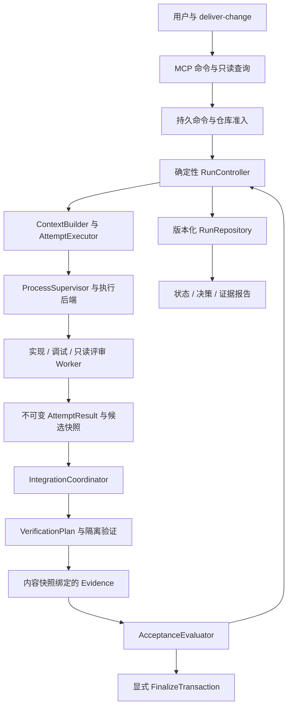

# Delivery Loop 全局评估与目标方案

> 历史评估：本文结果对应 2026-10-28/29 的源文件快照。2026-11-03 已据此实施修复；最新状态见 [实施评估](2026-11-03-global-implementation.md) 和 [实施台账](../implementation/2026-11-03-progress.md)。本文历史测试与问题复现不代表修复后的结果。

审查开始于 2026-10-28，完整方案于 2026-10-29 整理完成（Asia/Shanghai）；文件名保留审查开始日期。评估基准：当前文件快照；用户目标为审查与完整方案，本次没有修改产品源码。配套执行计划见 `../superpowers/plans/2026-10-28-global-reliability-plan.md`。本文按系统职责与风险组织，不采用研发阶段划分。

## 1. 结论与适用边界

**架构方向成立，但当前实现还不具备“可靠、可恢复、可验证的无人值守交付”条件。** 确定性控制器、任务 DAG、独立 Worker、Git worktree 与快照证据值得保留。严重问题主要发生在模块交接处：任务身份与执行尝试混用，内容身份与 Git 索引混用，代码任务与只读任务共用集成路径，缺证据与代码失败共用修复路径，状态恢复与执行资源恢复脱节。

产品当前可以被定位为受监督的编排原型；正常路径之外的自动修复、最终评审、恢复、预算和隔离保障仍需补齐。暂不应把现有 `COMPLETED` 当作可直接提交或交付的可靠证明。

不需要因此重写全部代码，也没有依据引入分布式工作流、远程调度或更多 Agent 角色。推荐保留单机、单仓库、串行集成、默认 `prepare-only` 的边界，围绕执行契约和一致性重构。扩大 Provider 和自动化权限应以本方案的验收矩阵通过为前提。

## 2. 本次实际核验

| 项目 | 本次结果 | 能证明什么 |
| --- | --- | --- |
| `npm test` | 94/94 通过 | 现有测试断言通过，不能代替真实边界验收 |
| `npm run typecheck` | 退出 0 | 源码及现有测试类型检查通过 |
| `npm run build` | 退出 0 | 当前源码可编译 |
| `npm run verify:skills` | 10 个 Skill 通过 | 当前锁文件覆盖的入口哈希一致 |
| `npm audit --omit=dev --registry=https://registry.npmjs.org --json` | 0 项已报告漏洞 | 本次生产依赖漏洞库检查通过 |
| 默认 registry 的 audit | 镜像返回 404 | 默认镜像不支持该接口，不能据此宣称无漏洞 |
| `npm pack --dry-run --json` | 退出 0，187 个文件 | 包文件清单可生成，不证明新环境安装可运行 |
| 既有审查脚本复跑 | 10 个场景，结果与历史问题一致 | 真实 Git + 确定性 Worker 的行为证据 |
| 新增补充探针 | 7 个场景 | 覆盖验证修改源码、失败集成、范围策略、评审策略、非零退出、结果身份与计量、子进程取消 |

当前目录不存在 `.git`，因此没有提交级差异、历史回归或分支结论。审查覆盖 `src/` 全部核心模块、Schema、测试、Skill、manifest、配置、运维与设计文档。构建刷新了本地 `dist/`。本次没有调用付费真实 Codex Worker，没有执行远程 Git、合并或部署。

本机为 Node 24.14.0、Codex CLI 0.164.0-alpha.11.1。CLI help 核对确认现有主要命令参数存在；这不证明模型服务接受当前生成的输出 Schema，也不证明所有 JSONL 计量事件都能被适配器正确解析。在线官方文档检索未返回可引用内容，这些兼容性保留为待验收项。

证据文件：

- `2026-10-28-global-audit-core-results.json`：本次复跑既有 10 个探针的结果。
- `2026-10-28-global-audit-extra.mts` 与 `2026-10-28-global-audit-extra-results.json`：新增 7 个可复现探针及结果。
- `2026-10-28-global-audit-source-manifest.json`：本次 39 个 TypeScript 源文件摘要。
- 原复现入口：`2026-10-28-audit-reproduce.mts`。

两个探针脚本仅在系统临时目录创建仓库、worktree 和无害标记文件，不调用模型。取消探针创建的测试进程在 `finally` 中终止。临时 Git 仓库保留便于调查。

## 3. 需要阻断可靠性发布的问题

严重度定义：P1 表示正常默认行为失效、完成证明失真、修复/恢复无法收敛，或执行权限边界失守；P2 表示能力、运维或维护契约不完整。本次没有证据支持宣称发生了 P0 事故。

### G01 / P1：默认最终评审被当成代码补丁执行

定位：`src/controller/delivery-controller.ts:734`、`:519`；`src/workspace/patch-integration-adapter.ts:60`；`src/workspace/patch-integrator.ts:73`。

`FINAL-REVIEW` 使用只读 Worker，却走通用验证、导出增量、`git apply` 路径。无修改时增量为空，真实 Git 拒绝空补丁；原本成功的最终评审进入 `FIX_REQUIRED`，并产生 debugger。`review.final_review` 默认开启，因此默认成功交付本身就会被破坏。

目标：任务明确声明 `change` 或 `observation`。评审、验收和纯验证只产生绑定内容快照的证据；控制器检查观察前后源码内容不变后直接完成。代码任务的合法无变更结果单独判断，不能依赖 Git 空补丁报错表达业务状态。

### G02 / P1：自动修复没有拿到失败实现

定位：`src/controller/delivery-controller.ts:306`、`:686`、`:119`。

`applyFix` 接收失败 workspace 却未使用；修复任务从已集成代码或 baseline 重新创建。真实复现中，implementer 创建的 `src/feature.txt` 在 debugger 中不存在，修复请求仍只有原任务标题。完整日志与 finding 被压缩为指纹或 ID。

目标：持久化失败 attempt 的不可变候选快照、变更集与 FailureRecord。repair 明确引用失败 attempt，在同一候选内容上先复现失败，再最小修复。修复成功后恢复原任务的验证义务，不能靠再次盲目实现原任务收敛。

### G03 / P1：恢复状态成功，恢复执行失败

定位：`src/controller/recovery.ts:8`；`src/workspace/worktree-manager.ts:65`；`src/controller/delivery-controller.ts:893`、`:912`。

崩溃恢复及人工回答把任务改回 READY，但 attempt 不变；`prepare` 无条件添加同路径 worktree，真实 Git 报目录已存在。`resume` 只改变运行状态，也没有明确恢复 BLOCKED 任务的原因与执行资源。

目标：独立 AttemptRecord，包含 workspace、seed、进程身份、执行状态、结果和集成事务。恢复先核对资源与已发生的副作用，再决定接管、重验或新建尝试。暂停、等待人工、重试、预算耗尽分别定义恢复动作。

### G04 / P1：内容快照既不稳定，也没有覆盖验证后的内容

定位：`src/workspace/repository-context.ts:68`；`src/workspace/patch-integrator.ts:22`；`src/workspace/patch-integration-adapter.ts:75`；`src/controller/delivery-controller.ts:790`。

快照哈希包含 porcelain status，`git add -N/-A` 使相同文件内容产生不同身份；集成先发布 snapshot，再导出会修改 index 的 patch。复现中，新增文件交付已完成，但重新计算的 snapshot 与记录不同。

补充探针还确认：最终验证命令修改 `src/base.txt` 后返回 0，运行仍为 `COMPLETED`，记录快照与实际源码不同。当前证据不能保证验收时的内容就是交付内容。

目标：内容身份由规范化路径、类型、执行权限、链接目标及原始字节决定，排除 index 布局、mtime 和运行元数据。验证、评审、补丁导出前后重新核对内容；改变源码使旧证据失效。构建生成物通过明确规则处理，不允许把整个源码目录作为可忽略生成物。

### G05 / P1：缺少证据会触发错误修复，最终验收不收敛

定位：`src/controller/delivery-controller.ts:790`、`:811`、`:869`；`src/controller/acceptance.ts:60`；`src/verification/command-runner.ts:144`。

最终验证只遍历 config 中的命令。早期任务证据因后续集成失效后，mandatory acceptance 对应的命令不会自动补跑，随后从“最后一个任务”复制修复，可能与失败验收毫无关系。真实复现产生了没有 acceptance IDs 和验证命令的 acceptance-gap 修复。

另外，Schema 允许 `expected_exit_code=2`，runner 却固定把非零视为 failed，使合法的预期拒绝行为永远无法验收。

目标：VerificationPlan 从最终 snapshot、必选验收、全局命令和有效证据编译。缺证据先执行检查；仅确定代码失败才创建修复；环境故障进入环境阻塞。命令执行结果与验收结论分离，实际退出码按每个 check 的期望解释。

### G06 / P1：Worker 上下文与人工决策没有形成闭环

定位：`src/controller/delivery-controller.ts:629`、`:655`、`:337`、`:912`；`src/controller/run-factory.ts:106`。

Worker 仅收到标题、关联 ID 和 `AGENTS.md`。冻结 spec、需求/验收描述、依赖产物、失败证据、历史决策均未装配。blocker 的问题和选项没有完整持久化，回答只写事件，不进入下一次执行输入。并发 blocker 还会覆盖 `pending_decision_ids`。

目标：生成冻结且有摘要的 TaskContextBundle，保存完整 Decision/Response。status 返回可直接回答的问题与选项；回答必须在后续上下文中可见。同一问题并发提交去重，不同问题合并；受多个问题影响的任务只在全部解决后解锁。

### G07 / P1：队列准入与运行所有权不一致

定位：`src/runtime/run-manager.ts:23`、`:38`、`:130`；`src/worker.ts:40`。

QUEUED 被当成 active，占用写运行名额；两个等待者可以永久互相阻塞。完成后没有持久队列推进器，start 在仓库锁外创建 PLANNING，wake 又不走相同原子准入流程。内存集成锁只对一个 controller 实例有效。

目标：队列等待者和持有写租约者分离；按 Git common directory 标识仓库；start、resume、respond、恢复均经统一准入。租约带递增 fencing epoch，旧 controller 即使仍存活也无法提交状态或集成结果。释放名额后主动推进下一项。

### G08 / P1：验证以宿主权限执行模型可修改的脚本

定位：`src/verification/command-runner.ts:31`；`src/state/state-store.ts:27`；`src/runtime/runtime-factory.ts:146`。

环境变量 allowlist 无法限制宿主文件访问、网络或进程行为。即使命令文本事先批准，Worker 仍能改变它调用的测试脚本。无害标记文件探针确认验证可写到 workspace 之外。状态与证据也位于同一用户可访问的运行目录，0600/0700 不能隔离同 UID 的被执行代码。

目标：验证通过具有强制隔离能力的 ExecutionBackend 执行；显式工作区、只读输入、可写缓存、临时 HOME、网络与凭据策略。权威状态、凭据、父目录和 Git common metadata 不作为可写挂载。Worker 继承的 MCP/工具能力同样收窄；prompt 禁止递归不能替代能力隔离。

### G09 / P1：预算计量遗漏，且信任模型自报用量

定位：`src/controller/delivery-controller.ts:337`、`:389`、`:465`；`src/workers/codex-exec-adapter.ts:120`、`:166`、`:173`。

失败、blocker、范围违规在计量前返回；独立 task reviewer 用量没有累加；进程非零退出被记为 0。复现中预算 50、失败 Worker 报告累计 200，持久化仍为 0。补充适配器探针显示，JSONL 中测得 999 时，模型结果中的 `token_usage:0` 仍覆盖它。

目标：每次调用在业务分支前先保存适配器测得的 UsageRecord，包括失败/取消/评审。未知与 0 分离；结果中自报值只能作为诊断字段。派发前预算准入，对并发额度预留；无法实施 token 硬限制时明确显示软上限与最大在途风险，不能宣传绝对硬限制。

### G10 / P1：集成没有明确的候选提交事务

定位：`src/workspace/patch-integration-adapter.ts:67`；`src/controller/delivery-controller.ts:547`、`:563`、`:609`。

patch 直接修改共享 integration，随后即发布 snapshot，集成验证失败没有回滚。探针确认原任务 FIX_REQUIRED 时，公开 integration 已保留未通过候选。验证、task DONE、snapshot、证据与事件分别落盘；崩溃没有统一的事务恢复点。

目标：持久化 IntegrationTransaction，记录 parent、candidate、patch digest、验证和 commit 状态。在候选工作区验证成功后 CAS 发布 accepted integration pointer；失败候选保留给 repair，其他任务继续基于 accepted snapshot。提交的幂等键是事务 ID，恢复不得重复 apply。

### G11 / P1：取消返回不意味着进程已结束

定位：`src/workers/codex-exec-adapter.ts:217`、`:243`；`src/controller/delivery-controller.ts:1016`；`src/verification/command-runner.ts:31`；`src/worker.ts:47`。

真实本地替身忽略 SIGTERM 后，adapter 立刻返回 130，但进程仍存活。abort 没有与 timeout 统一的升级终止和 exit 等待；验证命令没有取消 signal。最大运行时间也只在 tick 之间检查。重启可能在旧写进程仍运行时重复执行。

目标：所有 Worker/验证进程使用同一 ProcessSupervisor，持久化进程身份与启动标记；统一 TERM→配置宽限→KILL→确认退出→关闭日志。取消和超时各有明确终态，终止未确认时禁止回收执行所有权。

### G12 / P1：完成语义可被初始状态和不完整验收绕过

定位：`src/domain/schemas.ts:235`；`src/controller/acceptance.ts:15`、`:85`；`src/controller/run-factory.ts:76`。

新计划与可信恢复状态使用同一 Schema，允许输入 DONE、SATISFIED。没有 acceptance 时，DONE 就可替代证明；只有可选验收的需求也可能跳过必选验证。探针确认，预置 DONE + 空 evidence 可得到 PASSED。

目标：DraftPlanSchema 与 PersistedRunSchema 分离。新任务只接受 PENDING，attempt=0，由控制器赋 ID/状态/计量；每个必交付需求必须有 mandatory acceptance 或用户批准的明确豁免。缺证据、缺集成、缺独立评审不得完成。无代码评估可以用 observation 及明确证据完成。

## 4. 急需优化的工程问题

### G13 / P2：策略优先级和结果真实性检查不完整

范围检查只看 unstaged/untracked：`src/runtime/runtime-factory.ts:118`。探针中，Worker staged 了越界文件，控制器仍标为 DONE。该文件未进入 delta，所以本次没有证明越界内容被集成；已证明的是违规漏检与结果静默丢失。应比较真实 before/after 内容清单，并同时检查 Worker 是否改动 index。

全局 `always` 被任务 `none` 覆盖：`src/controller/delivery-controller.ts:82`。`batch` 直接跳过任务评审，没有真正的批次责任映射。应定义全局策略为最低门槛，任务只能加严。

adapter 接受不同 `task_id`：`src/workers/codex-exec-adapter.ts:170`。补充探针 TASK-1 收到 OTHER-TASK 仍为 completed。应验证 run、task、attempt、seed、context digest 和协议版本，拒绝串单结果。

### G14 / P2：配置、Skill 与 Provider 的实际能力不一致

`src/runtime/runtime-factory.ts:50`、`:83`、`:135` 每次恢复读取当前 Skill 定义，重写 bundle 描述，未使用冻结角色映射；resources 只检查路径，没有校验内容。工程配置中的 Worker profiles 未传给 adapter。`profiles_file`、`role_skills_file`、`max_task_attempts`、`worker_termination_grace_seconds`、`worktree_isolation`、`final_artifact` 等多项只定义未消费或未按配置生效。

OpenSpec 仅有版本检查和角色 Skill 覆盖，没有设计文档所述的完整 Provider 生命周期；custom 也缺少可配置实例化接口。应公布逐字段生效表；支持的字段必须从 MCP 到真实启动可验证，不支持的值启动即拒绝。活动运行从冻结 bundle 恢复；插件升级必须显式迁移。

### G15 / P2：状态读取、诊断、报告与持久化边界需要修正

`DeliveryRunManager.get` 可能启动执行，status 因而具有副作用；重启后读取状态需先构建 runtime 并通过 codex/Skill preflight，环境坏掉时反而无法查故障。`worker.ts` 异常时再次构建 runtime，preflight 再失败会丢失错误。状态文件没有运行时 Schema 校验与版本迁移。

Worker 故障默认删除日志、未完整保存 AgentResult；status 不返回 last_error 和完整 blocker。最终报告只列需求和任务，缺少逐条验收、findings、实际命令、证据与风险；COMPLETED 也不保证报告已生成。事件读取每次全量解析，命令输出无限拼接到内存。应将只读查询与执行装配分离，增加有界日志、游标、错误分类、报告物化和可审计状态事务。

### G16 / P2：测试与发布结论强于实际证据

`tests/runtime/run-manager-e2e.test.ts:65` 的 Git 替身令所有 apply 成功、diff 始终为空；控制器测试大多固定同一个 snapshot。这正好屏蔽真实 Git 空补丁、索引漂移、证据失效和 worktree 冲突。

`docs/review-report.md` 声称除沙箱问题外 P1 已解决，与本次复现不一致。双份设计文档、历史审查和打包文件清单也没有明确权威关系。当前没有 CI 配置，源码目录也没有版本基准。需要用真实边界测试保护原设计承诺，审查结论必须指向测试证据和源码摘要。

### G17 / P2：最终交付不是可恢复、幂等的操作

`src/runtime/run-manager.ts:229` 在检查 snapshot 后逐条 switch/add/commit/push，没有 finalization 租约与恢复记录；重试 branch 可能撞已有分支，commit 改变 HEAD 又影响旧 snapshot，后续 push 可能被自身前一步阻断。检查与动作之间仍有修改窗口。`git.mode` 与用户本次确认的动作权限层级也没有统一建模。

目标：FinalizeTransaction 绑定 accepted snapshot、artifact digest、目标动作与具体 Git ref；每步保存可验证结果，重复请求返回相同产物。远程状态不明时先查明实际 ref，不能重复执行或猜测成功。报告记录真实执行动作。

## 5. 推荐的整体设计

### 5.1 保留的结构与方案选择

可选路线为：继续在大 controller 内补分支；保留分层并建立一致执行契约；引入外部工作流平台重写。推荐第二条。第一条无法解决跨资源恢复，第三条超出当前单机产品需求，且引入运维成本。

控制器仍是唯一业务状态写入者；MCP 是命令与查询接口；Worker 负责实现、诊断与评审。存储继续使用现有文件与锁，新增版本化事务 envelope、不可变 artifact 和 fencing，不在本次强制引入数据库。不要同时维护两份可独立修改的权威 DAG/证据状态。

### 5.2 必须成立的系统不变量

1. **计划不是运行状态。** 外部输入不能自证 DONE、SATISFIED 或已花费预算。
2. **Task 不是 Attempt。** 每次调用都有独立 ID、seed、上下文和执行资源；所有结果可追溯。
3. **Snapshot 只代表内容。** 暂存、导出和读取不会改变身份；源码变化必然改变身份。
4. **观察任务不能写源码。** 评审不经过代码 patch 流程，且绑定独立被观察对象。
5. **修复继承失败候选。** FailureRecord 指向具体 attempt 与内容，不能仅传错误指纹。
6. **accepted integration 只前进到验证成功的候选。** 失败候选隔离保留，不能成为后续任务 seed。
7. **证据具有来源、检查定义、内容和执行环境。** Model 自述、空账本和旧快照不能代替证明。
8. **COMPLETED 是证据的派生结果。** 最终快照、必选验收、评审、未解决问题和交付报告同时满足。
9. **恢复先确认副作用。** 旧进程、旧事务和已有 worktree 未核对前不得重复执行。
10. **只有当前租约持有者能提交。** 跨进程状态写入与发布都校验 fencing epoch。
11. **每次调用先记录再分流。** 成功、失败、阻塞、取消都保存结果、用量和日志。
12. **执行代码不能改权威状态。** 只读查询不启动执行；执行后端权限可以被独立测试。

### 5.3 核心模型

| 对象 | 关键字段 | 作用 |
| --- | --- | --- |
| ApprovedPlan | spec_digest、requirements、acceptance、tasks、policy_digest | 冻结授权与范围 |
| ContentSnapshot | manifest_digest、baseline、entries、artifact_ref | 规范化内容及可恢复输入 |
| AttemptRecord | attempt_id、task_id、seed_snapshot、context_digest、phase、process、result_ref | 单次执行及恢复单元 |
| FailureRecord | kind、attempt_id、snapshot、check/findings、logs、fingerprint | 可复现的修复输入 |
| DecisionRecord | question、options、affected_tasks、response、snapshot/context_version | 人工决策完整闭环 |
| IntegrationTransaction | parent、candidate、patch_digest、check_refs、state、epoch | 集成一致性与幂等 |
| Evidence | kind、check_digest、snapshot、environment_digest、outcome、producer、artifact_hashes | 可信完成依据 |
| UsageRecord | invocation_id、source、known/unknown、input/output/total、reservation | 不漏计、不重复计 |
| RepositoryLease | repo_key、owner、epoch、heartbeat、queue | 原子准入与旧写者隔离 |
| RunEnvelope | schema_version、revision、lease_epoch、state、record_refs、outbox | 权威状态与事件一致提交 |
| FinalizeTransaction | accepted_snapshot、artifact_digest、action、target_ref、steps | 外部动作幂等与追溯 |

### 5.4 存储与进程协调

保留 `.delivery` 可见目录，但把权威控制数据置于执行后端不可写位置，通过 run locator 映射到外部控制目录；已有运行显式迁移。Worker 只接收只读 context bundle 与有限结果输出位置，不暴露控制目录。

每次状态事务在现有 proper-lockfile 锁下校验 Schema、revision、epoch 和合法迁移；先原子写不可变 artifacts，fsync 后写新 envelope，再以 rename 提交并同步父目录。崩溃遗留的未引用 artifact 可清理，不得反过来成为权威记录。事件作为 envelope 内的 outbox 同步提交，再按 event_id 幂等物化到 JSONL；JSONL 是查询投影，不能与 state 各自独立决策。

仓库准入有独立原子 admission envelope，以实际 Git common directory 的 realpath 为键。run 状态不是名额计数来源。协调器死亡后从 admission lease 与 command inbox 恢复；所有 start/resume/respond 使用相同准入路径。状态更新和集成发布都验证当前 epoch；文件锁本身不承担防止旧写者的全部责任。

### 5.5 内容、验证与集成

内容 manifest 覆盖 tracked 与允许的新文件、删除、模式、symlink；仅排除明确的控制元数据与配置生成物，使用 NUL 分隔路径解析。捕获前后再读一次 manifest，若仍变化则返回 unstable input，不能签发快照。submodule/gitlink 与 Git LFS 需要显式能力支持；未支持时预检拒绝相关变更。

patch 通过独立临时 Git index 生成，不能改变真实 worktree index。以 seed manifest 对应的基树导出 task delta，以 baseline 导出总交付；patch 路径按 attempt/transaction 隔离。空 patch 的语义由任务契约判断。

集成时从 accepted parent 创建候选，把 patch 应用到候选并运行集成检查；成功后 CAS 发布新 accepted pointer，并使依赖旧内容的证据过期。parent 在并行期间前进时，重建候选并重验，不复用旧 candidate 的证据。最终 VerificationPlan 在精确 accepted snapshot 上执行，检查前后内容相同，才生成 CompletionCertificate 和报告。

基线失败保存为独立观察，默认不能用“早就失败”自动豁免验收。需要豁免时，绑定明确 check、失败指纹、适用范围和用户决定，并在报告显式列出。

### 5.6 执行与信任边界

执行后端必须报告能力：文件只读/可写挂载、网络、进程终止、资源限制。macOS/Linux 首先交付容器验证后端；无可用后端时返回环境阻塞。保留显式 `trusted-host` 选项供用户承担已知限制，并在启动摘要与报告写明，不能静默降级。

容器以非 root 运行，源码按任务规则挂载，临时 HOME 和独立缓存可写；凭据按 check 最小注入，网络默认关闭，依赖安装通过明确网络策略执行。仓库 `.git` 中的 common metadata、SSH/用户配置及权威控制目录不暴露为可写。恶意或误操作代码不能从容器挂载直接修改控制器证据。

Codex Worker 的实际工具、MCP、sandbox 配置也由运行时策略固定；只读 reviewer/acceptance 不能启动写型扩展。Skill 是方法指导而非权限边界。CLI 版本、协议与有效 profile 写入执行元数据，并以本地 fixture 和少量真实 smoke 检验。

### 5.7 资源、决策与运行控制

用量来源取 adapter 事件，不接受模型覆盖。未知用量触发明确策略，默认暂停继续派发并展示缺失来源。token 预算采用派发预留和结算；真正的强制限制受后端能力约束，按能力声明。wall-clock 截止时间作用于 supervisor，排队和人工等待是否计时由运行策略明确，记录 elapsed 与 paused duration。

pause 为 drain：停止派发，允许当前受控尝试完成后落盘；cancel 为终止：停止派发，终止所有 Worker 与 verifier，确认退出后释放所有权。无法确认进程结束时进入 BLOCKED 并保留租约状态。恢复人工 blocker 时必须把答案加入 context；涉及范围扩大或策略变化的答案需产生新的 approval digest。

## 6. 工程实施与发布的整体约束

- 本次业务范围仍为单机单仓库；不增加多机消息系统。
- 同一仓库默认一个写运行；同一运行内允许两个隔离 Worker，集成 CAS 串行。
- 业务状态变更统一走 RunRepository + state machine；adapter 不直接推进任务状态。
- 新输入严格校验，未知配置项与未实现的 Provider/策略拒绝启动。
- v1 状态只通过可重跑迁移读取；旧完成结果不能自动升级为可信完成证书。
- 所有日志流式写入、持续脱敏、有额度，stderr 和原始事件先记录再解析；日志失败本身形成诊断事件。
- 既有单测保留；跨模块关键承诺必须有真实 Git、真实进程和故障注入测试。
- 报告与运行证据关联，不再以“测试数量”代替发布完成依据。

完整修改包、文件边界、接口、依赖、回归命令及验收条件见配套实施计划。所有修改包属于同一全局方案；优先级表达风险和依赖，不是功能分期或缩减承诺。
