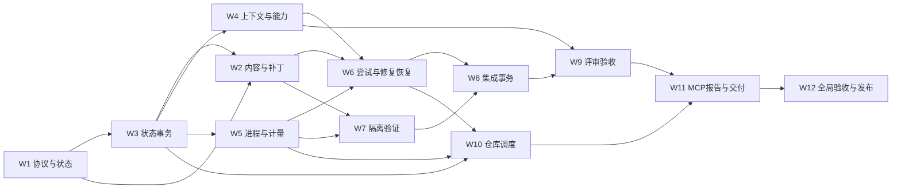

# Delivery Loop 全局可靠性交付 Implementation Plan

> **For agentic workers:** REQUIRED SUB-SKILL: Use superpowers:executing-plans to implement this plan task-by-task. Steps use checkbox (`- [ ]`) syntax for tracking. 用户要求一份覆盖全局的完整方案；以下工作包描述系统职责和依赖，不代表研发阶段，也不要求逐包向用户重复审批。

**Goal:** 让经过批准的单仓库交付，在真实 Git、真实子进程、失败修复、人工决策和重启情况下，都能产生可信、可追溯的验收及交付结果。

**Architecture:** 保留 Skill → MCP → 确定性控制器 → 独立 Worker 的结构，以内容快照、执行尝试、候选集成事务和类型化证据连接各层。用版本化文件事务、租约 fencing 和幂等命令统一状态与恢复；使用隔离执行后端运行不可信验证。

**Tech Stack:** TypeScript ESM、Node.js 24+、Zod、proper-lockfile、Git、Codex CLI；继续使用 node:test/tsx。容器隔离验证需要可用的 Docker-compatible runtime；不引入分布式工作流或消息服务。

**Spec:** `docs/reviews/2026-10-28-global-assessment.md`，以及现有设计中的范围、安全、恢复与证据承诺。冲突处以该评估明确的新执行契约为准；更新设计文档时记录差异。

审查始于 2026-10-28，本方案完成于 2026-10-29（Asia/Shanghai）；文件名沿用审查开始日期。

## Global Constraints

- 单机、单 Git 仓库；macOS/Linux 为验收平台，Windows 不宣称支持。
- `prepare-only` 默认成立；不自动 commit、push、merge、deploy。
- 同一仓库默认一个写运行；单运行默认两个隔离 Worker；accepted integration 发布串行。
- “仓库”按 Git common directory 的真实路径唯一标识；用户发起 worktree 的 HEAD 单独保留为 baseline。
- Worker completed 仅为待验证提交；模型不得推进权威状态、生成可信用量或自证验收。
- 新运行输入与持久运行状态分别校验；不静默接受未知字段或未实现配置。
- 不提供关闭 final review、伪造通过证据、丢弃失败代码等绕开问题的实现。
- 现有 94 项测试持续保留；本文新增验收针对真实边界，不以固定 snapshot/无条件成功的 Git 替身证明闭环。
- 业务源码只在开始执行本计划后修改；本次评估交付仅新增文档和诊断探针，构建刷新 dist。
- 资源额度不静默放宽；未知 token 用量与 0 不相同；硬限制能力必须如实报告。
- 工作包中的新类型/函数名为目标接口；它们不是当前源码中已经存在的实现。

---

## 1. 全局验收标准

以下条件全部满足才可宣称本方案完成：

1. 默认配置下，真实 Git + 确定性 Worker 能完成实现、独立评审、最终验证和报告，无空补丁错误。
2. 实现失败后，debugger 得到原失败候选和具体错误；最小修复通过后原任务完成，不丢失修改。
3. 任意执行/集成持久化边界被终止后，恢复不会重复 apply、丢掉结果、引用旧证据或撞已有 worktree。
4. 新增、删除、二进制、空文件、可执行文件、symlink、带空格/非 ASCII 路径、重命名均正确交付；不支持的 submodule/LFS 变更预检明确拒绝。
5. stage/unstage/patch export 不改变内容身份；实际源码变化必定使证据失效。
6. 最终内容上的每个 mandatory acceptance 都有正确类型、正确 check、正确环境和正确 snapshot 的证据；expected nonzero exit 能按预期通过。
7. 人工问题和答案重启后可查；下一次 Worker 请求看得到答案；并发问题不丢失。
8. 三个以上排队 run 在完成、取消、阻塞、恢复后持续推进；不能同时出现两个有效的单仓库写租约。
9. Worker/验证超时或取消后，进程及后代确认退出；旧 epoch 的控制器不能发布状态或 integration。
10. 失败、评审、取消和异常调用的已知用量不漏计、不重复计，未知用量按策略停止继续派发。
11. 隔离验证无法写宿主哨兵文件、控制状态或 Git common metadata；网络与凭据权限可独立验证。
12. 干净新环境中，解包安装、MCP 启动、prepared run、恢复和报告导出工作正常；发布包对应经过验收的源码摘要。

## 2. 文件职责与统一接口

保留 `src/controller/delivery-controller.ts` 作为流程协调入口，逐步将职责移交给以下明确模块；不要求按行数重构，也不复制旧分支形成两个流程。

| 目标文件 | 职责 |
| --- | --- |
| `src/domain/execution.ts` | Attempt、Snapshot、Failure、Evidence、Decision、Usage、Completion 等协议 |
| `src/domain/schemas.ts` | DraftPlan/v2 状态与跨字段校验，生成 Schema |
| `src/state/run-repository.ts` | 原子 envelope、revision、epoch、outbox、不可变记录引用 |
| `src/state/artifact-store.ts` | 内容寻址、原子落盘、摘要与只读读取 |
| `src/state/migrations/v1-to-v2.ts` | 显式、备份、幂等迁移 |
| `src/workspace/content-snapshot.ts` | 内容 manifest 捕获与物化 |
| `src/workspace/change-set.ts` | seed/candidate 内容差异与范围判定 |
| `src/controller/context-builder.ts` | 冻结 Worker 上下文 |
| `src/controller/decision-service.ts` | 完整 blocker/response 与解锁 |
| `src/controller/attempt-executor.ts` | 单次调用生命周期，结果与计量统一记录 |
| `src/controller/repair-planner.ts` | 失败分类、复现约束、修复关联与去重 |
| `src/controller/integration-coordinator.ts` | 候选集成事务与 accepted pointer 发布 |
| `src/controller/verification-planner.ts` | 最终内容的必需检查与证据缺口 |
| `src/controller/completion-service.ts` | 最终检查、证书与报告一致发布 |
| `src/runtime/process-supervisor.ts` | 启动、取消、超时、等待退出与日志关闭 |
| `src/runtime/usage-ledger.ts` | 调用用量、预留、结算与未知策略 |
| `src/runtime/repository-coordinator.ts` | 持久队列、写租约、epoch、命令消费 |
| `src/runtime/execution-backend.ts` | 验证执行隔离能力接口 |
| `src/runtime/container-backend.ts` | 容器挂载/网络/资源策略 |
| `src/runtime/trusted-host-backend.ts` | 显式可信宿主模式，强制披露限制 |
| `src/finalize/finalization-service.ts` | 有确认目标的幂等交付事务 |
| `src/reporting/report-writer.ts` | 从冻结证书及证据生成可追溯报告 |

核心类型在 W1 定义，后续工作包不得各自引入同义字段：

```ts
type TaskEffect = 'change' | 'observation';
type FailureKind = 'code' | 'review' | 'environment' | 'protocol' | 'policy';
type ProcessOutcome = 'exited' | 'cancelled' | 'timed_out' | 'spawn_error';
type EvidenceVerdict = 'passed' | 'failed' | 'error' | 'invalidated';

interface ContentSnapshotRef {
  snapshot_id: string;              // 完整 SHA-256，不截断作为唯一键
  manifest_ref: string;
  baseline_commit: string;
}
interface AttemptRecord {
  attempt_id: string;
  run_id: string;
  task_id: string;
  ordinal: number;
  lease_epoch: number;
  seed: ContentSnapshotRef;
  context_digest: string;
  phase: 'prepared' | 'running' | 'result_saved' | 'verifying' |
    'candidate_ready' | 'integrating' | 'done' | 'failed' | 'interrupted';
  workspace_path: string;
  result_ref?: string;
  candidate?: ContentSnapshotRef;
  failure_ref?: string;
  process_ref?: string;
}
interface FailureRecord {
  failure_id: string;
  root_task_id: string;
  attempt_id: string;
  kind: FailureKind;
  snapshot: ContentSnapshotRef;
  check_id?: string;
  expected_exit_code?: number;
  actual_exit_code?: number;
  stdout_ref?: string;
  stderr_ref?: string;
  findings_ref?: string;
  fingerprint: string;
}
interface UsageRecord {
  invocation_id: string;
  status: 'known' | 'unknown';
  source: 'adapter-events' | 'provider-api' | 'unavailable';
  total_tokens?: number;
  input_tokens?: number;
  output_tokens?: number;
}
interface VerificationCheck {
  check_id: string;
  check_digest: string;
  kind: 'command' | 'test' | 'review' | 'artifact' | 'manual';
  acceptance_ids: string[];
  command?: string;
  expected_exit_code?: number;
  policy_digest: string;
}
interface EvidenceV2 {
  evidence_id: string;
  run_id: string;
  check_id: string;
  check_digest: string;
  kind: VerificationCheck['kind'];
  snapshot_id: string;
  environment_digest: string;
  producer_ref: string;
  verdict: EvidenceVerdict;
  outcome_ref: string;
}
interface LeaseToken { repo_key: string; run_id: string; epoch: number }
interface RunTransaction {
  run_id: string;
  expected_revision: number;
  lease: LeaseToken;
  command_id: string;
}
```

`RunStateV2` 固定 `state_schema_version=2`，保留既有可见状态，但增加 `revision`、`lease_epoch`、`approved_plan_ref`、`attempt_refs`、`accepted_snapshot`、`integration_transaction_refs`、`evidence_refs`、`decision_refs`、`usage_refs`、`command_results`、`completion_ref` 和 `outbox`。新字段的 JSON Schema 必须与 TypeScript 同源；涉及外部输入的对象使用严格对象与大小上限。revision 由 repository 在每次成功提交时递增，业务闭包不能自行赋值。

全局依赖图如下；箭头只表示接口先决条件，所有工作包均属于完整交付范围：



## 3. 工作包

### W1：明确输入、执行、证据与完成协议

**覆盖问题：** G01、G05、G09、G12、G13。**依赖：** 无。

**文件：** 新建 `src/domain/execution.ts`；修改 `src/domain/types.ts`、`src/domain/schemas.ts`、`scripts/generate-schemas.ts`；测试 `tests/domain/plan-validation.test.ts`、`tests/domain/execution-contracts.test.ts`。

**Consumes:** 现有 TaskGraph、AgentRequest、AgentResult。**Produces:** 上文新类型、`parseApprovedPlan(input: unknown): ApprovedPlan`、`validateRunStateV2(input: unknown): RunStateV2`、`validateWorkerResult(request: AgentRequestV2, raw: unknown): AgentResultV2`。ApprovedPlan 保留任务/需求/验收描述及约束，但没有运行完成状态；AgentRequestV2 增加协议版本、attempt_id、seed_snapshot_id、context_digest，结果必须回传这些绑定字段；token_usage 从模型可信结果中移除。

- [ ] 写失败测试：预置 DONE/SATISFIED、未知关联、仅可选验收、空 mandatory 覆盖、未知配置、越界 scope、重复 ID、错 attempt/context 的结果必须拒绝。显式无代码任务必须有 observation 验收，不能让空图自动完成。

```ts
test('new plans cannot import completed runtime state', () => {
  const draft = validDraftPlan(); // 同文件工厂：单 REQ、mandatory command AC、PENDING task
  assert.throws(() => parseApprovedPlan({
    ...draft,
    tasks: [{ ...draft.tasks[0]!, status: 'DONE', attempt: 2 }],
  }), /initial|status|unknown/i);
});
test('worker results must belong to the dispatched attempt', () => {
  const request = validWorkerRequestV2();
  assert.throws(() => validateWorkerResult(request, {
    ...validWorkerResultV2(request), attempt_id: 'another-attempt',
  }), /attempt/i);
});
```

- [ ] 运行 `npx tsx --test tests/domain/plan-validation.test.ts tests/domain/execution-contracts.test.ts`，先确认现有实现缺少约束，失败原因不能只是 fixture 本身不合法。
- [ ] 实现严格 Schema 和跨字段校验。scope 统一为 repo-relative POSIX path；禁止绝对路径、`..`、控制目录、非法分隔和空写范围。保留旧输入转换器，转换不能接受外部完成声明；task max attempts 是 `min(task_limit, runtime_limit)`。
- [ ] 固定评审策略合成：全局 always 优先；任务 required 可以加严；batch 必须拥有独立批次证据对象，未实现前拒绝 batch。新任务在服务端初始化 PENDING/attempt=0。
- [ ] 修改 schema 生成器区分输入与持久化协议，生成结果加入构建一致性检查，禁止手工修改生成文件。
- [ ] 通过上述测试与 `npm run typecheck` 后独立提交；提交信息 `feat: define verifiable delivery execution contracts`。

### W2：内容快照、范围检查与无副作用补丁

**覆盖问题：** G02、G04、G10、G13。**依赖：** W1、W3（ArtifactStore）。

**文件：** 新建 `src/workspace/content-snapshot.ts`、`src/workspace/change-set.ts`；修改 `repository-context.ts`、`patch-integrator.ts`、`worktree-manager.ts`；新增 `tests/helpers/git-fixture.ts`、`tests/workspace/content-snapshot-real-git.test.ts`、`tests/workspace/patch-roundtrip-real-git.test.ts`。

**Produces:** `captureContent(workdir, policy): Promise<ContentSnapshotRef>`、`materialize(snapshot, target): Promise<void>`、`compareContent(before, after): Promise<ChangeSet>`、`exportChangeSet(base, candidate, outputPath): Promise<PatchArtifact>`。ChangeSet entries 包含 path、before/after type/mode/digest；不能仅提供文件名。

- [ ] 在真实临时 Git fixture 写失败测试。fixture 只初始化独立仓库、禁用 hooks/GPG、写最小 baseline、设置本地作者，结束时清理；不读写用户 Git 配置。

```ts
test('index operations do not change content identity', async () => {
  await using repo = await createGitFixture();
  await repo.write('src/new.bin', Buffer.from([0, 255, 10]));
  const before = await captureContent(repo.path, repo.policy);
  await repo.git(['add', '-N', '--', 'src/new.bin']);
  const staged = await captureContent(repo.path, repo.policy);
  await exportChangeSet(repo.baseline, staged, repo.artifact('delta.patch'));
  const after = await captureContent(repo.path, repo.policy);
  assert.equal(before.snapshot_id, staged.snapshot_id);
  assert.equal(before.snapshot_id, after.snapshot_id);
});
```

- [ ] 运行 `npx tsx --test tests/workspace/content-snapshot-real-git.test.ts tests/workspace/patch-roundtrip-real-git.test.ts`，证明当前 status 哈希/真实 index 副作用被测试捕获。
- [ ] manifest 采用排序路径、类型、模式、内容摘要的规范编码；读取 symlink 用 `lstat/readlink`，不能按普通文件跟随。字节 blob 在 ArtifactStore 原子落盘；排除运行元数据及明确生成物，执行前后检测输入仍稳定。
- [ ] 用 NUL 解析 Git 路径，正确识别 rename 双路径；before/after 比较用于范围和 required outputs。额外比较 index 内容，Worker 改 index 即 policy failure；stage-only 越界不能被忽略。
- [ ] 使用临时 `GIT_INDEX_FILE` 构造 base/candidate 树及 `git diff --binary --no-ext-diff`；禁止 hooks/external diff。额外 Git object 写入仅由控制器执行；不创建 commit。检查空 delta 后按 effect/output 契约返回，无需调用 git apply。
- [ ] 补齐新增/删除/空/二进制/执行模式/symlink/重命名/空格/中文路径往返测试；seed 导出的 index 不能泄漏到真实 index。submodule/LFS 尚不支持的变更在 capture 明确报 unsupported。
- [ ] 测试通过后提交 `fix: make content snapshots and patches independent of index state`。

### W3：版本化状态事务、记录和恢复基础

**覆盖问题：** G03、G07、G10、G15。**依赖：** W1。

**文件：** 新建 `src/state/run-repository.ts`、`artifact-store.ts`、`migrations/v1-to-v2.ts`；修改 `state-store.ts`、`evidence-ledger.ts`；测试 `tests/state/run-repository.test.ts`、`tests/state/migration.test.ts`、`tests/state/crash-commit.test.ts`。

**Consumes:** RunStateV2、LeaseToken、RunTransaction。**Produces:** `RunRepository.open(options: RunRepositoryOptions)`、`read(runId: string): Promise<RunStateV2>`、`transact(tx: RunTransaction, mutate: (state: RunStateV2) => RunStateV2)`、`putRecord(record)`、`readRecord(ref)`、`readEvents(cursor, limit)`。RunRepositoryOptions 包含 control_root、repo_key 和 admission store；transact 返回 `{state, revision, command_result}`，一个已消费 command_id 不重复 mutate，且命令去重先于旧 expected_revision 冲突检查。

- [ ] 写 CAS、旧 epoch、同命令重试、并发更新、损坏/未知 Schema 和崩溃测试。fault hook 注入 `artifact_written`、`envelope_synced`、`envelope_renamed`、`outbox_projected` 四个边界；真实子进程终止后用独立进程读取，不能只抛出模拟异常。

```ts
test('a committed command is not executed twice after restart', async () => {
  const f = await createStateFixture();
  await f.repo.transact(f.tx('cmd-1'), s => s);
  const reopened = await RunRepository.open(f.options);
  const revision = (await reopened.read(f.runId)).revision;
  await reopened.transact(f.tx('cmd-1'), () => { throw new Error('duplicate mutation'); });
  assert.equal((await reopened.read(f.runId)).revision, revision);
});
```

- [ ] 运行 `npx tsx --test tests/state/run-repository.test.ts tests/state/migration.test.ts tests/state/crash-commit.test.ts`，确认新约束缺失时失败。
- [ ] 保留文件存储：不可变 record/blob 完成写入和摘要校验后，envelope 在 run lock 下校验 revision/epoch、合法迁移；fsync 临时文件、rename、同步目录。返回值只来自持久提交，不能从可变内存副本推断成功。
- [ ] 业务事件、decision/usage/evidence 引用与 state 在同一 envelope 提交；JSONL 与证据 index 作为可重建投影。outbox 使用 event_id 去重；尾部损坏只影响投影时可重建，不允许静默忽略权威 envelope 损坏。
- [ ] 定义锁顺序：repository admission lock → run lock → artifact 独占写；任何路径禁止反向获取。提交时在 admission 锁下验证当前 epoch，避免先读 lease 后写 state 的竞态。
- [ ] 控制状态移至用户控制目录中的仓库/run 命名空间；`.delivery` 只含 locator/导出镜像/工作区。真实路径校验覆盖全部祖先，拒绝 symlink 重定向。仅路径/权限不能替代执行隔离，W7 完成前不可宣称防篡改。
- [ ] v1 迁移先备份、保存原文件摘要，转换为 v2 引用；原 DONE/COMPLETED 只记历史待重验，不签发新证书；完整过程有迁移 marker，可重复执行。未知高版本拒写，仍允许导出诊断。
- [ ] 测试通过后提交 `feat: persist delivery state with revisions and recoverable transactions`。

### W4：规格上下文、人工决策与冻结能力配置

**覆盖问题：** G06、G13、G14、G15。**依赖：** W1、W3。

**文件：** 新建 `src/controller/context-builder.ts`、`decision-service.ts`；修改 `run-factory.ts`、`runtime-factory.ts`、`capabilities/skill-resolver.ts`、`config/config.ts`、`workers/codex-exec-adapter.ts` 的 prompt 装配；新增 `tests/controller/context-builder.test.ts`、`decision-service.test.ts`、`tests/capabilities/frozen-bundle.test.ts`、`tests/config/config-effectiveness.test.ts`。

**Produces:** `buildTaskContext(run, task, attempt): Promise<TaskContextBundle>`、`DecisionService.recordBlockers(runId: string, blockers: DecisionBlocker[]): Promise<void>`、`respond(decisionId: string, response: DecisionResponse, commandId: string): Promise<void>`、`FrozenCapabilityBundle`。DecisionResponse 为 `{action: 'answer' | 'approve' | 'reject', text: string}`；bundle 包括 spec/任务描述、关联需求与验收全文、依赖 artifact、失败、findings、人工答案、规则与策略摘要；所有引用内容可在 Worker 沙箱只读读取。

- [ ] 写规格可见性、人工答案重启可见、并发 blocker 合并、多个问题全部解除才解锁、bundle 资源被篡改和升级恢复测试。

```ts
test('a resumed task receives the persisted human answer', async () => {
  const f = await createContextFixture();
  await f.decisions.recordBlockers(f.runId, [f.question('D1', 'TASK-1')]);
  await f.decisions.respond('D1', { action: 'answer', text: 'use 42' }, 'respond-1');
  const restarted = await f.reopen();
  const bundle = await restarted.build('TASK-1');
  assert.match(bundle.spec_text, /approved behavior/);
  assert.equal(bundle.decisions.find(d => d.decision_id === 'D1')!.response!.text, 'use 42');
});
```

- [ ] 运行上述四组测试，验证当前固定 `['AGENTS.md']` 的实现无法通过。
- [ ] 冻结完整上下文和 manifest digest；prompt 只装配本次任务的必要正文与可读引用，不把整个事件历史塞入上下文。超限时按关联关系裁剪失败日志并保留原始 artifact 引用，不丢验收与决策。
- [ ] DecisionRecord 包含原问题/选项/影响任务、创建 attempt/snapshot、状态、回答内容与命令 ID；manual 使用结构化 approve/reject，任意字符串不能充当批准。scope/policy 变化生成新 approval digest 后才可执行。
- [ ] 首次创建冻结所有角色映射、Skill 入口及 resources 哈希、Worker adapter 协议、CLI 版本和有效 profiles；恢复只使用该 bundle，不重新覆盖。不同路径同 basename 的 project skill 必须生成不同内部 ID；真实路径与资源摘要防逃逸和冲突。
- [ ] 建立配置生效表：workers profiles 在构造 adapter 时显式传入；runtime max_task_attempts/termination grace、capability 路径/fail_on_missing、final_artifact 要么实现端到端效果要么拒绝非支持值。`worktree_isolation=false`、未实现 batch、custom provider 和未实现 OpenSpec 生命周期必须拒绝或准确收窄声明；不能仅凭版本检查就承诺 Provider 全流程支持。
- [ ] preflight 检查实际选择的二进制与 profile 能力、Git repository、baseline、必要沙箱后端和锁定资源；查询旧状态不调用 preflight。写请求中记录 effective config 来源，密钥值不进入 bundle。
- [ ] 测试通过后提交 `feat: freeze worker context decisions and effective capabilities`。

### W5：进程生命周期、适配器协议与统一计量

**覆盖问题：** G09、G11、G13、G15。**依赖：** W1、W3。

**文件：** 新建 `src/runtime/process-supervisor.ts`、`usage-ledger.ts`；修改 `workers/worker-adapter.ts`、`codex-exec-adapter.ts`、`verification/command-runner.ts`、`runtime/loop-guards.ts`；新增 `tests/helpers/process-fixtures/`、`tests/runtime/process-supervisor.test.ts`、`usage-ledger.test.ts`、`tests/workers/codex-process-contract.test.ts`。

**Produces:** `ProcessSupervisor.spawn(request): Promise<ProcessResult>`、`terminate(processRef, reason): Promise<ProcessResult>`；ProcessResult 包含 outcome、exit_code、signal、process identity、日志引用、测量 UsageRecord，只有确认 close 且日志 flush 后返回。Worker adapter 返回 `{result, usage, process, diagnostics}`，业务状态由 AttemptExecutor 处理。

- [ ] 用真实本地 Node 子进程写失败测试：忽略 TERM、带后代、预先 aborted、输出大日志、spawn error、超时、Schema 解析失败、错任务、stderr-only、非零退出前已产生 token 事件。

```ts
test('abort waits until the process group has exited', async () => {
  const f = await createProcessFixture('ignore-term-with-child');
  const running = f.supervisor.spawn(f.request({ grace_ms: 50 }));
  await f.waitUntilStarted();
  await f.supervisor.terminate(f.processRef, 'cancelled');
  const result = await running;
  assert.equal(result.outcome, 'cancelled');
  assert.equal(await f.anyFixtureProcessAlive(), false);
  assert.equal(result.logs_flushed, true);
});
```

- [ ] 运行 `npx tsx --test tests/runtime/process-supervisor.test.ts tests/runtime/usage-ledger.test.ts tests/workers/codex-process-contract.test.ts`，用短宽限验证旧 abort 立即返回的缺陷。
- [ ] 实现统一超时/取消状态机：abort 前置检查 → spawn → 持久化身份 → TERM → 配置宽限 → KILL → 等待 close → 完成流关闭；clear timeout/escalation，解绑 signal；PID 检查同时核对启动标记，不能向复用 PID 发送信号。
- [ ] 日志使用有背压的流、持续脱敏和总量上限。默认单流 10 MiB，超限保留前 2 MiB/后 2 MiB 和摘要/截断原因；不得在内存无限拼接或先完整落盘后脱敏。敏感内容跨 chunk 时保留必要匹配尾部。
- [ ] 解析真实版本 fixture 的 token 事件，不递归猜测任意字段就是累计用量；优先 adapter/provider 数据。未知事件格式返回 unknown；非零、取消和解析失败均保留已测用量。Schema 要求身份绑定，并保存脱敏原结果用于诊断。
- [ ] UsageLedger 以 invocation_id 幂等结算。派发先检查余额并保留额度；缺硬 token 上限能力时明确软限，不以预留值替代实际。未知计量默认阻止新派发并返回 `USAGE_UNAVAILABLE`，允许用户显式选择 time-only 模式。
- [ ] deadline 从第一次获得运行准入起计算 `max_duration_hours`，排队前不计；恢复不重置，人工等待仍计入。supervisor 使用剩余 deadline 与 task timeout 的较小值，避免单个 tick 超过运行总预算。
- [ ] 测试通过后提交 `fix: supervise worker lifecycles and account every invocation`。

### W6：执行尝试、失败修复与资源恢复

**覆盖问题：** G02、G03、G06、G09、G11。**依赖：** W2、W3、W4、W5。

**文件：** 新建 `src/controller/attempt-executor.ts`、`repair-planner.ts`；修改 `delivery-controller.ts`、`recovery.ts`、`worktree-manager.ts`、`scheduler/failure-fingerprint.ts`；新增 `tests/helpers/delivery-fixture.ts`、`tests/controller/attempt-executor.test.ts`、`repair-real-git.test.ts`、`recovery-real-git.test.ts`。

**Consumes:** AttemptRecord、TaskContextBundle、ProcessSupervisor、UsageLedger、ContentSnapshotRef。**Produces:** `AttemptExecutor.execute(runId, taskId, lease)`、`RepairPlanner.fromFailure(failureId)`、`recoverRun(runId, lease): Promise<RecoveryReport>`。repair 引用 root_task_id/source_attempt_id/failure_ref；不复制最后一个任务推断根因。

- [ ] 真实 Git 写失败测试：实现新增文件后测试失败，debugger 启动时文件内容、同一失败命令、日志、完整 finding 和验收描述均可见；再修改为正确结果，恢复原任务验证，最终 patch 包含该修复。

```ts
test('repair starts from the failed candidate rather than accepted baseline', async () => {
  await using f = await createDeliveryFixture({ final_review: false });
  f.worker.on('implementer', async ctx => {
    await ctx.write('src/feature.txt', 'wrong');
    return ctx.complete();
  });
  f.worker.on('debugger', async ctx => {
    assert.equal(await ctx.read('src/feature.txt'), 'wrong');
    assert.match(ctx.context.failure!.stderr_text, /expected 42/);
    await ctx.write('src/feature.txt', '42');
    return ctx.complete();
  });
  await f.runUntilSettled();
  assert.equal(await f.readAccepted('src/feature.txt'), '42');
  assert.equal(f.state.status, 'COMPLETED');
});
```

- [ ] 运行 `npx tsx --test tests/controller/attempt-executor.test.ts tests/controller/repair-real-git.test.ts tests/controller/recovery-real-git.test.ts`，先获得失败证据。
- [ ] 所有 Worker 调用进入统一边界：申请预算 → 保存 attempt/context → 准备 workspace → 启动 → 无论结果先持久化 result/usage → 检查身份/scope/output → 验证或分类失败。环境故障与协议错误不创建代码修改任务；认证、额度、工具缺失优先阻塞并给出诊断。
- [ ] attempt 使用独立 UUID 路径，不用 task.attempt 计数代替唯一身份。保留失败候选的内容物化引用；恢复原 worktree 前检查注册、路径、baseline、manifest 与进程确实退出。已有结果重验即可，不重复调用模型。
- [ ] 同一修复链指纹以 root task、check、规范错误和影响内容为依据；记录重复次数和候选是否改变，不能把新 task ID 当进展。重复同一失败达到配置阈值停止扩大 DAG；动态数量、深度、attempt 限制统一入口检查。
- [ ] repair 成功后将修复内容作为原任务候选，重跑原检查和必要独立评审；不让原任务重新 blind implement。scope 由失败关联任务与 finding 推导，扩大范围需受策略约束。
- [ ] 故障注入覆盖 prepared/running/result_saved/verifying/integrating；旧进程尚活或身份不明返回 BLOCKED，不能简单 READY。测试人工回答后的新 attempt 能正常准备且含答案。
- [ ] 测试通过后提交 `fix: preserve failed candidates across repair and recovery`。

### W7：隔离执行后端与可信验证结果

**覆盖问题：** G04、G05、G08、G11、G15。**依赖：** W1、W2、W5。

**文件：** 新建 `src/runtime/execution-backend.ts`、`container-backend.ts`、`trusted-host-backend.ts`；修改 `verification/command-runner.ts`、`runtime/preflight.ts`、`config/config.ts`、`runtime/runtime-factory.ts`；新增 `tests/runtime/container-boundary.test.ts`、`tests/verification/check-runner.test.ts`。

**Produces:** `ExecutionBackend.capabilities()`、`runCheck(check, snapshot, executionPolicy, signal): Promise<CheckOutcome>`。CheckOutcome 保存实际 exit/signal/timeout、before/after snapshot、日志、environment digest；`evaluateCheck(check, outcome): EvidenceV2` 依据预期退出码产生 verdict。container 与 trusted-host 共享协议，不共享默认信任声明。

- [ ] 写 check 的 expected exit 2、timeout、signal、spawn error、验证修改源码、校验期间外部改动测试；隔离测试创建宿主哨兵目录/控制目录，命令尝试写入应失败，独立临时 cache 写入应成功。

```ts
test('expected rejection is valid evidence and timeouts never are', async () => {
  const check = commandCheck({ command: 'node -e "process.exit(2)"', expected_exit_code: 2 });
  const exited = await fixture.runCheck(check);
  assert.equal(evaluateCheck(check, exited).verdict, 'passed');
  assert.equal(evaluateCheck(check, { ...exited, outcome: 'timed_out' }).verdict, 'error');
});
test('verification cannot certify source content it changed', async () => {
  const check = commandCheck({ command: 'node scripts/change-source.cjs' });
  const outcome = await fixture.runCheck(check);
  assert.notEqual(outcome.before_snapshot_id, outcome.after_snapshot_id);
  assert.equal(evaluateCheck(check, outcome).verdict, 'invalidated');
});
```

- [ ] 分别运行 `npx tsx --test tests/verification/check-runner.test.ts` 与显式容器测试 `npx tsx --test tests/runtime/container-boundary.test.ts`。机器无后端时本地可标记不可运行，发布验收必须在具有后端的环境执行且不能跳过。
- [ ] 容器镜像按 digest 固定，非 root、只读根文件系统、只读冻结源码输入、独立候选工作区/临时 HOME/cache、进程和内存限额；默认禁网。检查 Git metadata 仅提供不可变 baseline 信息，不能挂载可写 common directory。
- [ ] build/test 所需写入使用明确生成目录或可丢弃候选副本；构建脚本修改受验源码时证据 invalidated，不自动接受第二次内容为已验证。禁止把完整 repo 当作可忽略 generated path。
- [ ] 权威控制目录不挂载；Worker 输出先写受限接收目录，再由控制器校验/摄入。fixture 验证绝对路径、symlink、父目录跳转、HOME、网络和控制状态访问边界。
- [ ] Worker 启动采用受控能力配置，禁止继承写型 Delivery MCP/递归调度工具；限制 project hook/MCP 能力到已批准集合。无法约束的宿主组合明确阻塞或要求显式 trusted-host policy，不把 prompt 约束当强制隔离。
- [ ] 默认 `verification.execution_backend=container`，缺少 backend 明确 `ENVIRONMENT_UNAVAILABLE`。`trusted-host` 需要启动策略显式选择并在报告保存限制；不能由自动修复任务自行降级。
- [ ] 测试通过后提交 `feat: execute verification within an explicit isolation boundary`。

### W8：候选集成、CAS 发布与崩溃幂等

**覆盖问题：** G02、G03、G04、G07、G10。**依赖：** W2、W3、W6、W7。

**文件：** 新建 `src/controller/integration-coordinator.ts`；重构 `workspace/patch-integration-adapter.ts`、`controller/delivery-controller.ts`、`worktree-manager.ts`；新增 `tests/controller/integration-transaction.test.ts`、`integration-crash-real-git.test.ts`。

**Produces:** `prepareCandidate(attemptId: string, parentSnapshot: ContentSnapshotRef, lease: LeaseToken): Promise<IntegrationTransaction>`、`verifyCandidate(transactionId)`、`publishCandidate(transactionId, expectedParent, lease)`、`reconcileIntegration(transactionId)`。transaction states 为 `prepared/applied/verified/committed/rejected`，每步记录 snapshot 与输入摘要。

- [ ] 写失败候选不污染 accepted integration、两个并行 task 的 parent 前进重建、空补丁、同事务恢复不重复 apply、旧 epoch 发布拒绝测试。

```ts
test('a failing candidate is retained for repair without advancing accepted content', async () => {
  await using f = await createIntegrationFixture();
  const before = f.state.accepted_snapshot!.snapshot_id;
  const tx = await f.integrator.prepareCandidate(f.failingAttemptId, f.state.accepted_snapshot!, f.lease);
  await f.integrator.verifyCandidate(tx.transaction_id);
  assert.equal((await f.read()).accepted_snapshot!.snapshot_id, before);
  assert.equal((await f.readTransaction(tx.transaction_id)).state, 'rejected');
  assert.equal(await f.candidateStillAvailable(tx.transaction_id), true);
});
```

- [ ] 运行 `npx tsx --test tests/controller/integration-transaction.test.ts tests/controller/integration-crash-real-git.test.ts`，验证当前直接污染共享集成树行为会失败。
- [ ] accepted snapshot 为不可变 artifact pointer；候选工作区按 transaction ID 独立创建。基于当前 accepted parent 应用本 task seed delta，冲突形成结构化 integration failure，不复制最后一个任务。
- [ ] 验证成功后，在仓库 admission/run lock 下核对 epoch、parent snapshot、revision、command id，原子提交 accepted pointer、task DONE、evidence 引用、事务 committed 和 outbox。commit 前检查内容仍等于 verified snapshot。

```ts
await repository.transact(tx, state => {
  if (state.accepted_snapshot?.snapshot_id !== candidate.parent_snapshot_id) {
    throw new ParentChangedError();
  }
  assertCandidateVerified(candidate);
  return publishAcceptedCandidate(state, candidate);
});
```

- [ ] parent 已变时重建候选并重验；重用证据必须精确匹配内容和环境。不要用先前 task worktree 的通过结果证明重建候选通过。
- [ ] 崩溃在 apply 后、验证后、envelope commit 前/后注入，恢复按事务状态核对 artifact。已 committed 事务返回原结果，未 committed 候选不会被其他任务 seed。交付 patch 从最终 accepted snapshot 导出并核对 digest，不依赖某个可变目录的旧状态。
- [ ] 测试通过后提交 `fix: publish only verified integration candidates atomically`。

### W9：独立评审、最终验证计划与完成证书

**覆盖问题：** G01、G04、G05、G12、G13、G15。**依赖：** W1、W4、W7、W8。

**文件：** 新建 `src/controller/verification-planner.ts`、`completion-service.ts`；重构 `acceptance.ts`、`review-cycle.ts`、`delivery-controller.ts`；新增 `tests/controller/verification-plan.test.ts`、`observation-real-git.test.ts`、`completion-certificate.test.ts`。

**Produces:** `compileVerificationPlan(plan, accepted, evidence, policy): VerificationCheck[]`、`runObservation(check, snapshot): EvidenceV2`、`evaluateCompletion(input): CompletionDecision`、`issueCertificate(input): CompletionCertificate`。CompletionDecision 为 ready/needs_checks/needs_repairs/waiting_human/blocked；缺证据不等同于代码失败。

- [ ] 写最终 snapshot 后重跑早期 AC、合法非零码、review 无改动不集成、最终修复后 review 失效重跑、manual 绑定快照、空证据拒绝完成测试。

```ts
test('missing acceptance evidence schedules verification rather than arbitrary repair', () => {
  const plan = fixture.approvedPlan({ command: 'node verify-feature.cjs' });
  const checks = compileVerificationPlan(plan, fixture.snapshot('new'), [
    fixture.passingEvidence({ snapshot_id: 'old' }),
  ], fixture.policy);
  assert.deepEqual(checks.map(c => c.command), ['node verify-feature.cjs']);
});
test('a read-only final review does not call patch integration', async () => {
  await using f = await createDeliveryFixture({ final_review: true });
  await f.runUntilSettled();
  assert.equal(f.state.status, 'COMPLETED');
  assert.equal(f.integrationsForRole('reviewer').length, 0);
  assert.equal(f.certificate.final_snapshot_id, f.state.accepted_snapshot!.snapshot_id);
});
```

- [ ] 运行 `npx tsx --test tests/controller/verification-plan.test.ts tests/controller/observation-real-git.test.ts tests/controller/completion-certificate.test.ts`，让当前默认 final review 和漏重验路径成为回归。
- [ ] check_digest 绑定 command/expected exit/check 类型/验收集合/策略；environment digest 绑定后端、镜像和影响结果的有效工具配置，不含密钥值。数据集、artifact 验收需声明输入 digest。
- [ ] planner 遍历 mandatory AC、全局 verification matrix、策略要求的 final review；按 check 定义去重，不仅按 command 文本去重。找不到 artifact validator 即环境/配置阻塞，不伪造 `artifact-check`。
- [ ] 观察任务在精确 accepted snapshot 上运行，读取 spec、整体 baseline diff 和关联证据，前后内容必须不变；review finding 保存全文和范围，交由 RepairPlanner 分类。评审 completed 后不得调用 PatchIntegrator。
- [ ] final review 不是永久 DONE 节点：任何 accepted snapshot 前进即重新评估对应证据。manual approve 也绑定当前 snapshot/context，reject 保持未满足；旧批准不会跨新内容自动生效。
- [ ] requirement 状态从 mandatory acceptance 推导；计划中的 SATISFIED、历史 DONE、日志字符串都不参与通过判定。baseline 失败不自动豁免；用户明确批准的 check waiver 单独记录，证书展示。
- [ ] completion 先冻结全部依赖引用并生成 CompletionCertificate 和报告 artifacts，再在同一事务发布 `COMPLETED + completion_ref`。证书包含 plan/config/bundle/final snapshot/check/evidence/findings/decision/usage/patch/report digest；报告缺失或摘要不符不能完成。
- [ ] 测试通过后提交 `feat: derive completion from current independent evidence`。

### W10：仓库准入、命令控制与后台恢复

**覆盖问题：** G03、G07、G09、G11、G15。**依赖：** W3、W5、W6。

**文件：** 新建 `src/runtime/repository-coordinator.ts`；修改 `run-manager.ts`、`worker-lock.ts`、`run-registry.ts`、`detached-worker.ts`、`worker.ts`、`loop-guards.ts`、`scheduler/state-machine.ts`；新增 `tests/runtime/repository-queue.test.ts`、`coordinator-multiprocess.test.ts`、`run-controls.test.ts`。

**Produces:** `enqueueCommand(repoKey, commandId, command)`、`acquireRunLease(runId)`、`releaseRunLease(lease)`、`reconcileRepository(repoKey)`、`readRunSummary(runId)`。命令包含 start/pause/resume/cancel/respond；只读查询不调用 acquire/wake/preflight。

- [ ] 两个真实控制进程并发 start，加上三个 queued run；覆盖 owner 完成/取消/阻塞/崩溃后的出队。旧 owner 恢复后仍持旧 epoch，必须无法写状态或发布候选。

```ts
test('queued waiters do not consume the writer slot', async () => {
  const f = await createCoordinatorFixture({ max_active_write_runs: 1 });
  await f.submit(['run-a', 'run-b', 'run-c']);
  await f.finish('run-a');
  await f.reconcile();
  assert.equal((await f.run('run-b')).status, 'RUNNING');
  assert.equal((await f.run('run-c')).status, 'QUEUED');
  assert.equal(await f.activeLeaseCount(), 1);
});
```

- [ ] 运行 `npx tsx --test tests/runtime/repository-queue.test.ts tests/runtime/coordinator-multiprocess.test.ts tests/runtime/run-controls.test.ts`，当前 QUEUED active 逻辑必须在回归中失败。
- [ ] admission envelope 原子维护 queue/owner/epoch/heartbeat/command inbox，不通过枚举 run.status 推断名额。FIFO 按批准入队时间，run ID 仅为稳定 tie-break；所有入口通过同一准入。
- [ ] lease 过期先确认 controller/Worker 进程身份与终止状态，再递增 epoch；任何旧写者的 run transaction 都被拒绝。候选文件可独立保留，accepted pointer 只经受 fence 的事务发布。
- [ ] start 先持久 command 与 draft record，协调器原子占位后做执行准备；失败释放占位并推进 queue。run 创建和 admission 崩溃不一致由 command ID 与运行引用对账，不留永久 PLANNING 幽灵 owner。
- [ ] 后台 coordinator 消费持久命令，gateway 不实例化第二个执行 controller。detach 返回 ready handshake 或明确启动失败，不把 spawn 成功当 ready；异常写入 StateStore 的轻量路径，不重新 preflight 才能保存错误。
- [ ] pause 停止派发并 drain；cancel 终止所有 Worker/verifier，确认退出才提交 CANCELLED。WAITING_HUMAN/PAUSED/BLOCKED 释放写名额，但保留候选；resume/answer 重新准入且检查 deadline、预算与 blocker。BLOCKED 原因需对应解除动作，不能仅改 RUNNING。
- [ ] 停滞只看 accepted content、验收覆盖、已解决缺陷及同根失败收敛；retry ordinal 或新 task ID 不是有效进展。状态机声明并校验所有可达迁移，不直接绕过。
- [ ] 完成/释放/崩溃恢复均触发仓库对账；无 gateway 时 coordinator 仍能推进已持久的 queue。测试 gateway 退出后下一 queued run 自动启动。
- [ ] 测试通过后提交 `fix: unify repository admission ownership and lifecycle commands`。

### W11：MCP 查询、证据报告与幂等最终交付

**覆盖问题：** G06、G15、G17。**依赖：** W3、W9、W10。

**文件：** 新建 `src/finalize/finalization-service.ts`；修改 `mcp/tools.ts`、`mcp/server.ts`、`runtime/types.ts`、`reporting/report-writer.ts`、`finalize/finalizer.ts`、`runtime/run-manager.ts`；新增 `tests/mcp/read-only-status.test.ts`、`tests/reporting/evidence-report.test.ts`、`tests/finalize/finalization-recovery.test.ts`。

**Produces:** `QueryService.status(runId)`、`watch(runId, afterRevision, timeout)`、`exportReport(runId)`、`finalize(runId, confirmation, action, target, commandId)`。status 提供 revision/cursor、完整但有界 blocker、last_error、用量、queue position、有效 snapshot、证据摘要和报告路径。

- [ ] 测试 codex 缺失/Skill 损坏/后台不在时，status 仍能读；status/watch 不启动进程、不修改 run revision。watch 在 revision 前进时返回，超时返回未变状态且携带游标。

```ts
test('status reads persisted failures without starting an executor', async () => {
  const f = await createMcpFixture({ codexAvailable: false });
  await f.persistBlocked('CLI_UNAVAILABLE');
  const status = await f.service.delivery_status({ run_id: f.runId });
  assert.equal(status.last_error.code, 'CLI_UNAVAILABLE');
  assert.equal(f.launchCount, 0);
});
test('retrying finalization reconciles an existing local branch', async () => {
  const f = await createFinalizeFixture();
  await f.finalize({ action: 'branch', stopAfter: 'branch_created', command_id: 'final-1' });
  await f.reopen();
  const result = await f.finalize({ action: 'branch', command_id: 'final-1' });
  assert.equal(await f.deliveryCommitCount(), 1);
  assert.equal(result.target_ref, f.approvedRef);
});
```

- [ ] 运行 `npx tsx --test tests/mcp/read-only-status.test.ts tests/reporting/evidence-report.test.ts tests/finalize/finalization-recovery.test.ts`。
- [ ] 控制 MCP 调用先验证并保存幂等 command，再返回 command/run/revision；阻塞问题通过 structured data 返回原文、选项和影响任务。Schema 大小和 timeout 有上限，工具错误区分参数、环境、状态冲突。
- [ ] 事件按持久 cursor 增量读取，默认 50、最大 200；只解析必要段。日志不内联返回，摘要带 truncation 与 artifact ref。导出报告使用已解析的 canonical run locator，不能信任调用者提供任意输出 root。
- [ ] 报告列出 requirement→acceptance→check→snapshot→evidence，完整 review findings/处理状态、失败尝试、决策、预算、变更、artifact hash、实际 Git 动作与残余限制。Markdown 单元格转义 newline/pipe；路径不泄漏凭据。
- [ ] FinalizeTransaction 在仓库独占 lease 下绑定 certificate/final snapshot/patch digest、具体 action 与 ref，保存每步 intent/result。确认是本次用户对动作与目标的授权，不能以一个普通 run ID 字符串替代 action policy。
- [ ] 分支/commit 从冻结 accepted 内容创建；提交前再次验证内容，commit 后验证 tree digest 等于证书。幂等地复用本事务已经创建的 branch/commit，若同名 ref 属他人则拒绝覆盖。push 明确目标 ref；不明结果先读远端 ref 再决定，不能 force push。merge 继续明确 unsupported，除非新增独立 finalizer 通过相同协议。
- [ ] prepare-only 不调用任何 Git 写操作；报告反映真实动作记录，不根据 config 推断“从未提交”。finalize 重试不因自己已创建的 commit/HEAD 变化拒绝，而是按内容与事务归属核对。
- [ ] 测试通过后提交 `feat: expose auditable status and recoverable finalization`。

### W12：全局故障验收、能力声明与可复现发布

**覆盖问题：** G01—G17，重点 G14/G16。**依赖：** W1—W11。

**文件：** 新建 `tests/e2e/real-git-delivery.test.ts`、`crash-matrix.test.ts`、`plugin-package.test.ts`、`codex-smoke.test.ts`、`scripts/verify-release.ts`、`.github/workflows/ci.yml`；修改 `package.json`、README、`docs/configuration.md`、`operations.md`、`evaluation.md`、`review-report.md`、`verification-report.md`、主设计文档及 plugin manifests。

**Produces:** 固定的需求/风险验收矩阵、可重跑 release verification、版本与包摘要。真正调用模型的 smoke 独立运行，不能在普通单测中隐式花费预算。

- [ ] 将本次两个探针转换为断言型测试；所有 17 个场景保留为回归，修复后断言正确行为而不是继续期望现有坏结果。原诊断 artifact 继续留作历史证据。
- [ ] 编写真实 Git + scripted Worker 的完整闭环：错误实现→失败→debugger→task review→两个任务集成→早期 AC 重验→final review→manual approve→证书/patch；对最终内容和每条证据逐项断言。

```ts
test('the accepted artifact matches every final proof', async () => {
  await using f = await createDeliveryFixture({ scenario: 'repair-review-manual' });
  await f.runUntilHumanDecision();
  await f.answerAllManualChecks('approve');
  await f.runUntilSettled();
  const certificate = await f.readCertificate();
  assert.equal(f.state.status, 'COMPLETED');
  assert.equal(certificate.final_snapshot_id, (await f.captureAccepted()).snapshot_id);
  assert.ok(certificate.checks.every(c => c.snapshot_id === certificate.final_snapshot_id));
  await f.applyPatchToFreshBaseline();
  assert.equal((await f.capturePatchedBaseline()).snapshot_id, certificate.final_snapshot_id);
});
```

- [ ] 故障矩阵在 prepared、spawned、result_saved、candidate_applied、checks_saved、before_publish、after_publish、before_report、finalize_step 各处终止真实控制进程；每个点恢复两次，保证内容、任务状态、计量、证据与队列一致且无存活旧 Worker。
- [ ] codex smoke 采用独立临时 Git/临时受控配置，限制单 Worker、短超时和明确用量策略；检验真实 output Schema、JSONL 事件、结果文件、只读权限、错误日志和 profile 生效。未获模型调用预算授权时报告未执行；发布门槛仍需由受权环境补齐。
- [ ] 注册命令：`test:integration` 跑真实 Git/进程；`test:isolation` 跑容器边界；`test:smoke` 为显式真实 Codex；`verify:release` 串行执行生成一致性、构建、单测/集成与包安装检查。测试 fixture helper 的函数、返回类型和清理责任在同一包内实现，不让测试依赖全局临时状态。
- [ ] CI 验证 Node 24，macOS/Linux 的 Git/进程/文件事务；Linux runner 跑容器隔离。生成 schemas/dist 前后做摘要一致性比对，生产 audit 固定官方 registry。依赖锁固定；不以最新依赖或最新 CLI 代替已验收版本。
- [ ] `npm pack` 到临时输出，在不包含源码仓库/node_modules 的目录解包并 `npm install --omit=dev --ignore-scripts`，验证 launcher 可执行、stdio 9 个工具、配置/Skill/schema 资源可定位、真实 scripted run 可恢复；复现失败即阻断发布。
- [ ] 清理分发白名单：运行源码不必依赖文档中的 `.mts` 探针；过滤 `.DS_Store`、机器本地路径和无运行必要的历史大文档。提供唯一主设计；旧文档保留明确历史状态/指向，不能继续宣称本次仍复现的问题已全部修复。
- [ ] 刷新报告，写入源码 aggregate digest、package digest、CLI/backend/镜像版本、各验收结果与未运行项。release tgz 只由本流程生成，SHA256SUMS 与同一 artifact 匹配；不手工覆盖旧版本包冒充新验收。
- [ ] 全局检查通过后提交 `test: verify delivery guarantees across real boundaries and release packages`。

## 4. 配置与兼容迁移要求

| 配置/协议 | 新行为 | 兼容处理 |
| --- | --- | --- |
| 新 plan 的 status/attempt/SATISFIED | 服务端拥有运行状态 | 转换旧输入时校验为初始值；拒绝完成声明 |
| Worker profiles | 显式传入 CLI；记录 effective profile | 没有可用 profile 明确 preflight 错误；不静默 fallback |
| max_task_attempts | 对每个逻辑任务及其修复链统一约束 | 不因创建新 task ID 重置预算 |
| termination grace | Worker 和 verifier 同一 supervisor 消费 | 默认沿用配置的 30 秒，测试使用小值 |
| worktree_isolation | 当前可靠模式固定 true | false 拒绝，不能保留无效开关 |
| review always/required/batch | 全局最低门槛，任务只能加严 | 未实现 batch 显式拒绝 |
| artifact validator | 只有声明并实例化的 provider 可执行 | 仅字符串 `artifact-check` 不能充当来源证明 |
| Provider | 明确 supported lifecycle | native 保留；OpenSpec 若仅 Skill overlay 则准确标注，custom 未实现拒绝 |
| skills/resources | 冻结完整 bundle 后恢复 | 升级不覆盖；摘要不符阻塞并提供修复入口 |
| expected_exit_code | 验收按每个 check 定义解释 | 非零预期可通过；timeout/signal 永远不是预期退出 |
| execution backend | container 默认；可信宿主需显式选择 | 旧 run 迁移时要求重审执行策略，不能自动扩大权限 |
| max_duration_hours | 首次准入后固定 deadline | 排队前不计；恢复不重置；超期提供明确剩余预算决策 |
| State schema v1 → v2 | 备份、校验、幂等迁移 | 旧完成仅为待重验证历史，未知新版本拒写 |
| MCP command_id/revision | 重试幂等，冲突可识别 | 客户端未给 ID 时 gateway 首次创建并返回，客户端重试应携带 |

涉及自动化默认行为变化，README 和启动摘要必须说明实际 policy 与 backend 能力；不能只修改 Schema 默认值而不修改安装与配置示例。

## 5. 验收矩阵与发布阻断条件

| 场景 | 关键断言 | 覆盖工作包 |
| --- | --- | --- |
| 默认实现 + final review | 无空补丁，review 不集成，最终完成 | W2/W8/W9/W12 |
| 集成前失败 | debug seed 含失败代码，日志/规格可见 | W4/W6 |
| 集成后失败 | accepted parent 不变，候选保留 | W8 |
| 同内容 stage/unstage/export | snapshot 不变 | W2 |
| 验证修改源码 | 证据无效，不能完成 | W7/W9 |
| 后续 task 改 snapshot | AC 和 final review 重新检查 | W9 |
| 预期非零码 | 按 expected_exit 判定通过 | W7/W9 |
| 人工问题 + 重启 + 回答 | 原问题/答案完整，全部 blockers 解决后解锁 | W4/W6/W10 |
| 3 个排队 run | 无互阻、自动推进、仅一个写 lease | W10 |
| 失败/blocked/reviewer/cancel usage | 已知完整结算，未知不冒充 0 | W5/W6 |
| 忽略 TERM + 子进程 | 升级终止且无存活进程 | W5 |
| staged 越界/错 task result | policy/protocol failure，不能 DONE | W1/W2/W5 |
| source artifact 字节往返 | patch 应用后与证书内容一致 | W2/W12 |
| 旧 epoch 复活 | 状态和 accepted publication 被拒绝 | W3/W10 |
| 状态查询遇环境坏掉 | 可读诊断、无启动副作用 | W11 |
| 验证访问宿主/控制目录 | 拒绝，状态/证据未变 | W7 |
| 中途故障 + 两次恢复 | 幂等，无重复计费/集成/任务 | W3/W6/W8/W10 |
| finalization 重试 | 一次有效 commit/ref，内容匹配证书 | W11 |
| 解包独立安装运行 | 不依赖开发 cwd、devDependencies 或源码路径 | W12 |

任何一条 mandatory 验收失败、未执行的关键平台/隔离验收、真实 CLI 协议未获验证，均不得标记为完整可靠性发布。现有单测通过只能说明回归基础通过。

## 6. 依赖、工作量与执行边界

风险最高的依赖集中在内容身份、状态事务和进程生命周期；这三个契约确定后，其余模块按接口收敛。审查单元采用上面的工作包，每包可以单独 review，但最终验收是统一矩阵，不能以“某模块完成”替代全局闭环。

粗估投入为 **35—55 个资深工程人日**，包含联调、真实边界测试、迁移和发布验证；它是当前代码快照上的规划估算，不是工期承诺。容器环境适配、真实 Codex 协议和历史状态迁移可能增加投入。不要用新增 Agent 并发数量直接换算交付日期。

执行过程中遵循每包的失败回归→实现→验证→review；只在涉及业务范围变化、外部预算/凭据或发布授权时需要新决策。计划本身不授权真实模型花费、远程 push 或部署。

本计划交付不包含实际产品修复；实施完成必须重新运行全套矩阵并更新证据，不得沿用本次原型审查的通过项作为新实现证明。
