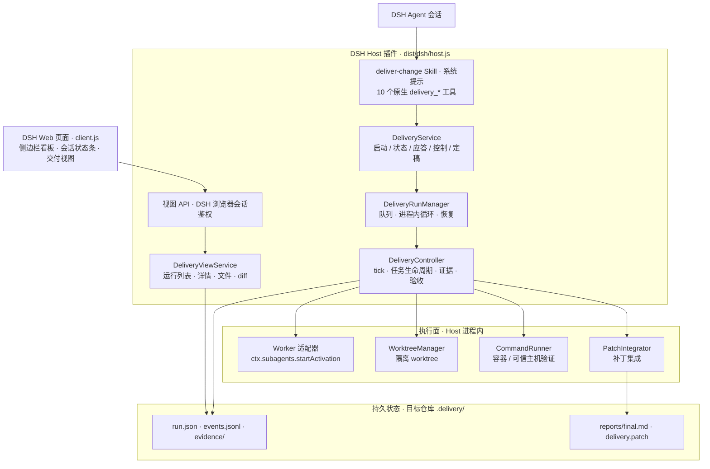
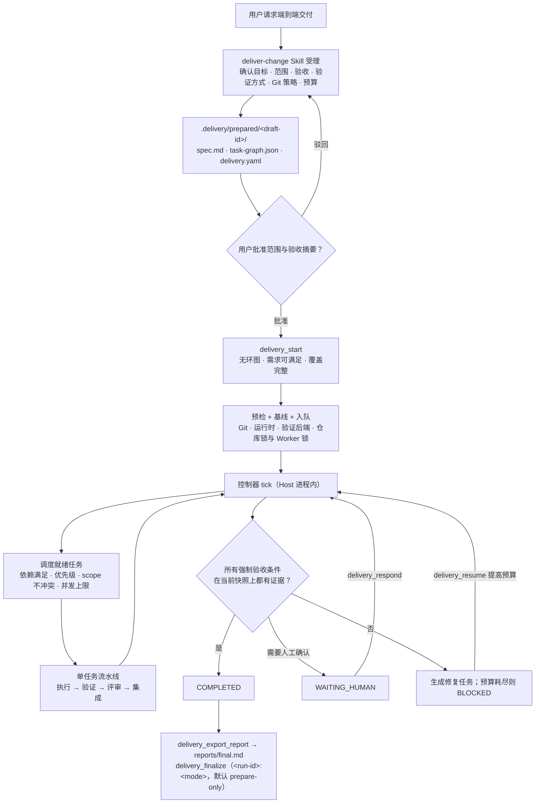
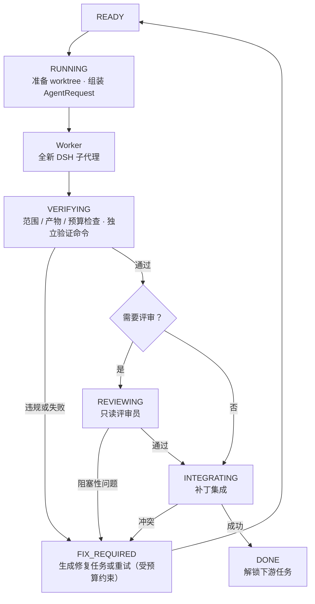

# Delivery Loop（交付循环）

[English](README.md) | 简体中文

Delivery Loop 是一个原生的 **DeepSeek Harness（DSH）** 插件，用于可恢复的端到端软件交付。它把一份已批准的规格说明转换为持久化的任务 DAG（有向无环图），在全新的 DSH 子代理中逐个执行任务，独立验证产出的内容，把测试与评审中的失败转化为新任务，并持续运行，直到验收通过或需要人工决策为止。

该插件完全运行在 DSH 内部：

- 原生 Host 插件与原生 `delivery_*` 工具；
- Worker 是全新的 `ctx.subagents` 子代理，而不是外部 CLI 进程；
- 控制循环运行在 DSH Host 进程内；
- Skill、运行状态、证据、决策与 Web 视图都是一等的 DSH 界面。

## 提供的能力

- `deliver-change` Skill：负责需求受理、一次性批准与状态汇报。
- 原生 `delivery_*` 工具、由 DSH 浏览器会话鉴权的 HTTP 视图 API，以及 Web 交付看板。
- 确定性调度器、任务状态机、重试上限与失败指纹。
- 用于实现、调试、评审与验收的全新上下文 DSH 子代理 Worker。
- 内置并做哈希锁定的通用 Skill；默认不依赖 OpenSpec 或任何业务领域 Skill。
- 按代码快照持久化证据，并在集成改动后自动失效。
- 隔离的 Git worktree、基于 Patch 的集成，以及默认的 `prepare-only` 交付。
- 供视图使用的持久决策日志与变更文件记录。

## 架构与执行流程

Delivery Loop 把**决策**与**执行**分开。Host 控制器负责计划、预算与状态；每一项具体工作都由一个一次性、全新上下文的 DSH 子代理完成。关键信息不只存在于模型上下文中：每次状态迁移都会落盘，每个结果都会被独立验证，每次失败都会转化为任务，而不是被静默重试。

> 以下图表使用 Mermaid 绘制，GitHub 可直接内联渲染。

### 分层架构



### 端到端运行流程



### 单任务流水线



### 设计原则

- **控制器决策，Worker 执行。** Worker 只提交结果；验证、评审、集成与验收都由控制器自己完成。
- **状态即事实来源。** `run.json` 与事件日志可在 Host 重启后恢复；如果某次运行的 Worker 锁已无存活的持有者，该运行会被回收并重新入队。
- **证据绑定快照。** 一条通过的命令只对它运行时的代码快照有效；集成会使旧证据失效，已完成任务的验证命令会在最终验证矩阵中重新执行。
- **失败转化为任务。** 测试失败、评审意见、验收缺口与 scope 越界都会生成数量受限的修复任务；预算耗尽时运行转入 `BLOCKED`，而不是无限循环。
- **一个批准关口、一个定稿关口。** 用户只需批准一次范围与验收；在 `delivery_finalize` 收到 `<run-id>:<mode>` 之前，不会执行任何 Git 操作。

Worker 启动的具体机制见 [Worker 如何运行](#worker-如何运行)。

## 环境要求

- DeepSeek Harness 0.2.x
- Node.js 24+
- 目标仓库使用 Git

无需外部 Agent CLI 或网关。

## 安装

构建软件包：

```bash
npm install
npm run build
```

在 DSH 中把本目录安装为本地 bundle：

- **插件 → 添加插件**，选择本目录；或
- 让 Agent 调用 `plugin_manager`，`action: install_bundle`，并传入绝对路径。

该 bundle 会从 `cordis.patch.yml` 插入 `delivery-loop` 行。它的 Host 部分是 `dist/dsh/host.js`，浏览器部分是 `client.js`。

安装或修改 `client.js` 后请刷新 DSH 页面。视图 API 通过 DSH 的 Connection 服务校验浏览器会话；Desktop 应用会在每次插件请求中转发 Host Cookie。没有 Connection 的组合会回退到注入页面的按进程令牌。如果视图返回 `401`，说明页面仍在运行旧的客户端代码或缺少会话 Cookie，刷新即可。

## Bundle 配置

加载器行接受以下配置：

```yaml
- id: delivery-loop
  name: 'dsh-delivery-loop'
  config:
    apiPrefix: /delivery-loop     # 视图 API 前缀
    modelInvocableSkill: true     # 注册 deliver-change
    systemPrompt: true            # 注入简短的 Delivery Loop 提示片段
    subagentProvider: spawn       # Worker 使用的 ctx.subagents provider
    # subagentMaxDepth: 4         # 可选的递归深度上限
    # defaultRepoRoot: /path/to/repo
```

全部字段见[配置说明](docs/configuration.md)。

## 交付视图

DSH bundle 在持久运行状态之上提供了一套视图：

- 会话输入框下方的 **Delivery Loop 状态条**展示当前运行、进度与待决策数量；点击即可打开完整视图；
- 完整视图包含 **概览 / 任务 / 决策 / 文件 / 产物 / 事件** 六个标签页：
  - 进度、状态、Token 用量、当前任务与规格说明摘要；
  - 任务图：尝试次数、风险、来源、依赖、范围、失败上下文与变更文件；
  - 按时间排序的**决策时间线**：派发、Worker 结果、验证、评审发现、集成、验收、重试、预算阻塞，以及每一次人工答复；
  - 变更文件预览与 diff，支持在 worktree/仓库之间切换；
  - 运行产物（`spec.md`、`task-graph.json`、`reports/final.md`、`completion.json`、`delivery.patch`、证据日志）；
  - 原始事件流；
- **左侧边栏 → 交付循环 / Delivery loop** 打开交付看板：顶部是按仓库筛选的标签行（带每个仓库的运行数），下面是按状态分组的索引表（运行、仓库、状态、进度、Token、更新）；
- 看板与运行详情里都能进入 **设置** 页，直接调整运行预算（Token 总量、时长、单任务尝试轮数、连续无进展轮数、并行 Worker 数、Worker 超时），无需改 `delivery.yaml`。每个字段都会显示将保存的值、内置默认值、当前生效值及其来源，不再出现空输入框。值分别保存在全局的 `~/.delivery-loop/settings.json` 与仓库内的 `.delivery/settings.yaml`，对之后新建的运行生效；已暂停或已阻塞的运行可在运行详情的设置页里上调预算。

除暂停、恢复、取消、导出报告、回答待处理的人工决策、在设置面板中调整运行预算，以及经模式确认的定稿请求外，视图是只读的。运行数据保存在目标仓库的 `.delivery/` 目录，跨运行索引保存在 `~/.delivery-loop/runs.json`。如果 DSH 浏览器会话与令牌注入机制都不可用，插件会拒绝注册 HTTP API，而不是暴露一个未鉴权的接口。

视图 API 为同源访问，由 DSH 浏览器会话保护，并以按进程令牌作为回退。它只读取该运行的仓库、其 worktree 以及 `.delivery` 产物，拒绝这些根之外的路径（包括符号链接逃逸），并且绝不会仅仅为了列出运行而创建 `.delivery` 目录。除运行状态外，它唯一的写入来自设置面板：`GET/POST /delivery-loop/settings` 只会写 `<repo>/.delivery/settings.yaml` 或全局 `~/.delivery-loop/settings.json`，仅接受预算白名单字段，其他配置键一律拒绝。

## 使用

显式调用该 Skill：

```text
使用 deliver-change 完成以下需求，并持续实现、修复、评审和验收：

<需求>
```

该 Skill 会准备：

```text
.delivery/prepared/<draft-id>/
├── spec.md
├── task-graph.json
└── delivery.yaml (可选；优先使用仓库根配置)
```

在你批准范围与验收摘要之后，让 Agent 调用 `delivery_start`。原生工具：

| 工具 | 用途 |
| --- | --- |
| `delivery_start` | 启动一份已批准的预置运行 |
| `delivery_status` | 有界地返回进度、任务、待处理决策与近期决策 |
| `delivery_inspect` | 完整视图负载：任务图、需求、决策、文件、产物 |
| `delivery_watch` | 等待进度变化或终态 |
| `delivery_respond` | 回答待处理的人工决策 |
| `delivery_pause` / `delivery_resume` / `delivery_cancel` | 生命周期控制；恢复时可提高预算/时限/尝试次数上限 |
| `delivery_export_report` | 写出 `reports/final.md` |
| `delivery_finalize` | 显式确认的完成期 Git 操作；确认串为 `<run-id>:<mode>` |

## Worker 如何运行

每个任务都由通过 `ctx.subagents.startActivation` 启动的全新 DSH 子 Agent 执行：

- 子 Agent 以任务 worktree 为 `cwd`，拥有自己的会话、工具与中止信号；
- `outputSchema` 为引擎的 `AgentResult` schema，因此子 Agent 必须调用 DSH 的 `structured_output` 工具，控制器收到的则是已校验的对象；
- `delivery: 'caller'` 让结果直接由控制器捕获，而不向发起会话注入一条结算消息；
- 控制器运行在 DSH Host 进程内，因此由已安装的插件掌握循环；运行会记住发起它的 Agent 作为 Worker 树根，Host 重启后回退到协调者（coordinator）；
- Token 用量由子会话的 `assistant/message` usage 事件累加；只有在完全未观察到 usage 事件时，运行才标记 `usage_incomplete: true`；
- 评审与验收 Worker 被要求保持只读，控制器会独立拒绝任何改动了候选快照的评审。

## 预览视图

无需启动真实交付：

```bash
npm run demo:view
```

它会在独立的临时 Git 仓库中创建一次合成的已完成运行，并注册到左侧边栏的 **交付循环 / Delivery loop** 看板。用完后请删除打印出的仓库目录，以及 `~/.delivery-loop/runs.json` 中对应的条目。

## 运行时与状态

Host 插件在进程内运行控制循环；不存在分离的控制器或外部 Worker 进程。状态以原子文件与锁写入 `.delivery/runs/<run-id>/`。`~/.delivery-loop/runs.json` 注册表使重启后的 Host 能够定位并恢复运行。测试可以注入进程内控制器，以保持反馈的确定性。

## 验证

- `npm test` — 控制器、调度器、状态、证据、工作区、定稿器、DSH 适配器、视图服务与真实 Git 集成测试。
- `npm run typecheck`
- `npm run verify:skills`
- `npm run verify:release` — schema 新鲜度、类型检查/构建/测试、DSH 包布局与入口语法。

一次完成的真实 DSH 子代理交付运行记录在[验证报告](docs/verification-report.md)中。

## 文档

- [English README](README.md)
- [配置说明](docs/configuration.md)
- [运维手册](docs/operations.md)
- [评估](docs/evaluation.md)
- [设计文档](docs/design/dsh-end-to-end-delivery-plugin-design.md)
- [验证隔离设计](docs/design/verification-isolation.md)
- [验证报告](docs/verification-report.md)

## 当前限制

- 本地验证在 macOS 上完成；Windows 尚未验证。
- 评审/验收的只读约束是提示词约束加独立的快照检查，而非操作系统级沙箱。
- Token 用量由助手消息中的 usage 累加，当供应商未提供 usage 时可能不完整。
- Host 重启后的协调者回退尚未在真实的重启演练中验证。
- 视图的渲染布局、明暗外观、焦点行为与窄屏布局未在本环境的浏览器中验证；安装或升级后请刷新页面。
- 验证默认使用失败即关闭（fail-closed）的容器后端，需要预加载的、以摘要（digest）锁定的镜像。本机没有容器运行时；可信项目可显式启用 trusted-host 模式。
- 产物验收仅限产出的交付产物（`delivery.patch`）；其他产物类型需要项目自定义 provider。
- `merge` 定稿模式需要项目自定义定稿器（finalizer）。
